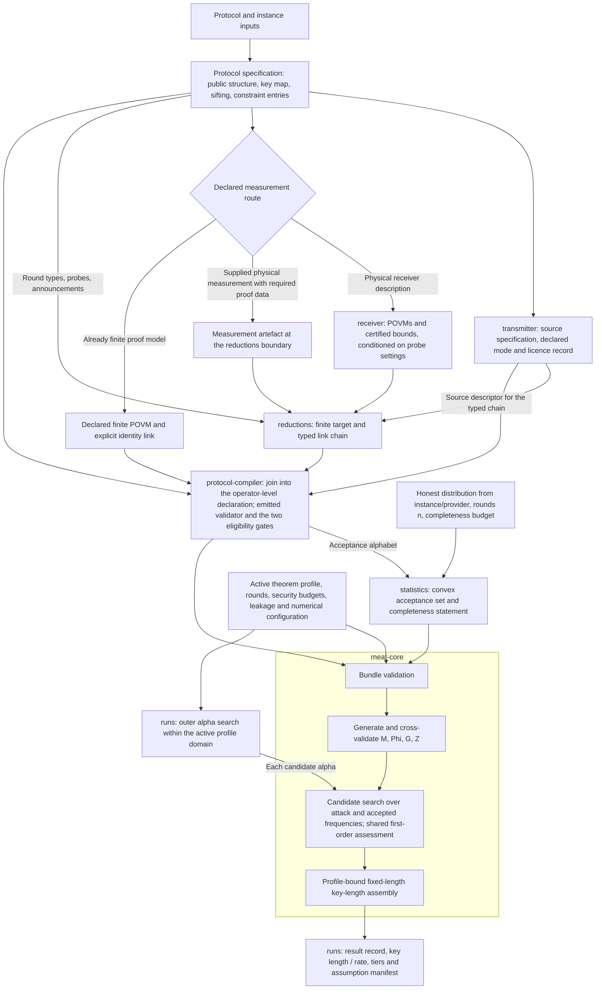

# Architecture

This document is normative on architecture: module boundaries, what crosses them, the code that
carries the number model, and how the backend is attached; the number model itself is the claims of
the `foundations` module (§2.8). `PRINCIPLES.md` wins where the two disagree; a claim file wins over
both on the mathematics it states. What is deferred is in `spec/future-scope.md`, and nothing here
depends on any of it.

Several topics are deliberately not here. A protocol adapter is an instance, not architecture (§3.5),
and BBM92 is the instance `instances/bbm92`. A digital twin enters as a statistics provider
(§3.4), and the rest of its integration is deferred (`spec/future-scope.md` §5). The repository layout is
`PRINCIPLES.md` §4; how humans and agents work together is `PRINCIPLES.md` §3; the contract-first
process is `PRINCIPLES.md` §5–§6 and `harness/`; the citation policy and the citable universe,
`refs/index.json`, are `PRINCIPLES.md` §8.

## Overview

CERTIQS-KEY computes a fixed-length, finite-size key rate for a QKD protocol with the
marginal-constrained entropy accumulation theorem (MEAT). It builds the security proof from
replaceable parts: a source model, a receiver model, proof reductions (squashing), a protocol
compiler, an acceptance set and the MEAT engine. Each part is a module: a set of claim files that
state and prove its mathematics, and the code that implements them. A run ends in one of two ways. It
reports a key length together with the assumptions it rests on, or it refuses with a typed reason.

**The modules.** Seven core modules carry the mathematics (§3.2). Each may carry submodules; the
registry of modules and submodules is `spec/modules.yaml`.

| Module | What it owns |
| --- | --- |
| `foundations` | the number model (binary64 data, exact admissibility, one declared tolerance, the snap), the three result tiers, and the quantum-information preliminaries; every module may use it |
| `transmitter` | Alice's declared preparation and retained system, the source modes and the source-replacement certificate; weak coherent pulses are its submodule `decoy` |
| `receiver` | the physical measurement: passive optics and threshold detectors compiled into photon-number-block POVMs with certified high-photon bounds |
| `reductions` | squashing: a chain of typed links from the physical model to a finite target POVM, with typed constraint entries and the attack-set licence |
| `protocol-compiler` | the protocol IR and the join: the operator-level declaration the engine reads, decided by two eligibility gates, or a refusal |
| `statistics` | the acceptance set, built forwards from an honest model, with its completeness statement |
| `meat-core` | bundle validation, the MEAT objective, the key-length assembly and the theorem profiles; its submodule `frank-wolfe` is the solver |

Three tiers below the modules carry no mathematics (§3.3): `domain/` is the shared format, `runs/`
composes and records a run, and `instances/` holds one protocol's data per directory.

**The data flow.** An instance declares a protocol and its devices. The transmitter and the receiver
emit their artefacts. The reductions turn the physical measurement into a finite target. The compiler
joins source, chain and protocol into the declaration, and `statistics` builds the acceptance set.
`meat-core` validates the bundle, generates its maps, searches and assembles the key length; the run
tier searches the Rényi order and writes the result record with its assumption manifest. §6 draws
the flow.

**The boundary rules.**

- A module boundary is a pure function over serialisable, versioned artefacts (§2.1).
- Every module's artefact names the module version that produced it and the assumption ids it carries (§2.4, §4.1).
- An operator crosses a boundary as sector blocks with a sector map, never as one full matrix (§2.9).
- Only the declarer snaps its own declared data, once and on the record; a consumer decides exactly and repairs nothing it was handed (§2.8).
- No module takes a tolerance. An instance declares one, and it bounds only how far the instance may move its own declaration (§2.8).
- A consumer re-decides what a producer certified rather than inferring it (§3.2, §4.3).
- Reductions are applied before the entropic step, and they travel as a chain of typed links (§5).
- A solver status is never a bound, and a tier is reached, never requested (§2.5, §2.8, §7).
- Imports point downward only (§3.5).
- A failure is a typed refusal carried as data, never a labelled key rate (§1, §3.6).

**How to read this document.** §1, §3, §5 and §6 are the overview a newcomer needs. §2.1–§2.7
apply `PRINCIPLES.md` to the architecture. §2.8–§2.9, §4 and §7 are reference for implementers: the
number model in code, the artefact formats and the numerics backend. §8 is the technology stack, §9
the test strategy and §10 the open questions. What the project wants and how its work is reviewed is
`PRINCIPLES.md`; the mathematics is each module's contract under `spec/modules/`.

---

## 1. Purpose and scope

The engine assembles a security proof from independently replaceable components and computes a
**fixed-length, finite-size MEAT key rate** from them. Seven ingredients: a source model; a receiver measurement model;
optional source and measurement proof reductions (squashing); a protocol specification compiled into
finite quantum and classical maps; observed or simulated channel statistics with a declared acceptance
region; a MEAT proof formulation; a numerical backend. An instance selects and parameterises these
for one protocol (§3.5).

Squashing is a first-class **proof-reduction component**, not something hidden inside detector
simulation or inside the optimiser: receiver characterisation supplies the physical evidence a squasher
needs, the reduction constructs the finite target measurement and the attack-set constraints, and the
protocol compiler consumes the resulting finite model.

Python owns **all semantics**: the protocol IR, the canonical declaration, the derived
\(\mathcal M, \Phi, \mathcal G, \mathcal Z\), bundle validation, and the MEAT objective
\(K = T + P - \operatorname{tr}(G)\). Numerics run in the same process. The serialisable proof instance
and operator-bundle formats are the reproducibility boundary and the future isolation seam (§2.1, §4.1);
backend-native objects, solver handles and pickle graphs are never public interfaces.

**Not in scope, deliberately.** Claiming a bound because a convex solver reported `Solved`; treating a
best-fit receiver, sampled uncertainty points or a floating-point minimum eigenvalue as a family-wide
proof; a detector-attack proof as part of the backbone; variable-length output,
correlated sources, adaptive secret-memory protocols; distributed queues, databases or services;
automatic installation of dependencies. An unsuccessful computation **ends in a refusal**: it may
return diagnostics, never a labelled key rate.

## 2. Architectural principles

### 2.1 Semantic interfaces, not shared implementation details

A module boundary is a pure function over serialisable, versioned artefacts (`PRINCIPLES.md` §9,
"Clear piping"). Across a module edge there are no live objects, no in-process handles and no mutable
shared state; no mutable dictionaries, implicit array ordering or backend-specific objects. An
externally supplied channel model or POVM is then an adapter over an existing boundary, like a
command line or an API.

### 2.2 Proof construction is separate from numerical solving

Python compiles the physical and protocol model into a solver-neutral proof instance; a backend lowers
that instance into its own variables and constraints; deciding whether the returned number supports the
label it will carry is a third step and belongs to neither.

### 2.3 Physical blocks, proof sectors and numerical sparsity are distinct

The word "block" always carries a kind: `physical_sector` (photon number, a classical device mode),
`proof_sector` (a direct-sum decomposition justified by dephasing or source replacement),
`numerical_block` (sparsity a solver exploits inside one operator). Conversions are explicit and
checked, and a positional array called only `blockDims` is not a public contract.

**The kind records why the decomposition is licensed, not what its labels mean physically.** The same
photon-number labels are `physical_sector` where they are the device's own mode structure and
`proof_sector` where the direct sum is licensed by a dephasing or QND argument; since the kind is a
machine key compared for equality, a producer and a consumer that disagree about the licence disagree
about the map, which is the disagreement worth surfacing.

### 2.4 Assumptions are data

Every proof-critical assumption is machine-readable and travels with the artefact it conditions:
passivity, trusted-vacuum dilation inputs, rank-one restrictions, fixed versus state-dependent test
probability, trusted marginals, attack-set outer approximations, statistical coverage. Assumptions have
stable short ids (`A-...`, `spec/claim-format.md` §2), and those ids — not prose — are what an artefact
and a result record carry (§4.4).

### 2.5 A bound and a diagnostic never share a status

Repairs — eigenvalue clipping, approximate feasibility projection, a `near_optimal` or
`Inaccurate/Solved` backend status — are recorded explicitly, and none of them silently enters a number
reported as a bound. **Three repairs are licensed, and each is recorded**: a declarer's snap of
its own declared data (an instance's, inside the declared tolerance, or a producer's of its own
emission), the oracle adapter's positivity clip on a returned Choi operator inside a declared window,
and the projection of a formed Frank-Wolfe iterate onto the positive semidefinite cone inside its own
declared window (§2.8; `foundations/req:who-snaps`, `foundations/req:tolerance-scope` (ii);
`meat-core/frank-wolfe/req:iterate-repair`). Everything else measures
and refuses. What decides whether a repair is admissible is *what it acts on* and *whether it is recorded* — never which
tier the caller asked for.

### 2.6 Reproducibility without a store

A run is reproducible from its bundle, and absolute machine paths, timestamps and run ids are never part
of the mathematical content. Content-addressing and a provenance envelope earn their cost once more than
one producer exists; until then the platform needs a **file format**, not a store.

### 2.7 Proof-critical code is contract-first

Claim files are written and reviewed before the code that encodes them; the lifecycle and the two human
gates belong to `PRINCIPLES.md` §5–§6. What is architectural is the consequence: a module's code
implements claims that exist, and an artefact names the module version whose claims produced it (§4.1).

### 2.8 One numerical policy: binary64, one declared tolerance, one place that snaps

The numerical policy is stated as claims of the `foundations` module; this section keeps the code rules
and points at the claims. Where the two disagree, the claim wins. Why the policy is shaped as it is, and
the measurements behind it, are in `spec/modules/foundations/design.md`.

**The number model.** The engine computes in binary64 in its optimiser and carries binary64 on the wire.
A declared value is the dyadic rational it denotes, with no exact object behind it
(`foundations/def:binary64`). Declared operator data are exactly admissible at every module boundary
(`foundations/def:exact-admissibility`, `foundations/req:boundary-admission`), so every sum a predicate
reads is the exact sum (`foundations/lem:exact-accumulation`). Exact rational arithmetic lives in the
exact island below; outside it the engine's rounding is trusted and unbudgeted, and no result rests on a
floating-point error budget except a supplier's declared slack on one of its own floating-point
evaluations, which rests on a named assumption the supplier carries in its output
(`foundations/req:exact-island`).

**The tolerance datum.** Each instance declares exactly one numerical tolerance `tau` in its run
configuration, in \([0, 1)\) and with no default: the ceiling on the defect an instance may repair in
what it declares (`foundations/def:tolerance`, `foundations/req:declared-tolerance`). No module has a
tolerance input, and every consumer decides every admission predicate on declared data exactly
(`foundations/req:consumer-decides-exactly`): a tolerance never widens what a security predicate admits;
it only bounds how far an instance may move its own declaration. Why no tolerance can be accepted where
the entropic step reads a declaration is `meat-core/prop:optol-nobound`.

**Which norm `tau` is measured in.** A defect of a difference is an entrywise maximum modulus, and
positivity is a floor on the least eigenvalue (`foundations/def:tolerance`); the floor is the stricter
test, by a factor of the dimension that is attained (`foundations/lem:floor-stricter`). A bound stated
in one norm is never read as a bound in another, and a number derived from one carries its conversion
factor on the record (`foundations/req:norm-conversion`). The same holds inside a derivation: a module
whose assumption bounds an entrywise defect and whose conclusion is an operator inequality carries the
dimension factor through its own proof, in the open.

**What `tau` does not reach** (`foundations/req:tolerance-scope`). A set defined by declared data is the
exact set, and a validator that certifies a supplied witness decides its membership exactly. A window on
a computed object, such as the Frank–Wolfe driver's feasibility number or the oracle adapter's positivity
clip, is a number of the module that applies it, declared and recorded in its own right. `eps_gap` and
`eps_eig` are slacks an instance declares to the receiver, a supplier, and are declared separately
(§2.9, "Other frozen slots"): `eps_gap` bounds a residual gap the receiver checks, and `eps_eig` bounds
the error of the receiver's floating-point evaluation of an eigenvalue under its assumption A-EIG, at a
setting whose weight the receiver evaluates in floating point, and is never derived from `tau`
(`foundations/req:tolerance-scope` (iii), `foundations/req:exact-island`); where the receiver encloses its
port Grams it evaluates the weight rigorously at a setting where the needed enclosures are formed (the
artifact records which), and `eps_eig` does not enter there (`receiver/req:rigorous-weight`).

**Who snaps** (`foundations/def:snap`, `foundations/req:who-snaps`). Only the declarer snaps declared
data, once, before any consumer reads them: the instance what it declares about its device, by the
snapping table of `foundations/snap.py` (§2.9), and a producer its own emission, by the procedure its own
claims state (`reductions/def:emitnorm`). A snap of a measurement family is decided **block by block**
(`foundations/req:snap-reference`). A block whose reference is exact and whose elements are already
lattice values is **kept** and rests on nothing. Every other block is **moved** by one procedure that
aims at fidelity to the centres of an exact reference of the block, or to the data where there is none;
a block whose data the declarer evaluates from a model not known exactly on it is moved even where the
snap leaves the evaluation unchanged, since only data stated with no model behind them can be decided
equal to what the snap is made from. No claim relates a moved block to its model. A moved block that
the run evaluates off its snap on the reference companion (below) rests on nothing; every other moved
block rests on `foundations/ass:snapped-measurement` (A-SNAP), and the run's manifest carries it, naming
the block with its cause, its group and the fix (the table of §2.9). A run that declares the strict
option `strict_snaps` refuses wherever a block would rest on A-SNAP (§2.9, "The strict option"), and in
it the certified evaluation's fallback to the snapped declaration does not run. No snap revives an
element, row or column that the data state to be zero (`foundations/req:support-safe-snap`), save the flagged last resort: where the
support-safe steps cannot restore the conditions of a snap on a block, a uniform lift is applied there
and the block is recorded `support_not_preserved`. Every snap is recorded, and no party alters data it
was handed except as `foundations/req:consumer-decides-exactly` states. A declarer's snap of its own
declared data (an instance's, or a producer's of its own emission), the oracle adapter's clip and the
iterate projection of `meat-core/frank-wolfe/req:iterate-repair` are the repairs §2.5 licenses; none is a
repair of a bundle, which a consumer decides and refuses (§3.6).

**Where a reference is held, the snap steers the search** (`foundations/def:evaluated-off-snap`,
`meat-core/frank-wolfe/cor:fo-reference`, `meat-core/frank-wolfe/req:bracket-on-reference`). The
receiver forms its reference, exact or enclosed, in every run that does not declare enclosed references
not used (`receiver/detector-imperfections/req:dark-composed-reference` (vi)), and the instance hands it
beside its snapped family. Where a claim establishes for the instance that the construction may run on a
reference (`reductions/cor:reference-companion` (H-REF)), the reductions run the same construction on it
in exact arithmetic, with no normaliser and no lattice condition, enclosures recentred so that an entry whose enclosure contains zero
has centre zero (`foundations/lem:recentred-enclosure`), before the construction and again after it, and emit the result beside the artefact as the
**reference companion** (`reductions/cor:reference-companion`, `reductions/req:reference-companion`); a
block without a reference carries its snapped block there, and an entry built from the reference is
emitted in binary64 with its constant moved outward by the rounding residual, so the set the oracle sees
contains the exact one (`reductions/lem:row-relaxation`). Where no block is handed but the emission
normaliser moved a class, the companion is formed all the same, on the snapped blocks: it is then the
instance at its exact construction, which bypasses the normaliser's snap, while the instance's own moved
blocks stay snapped. An entry a caller requests beside the instance's own (`carried_operators`, such as
the two-sector operator `eq:two-sector-entry` of `reductions/wpfss/rem:published`) is formed on the companion by the same
formula at the companion's datum and relaxed like the others, where its certificate is established
there (`reductions/cor:reference-companion` (vi), `reductions/wpfss/cor:flat-companion`); one whose
certificate is not established there is left out and recorded, which only enlarges the companion's
feasible set. The compiler compiles the companion beside the
declaration by the same map, one companion replacing every measured factor whose chain carries one, both
stations of an entanglement-based declaration among them
(`protocol-compiler/req:reference-companion-compiled`, `meat-core/prop:reference-companion`), and meat-core admits
it beside the declaration: the components it shares with the declaration are decided equal, its statistics
map, objective and gradient are generated from its own family and from no map of the declaration's, that its family
is a POVM is imported from the reference's claims, and its binary64 defects are measured and recorded,
never decided (`meat-core/req:companion-admission`, `meat-core/prop:reference-companion`). The solver
searches on the snapped declaration; afterwards a short search, the polish, continues on the companion's
own program from the best of its points, within a fixed share of one evaluation's wall budget, and the first-order
bound is formed on the companion at the best four iterates of each search and the last of each, and certified at the best five of them. The
polish is the one program solved over the companion, and its points are points like any other: the
bound holds at any point at which its hypotheses are decided, whatever produced it
(`meat-core/frank-wolfe/cor:fo-reference`). It is there because the snapped search fits the
acceptance-side component to the snapped statistics, and where the snap moved an entry that is small
beside its outcome's probability, as dark-count products are, the companion's bracket at that point can
fall far below the snapped one. Where some of those points contributes, the key length comes from that
bound or from its certified counterpart on the companion, the snapped bound being recorded as a
diagnostic, and every moved block on which the companion carries the reference, and every moved class of
the emission normaliser, is evaluated off its snap and rests on no premise about it; a kept block is
recorded as kept and is not counted among them, and A-SNAP is engaged only for the moved blocks the
companion carries snapped. There are two exceptions, both from the certified evaluation. Where it finds
the two enclosures (entrywise and factor) of a block the companion carries inconsistent, an engine defect
to report, the bracket on the companion is withdrawn, with the cause `factor_enclosure_inconsistent`, and
the run proceeds as below where none contributes (`meat-core/frank-wolfe/req:certified-evaluation` (iv)).
And where the bound on the companion counts but its certified evaluation certifies no point, a number
certified on the snapped declaration carries the key length (the fallback), and the blocks and classes
the companion carried are then not evaluated off their snap and rest in the group **reference bracket
withdrawn** with the cause `companion_not_certified` (`meat-core/frank-wolfe/req:certified-evaluation`
(i), `meat-core/frank-wolfe/req:bracket-on-reference` (v)). Where none
contributes, the run falls back to the snapped bound and the moved blocks and classes the companion
carried rest in the group **reference bracket withdrawn**, every other moved block resting as it does
without a companion (`meat-core/frank-wolfe/req:bracket-on-reference` (iii), (iv)), and a
`strict_snaps` run refuses instead. The companion keeps the reference's exact
data, Gaussian-rational centres with radius zero where the reference is exact, and is rounded to binary64
only at docking. Its evaluation at the centres is unbudgeted, and it is more than binary64 rounding: it
displaces the measured family by up to the enclosure's radius, a perturbation to which
`meat-core/prop:optol-nobound` applies as it does to a snap, so the route removes A-SNAP for such a block
but not the exposure to the radius, whose recorded largest value is the only handle on it
(`meat-core/frank-wolfe/rem:fo-arithmetic`).

**What a producer owes.** A producer constructs what it emits exactly, block by block, and establishes
its exact admissibility before emitting it, or refuses (`foundations/req:exact-emission`,
`foundations/req:exact-island`); it rounds every emitted bound in the direction that weakens it
(`foundations/req:rounding-direction`); and where it declares a lattice exponent, the lattice condition
binds its emission (`foundations/req:declared-lattice`). Where a predicate is a sum, the summation order
is declared with the outcome alphabet and travels with the artefact (`foundations/req:declared-order`);
the order is part of the interface, not an implementation detail.

**The exact island** (`foundations/def:exact-island`, `foundations/req:exact-island`). Every decision
that declared operator data are exactly admissible is taken by one shared implementation, the exact
modules of `foundations/` (§2.9). Everything outside the island — the optimiser's iterate apart from its
acceptance side, its oracle, the objective and the gradient — may be computed in binary64, its
rounding unbudgeted, save in a rigorously enclosed computation, each of whose operations bounds its own
rounding; the certified evaluation is the one (`foundations/req:exact-island`).

**The tiers** (`foundations/def:tiers`, `foundations/req:tiers`). Three tiers, `estimate` (an
upper estimate, `meat-core/frank-wolfe/rem:fo-interface`), `first-order` and `certified`; every run
reports the estimate, the `first-order` number wherever its hypotheses held, the `certified` number
wherever the solver's certified evaluation reports it, and a `reported_tier` field naming the strongest
tier reached, whose number is the headline key rate and gives the key length. A tier is reached, never
requested. A negative `first-order` or `certified` bound is reported as `max{0, h}` and flagged; a negative `estimate` objective is a typed refusal and is never clamped
(`meat-core/frank-wolfe/req:first-order-clamp`, `meat-core/frank-wolfe/req:negative-estimate-refused`,
`meat-core/cor:keylength-bound`).

**What the `first-order` tier must not do.** Its hypotheses are named in
`meat-core/frank-wolfe/thm:firstorder` and never assumed: the face discipline
(`meat-core/frank-wolfe/lem:fo-face`), no gradient perturbation (`meat-core/frank-wolfe/rem:fo-nopert`),
and lower bounds on the two linear minima over the exact sets (`meat-core/frank-wolfe/thm:firstorder` (iv)):
the acceptance-side one computed exactly, the feasible-side one verified in exact arithmetic from the
oracle's dual, the rounding of the binary64 frame in the constraint rows deducted
(`meat-core/frank-wolfe/lem:feasible-side-dual`, `meat-core/frank-wolfe/req:verified-feasible-side`), so no
solver's optimality is trusted; `meat-core/frank-wolfe/rem:fo-danger` says why a failure of maximal support
lies on the unsafe side. `h_lb <= h_low` is not a floating-point invariant, and the comparison of
`h_lb` with the estimate is a diagnostic to record; `max{0, h_lb}` does not repair a bound that is too
high (`meat-core/frank-wolfe/rem:fo-arithmetic`). No relative-entropy penalty (`winick2018reliable`, Thm. 2's
\(\zeta_\varepsilon\), or a two-step solver's \(\beta/(1-\varepsilon)\)) is imported onto the objective
(§6; `meat-core/frank-wolfe/req:no-imported-penalty`). A caller
never receives a stronger label than the checks support (`foundations/req:tiers`), and neither an oracle
return nor its status enters or withdraws a bracket: a solve that stopped short, or failed, loosens the
feasible-side bound and cannot raise it (`meat-core/frank-wolfe/req:first-order-withdrawal`;
`meat-core/frank-wolfe/rem:fo-interface`).
Where a reference companion is admitted and some point evaluated on it contributes, the `first-order`
number is the bound formed on it, the bound on the searched declaration a recorded diagnostic, and the evaluation of the companion at its enclosure's
centres is unbudgeted, a displacement of the measured family of the size of the radius
(`meat-core/frank-wolfe/req:bracket-on-reference`, `meat-core/frank-wolfe/rem:fo-arithmetic`).

**What the `certified` tier adds** (`PRINCIPLES.md` §10). The first-order bound formed again at the run's
final points, on the declaration the first-order number is formed on, from that declaration's exact data,
every step exact or rigorously enclosed (`meat-core/frank-wolfe/req:certified-evaluation`). The objective's
homogeneity makes a bracket the sum of its two lower bounds, so only the gradient is enclosed
(`meat-core/frank-wolfe/lem:certified-bracket`); the branch maps are built from exact factors, or,
for an element carried with a factor enclosure whose Gram matrix is certified, from that enclosed factor
(`meat-core/lem:kraus-freedom`, `foundations/def:factor-enclosure`,
`foundations/cor:rank-over-factor-enclosure`), which the receiver forms through a port dilation and the
reductions and the compiler carry to the companion (`receiver/thm:factor-blocks`,
`meat-core/cor:reference-companion-factors`); eigenvalues, ranks and matrix functions are bounded over enclosures by
`foundations/cor:least-eigenvalue-over-enclosure` and `foundations/lem:matrix-function-perturbation`; and
the key length is computed exactly, its one logarithm enclosed until the integer part is decided. The search stays in binary64.
A run whose companion certifies no point is certified on its searched declaration, resting on A-SNAP
for the blocks the companion carried (unless `strict_snaps` is declared); a run that certifies no point
keeps its `first-order` number with the reasons, and a run whose
declaration reads a receiver weight evaluated in floating point, or that invokes an assumption of the
category numerical-trust, is not reported certified. The ball-arithmetic library is implementation and
no premise (`meat-core/frank-wolfe/rem:certified-scope`). The option `certified_evaluation` is `on` by
default, `off`, or `strict`, which refuses a run not reported certified and accepts one certified
through the fallback.

**What is not a switch.** There is no lenient mode, no exact-rational mode, no per-run floating-point
budget and no compile memo; `certified_evaluation` decides whether the certified evaluation runs and
whether its failure refuses, and changes no number. A stricter run is a smaller `tau`; the one thing a mode would add — knowing
that declared data was repaired — is served by the recorded snaps. The run options of this kind belong to
the snaps of measurement families (`foundations/req:snap-reference`): the strict option `strict_snaps`
and the enclosure opt-out `reference_enclosure`, both stated in §2.9.

**The operator form.** From construction to bundle, an operator is a list of sector blocks plus the
sector map that names them, block diagonal by construction, and its positivity and completeness hold
block by block (`foundations/def:sector-map`); a consumer compares the sector map and nothing else
(`foundations/def:exact-admissibility` (T)). No full \(d_Q \times d_Q\) matrix is materialised on a live
path.

### 2.9 The frozen shared types

These are the types the policy above is carried by. The operator form, the exact decisions, the measuring
kernel, the snapping table and the tier vocabulary live in `foundations/`, the code of the `foundations`
module, which every package may import and which imports nothing else of this repository; the operator
bundle, the factorised family and the reduction-chain records live in `domain/`, which every module depends
on and which imports `foundations/` and no other module's package. Their shape is fixed here because
parallel authors who each invent their own reading of a shared type produce claim sets that agree with
nothing.

**The operator type is a list of sector blocks.** `OperatorRef` **is** `BlockDiagonalOperator`: one
array per block plus the block kind and the ordering that names them, with no full-space alternative
inside it (a plain array descriptor remains for payloads that are not operators). A consumer's
structural check is a **sector-map comparison** — the producer's block kind, block identifiers and
ordering against its own (`foundations/def:sector-map`, `foundations/req:exact-emission` (i)) — and a
disagreement is a refusal with a machine-readable reason. No zero-verification is needed: an off-sector
part, which would have to be visible in order to be rejected, cannot be constructed once a producer
emits per sector. A producer that constructed an operator ambiently would bring the off-sector part
back, and with it the need to verify that it is zero.

**A sector map is a product of system- and party-scoped factors** (the general format of
`protocol-compiler/def:declaration`, (DX1)). `FactorisedSectorMap` carries an
ordered list of factors, each of them the **system** it decomposes and a party label together with that
party's own sector map, and the list order **is** the product order: the flattened map runs the last
factor fastest, its identifiers are the factors' identifiers joined in that order and its dimensions are
the products, so that two producers cannot flatten the same pair of factors differently — an undeclared
product convention surfaces as a spurious `order` disagreement. The system is the closed two-member
vocabulary \(A\) and \(Q\) — the retained system and a measured one, the two the round model has — and it
is independent of the party: two \(Q\) factors held by different parties is one shape, an \(A\) factor and
a \(Q\) factor is another, and a format that carried only the party could not tell them apart. It defaults
to \(Q\). The **single-factor default** is one factor, Bob's \(Q\), built by `single_factor`, and one
factor flattens to exactly the map it was given, so a consumer reads a single-factor map exactly as it
reads that map unfactorised. The factors of one map carry one block kind, because the flattened map carries one;
a product of differently-licensed factors is refused here rather than assigned a kind.

**At most one \(A\) factor, and it comes first.** The retained system is one system, so a second
decomposition of it beside the first is refused rather than flattened into a shape whose meaning nobody
declared; and where an \(A\) factor is present it is the first factor of the product, because the joint
block convention is \(A\)-first (the `subsystem_order` convention). A product that puts it elsewhere is
refused rather than permuted, for the reason the product order is declared at all. `JointBlockOperator`
carries the \(A\) side as a sector map rather than as one \(d_A\): block \((t, s)\) of the flattened joint
map has size \(d_{A_t} d_s\) with the \(A\) index first inside the block, and with one \(A\) sector it
is the per-\(Q\)-sector list with block size \(d_A d_s\). A consumer's sector-map comparison
runs **factor by factor in the product order**, reporting the first factor that disagrees and the ground
on which it does: the number of factors, the system, a party label, or one of the four components above
inside that factor; the system is reported before the party, being the coarser of the two.
**The factorisation declares structure and never a
licence:** a producer that declares \(\tau_A\) or \(\{M_x\}\) block diagonal licenses no consumer to
infer that \(\omega\) is. That inference would be the unlicensed restriction of
`protocol-compiler/rem:block-restriction`, made on the side where the reachable-set argument does not apply, and in
the same unsafe direction.

**An operator family of several measuring parties is a product of factor families, and the product is
never a datum** (`protocol-compiler/def:declaration`, (DX3)). `FactorisedFamily` carries, per measured
factor of the map and in the product order, that factor's party, its own ordered alphabet and its family
of sector-block operators against that factor's own map, together with the rule
\(F_v = \bigotimes_f F^f_{v_f}\). What is declared and made exactly admissible is each factor; the
product's Hermiticity, positive semidefiniteness, completeness and block structure are a **theorem** about
the factors' exact numbers — `reductions/thm:emitted-product` (i) — and therefore **every exact predicate
of the admission above runs per factor**, on arrays of a factor's size, with the same functions a single
family uses — nothing forms an array of product size in order to decide anything. A Kronecker block is
formed only for a numerical consumer that has to multiply by \(F_v\), by a function no predicate calls.
The product alphabet follows the sector convention exactly: the last factor fastest, a product letter the
factors' letters joined by the one declared separator, which is why a factor letter may not contain it.
With one factor the alphabet, the map and every block are the single-factor family entry for entry. The
product is not declared because a normalised product of two separated stations' targets would declare a
non-product measurement, and a product sector fits neither kind of reduction-instance datum.

**There is no support-compression utility.** The rules for compressing a declared sector — structural
before spectral; a spectral threshold, where used at all, being the run's one declared tolerance and
never a performance knob; the discarded weight and the entrywise displacement on the run record; a
request exceeding the tolerance refused; and **no claim relating the compressed and the uncompressed key
rate** — stand for any *declarer* that compresses a block-form declaration on what it is about to
declare. They are not a licence for a consumer to truncate, and they are not a row of the snapping table
below. No claim uses the rules, and neither `foundations/` nor `domain/` has a compression function
(`spec/future-scope.md` §7).

**`foundations/numeric.py` measures and never decides.** One implementation of each measurement, each
returning a **number**: `hermiticity_defect`, `min_eigenvalue`, `completeness_residue`,
`column_residue`, `trace_residue`. No function in it takes a tolerance, returns a boolean, or modifies
its input. Each has a block-wise wrapper returning the per-block vector **and** the reduction that
decides, because a consumer that refuses must say *which* block failed; that reduction is the maximum
for every defect and the **minimum** for `min_eigenvalue`, and the record names which one produced the
number. The kernel refuses a non-finite entry rather than measuring it — `nan > tau` is `False`, so a
NaN defect would otherwise pass every refusal in the tree.

**`foundations/exact.py` and `foundations/exact_admission.py` decide exactly on declared dyadic blocks**, and are
used by every consumer and by every producer on its own emission. Inputs are binary64 arrays converted
*exactly* to Gaussian rationals; nothing in them takes a tolerance, and they refuse a non-finite entry.
`exact_admission.py` provides `to_exact`, `is_hermitian_exact`, `is_psd_exact` (symmetric elimination
with the zero-pivot row test, cubic), `is_complete_exact`, `trace_residue_exact`, `column_residue_exact`,
`sum_rounds_nowhere` (whether every sequential entrywise binary64 addition, in the given order, is exact)
and `admit_family_exact`; `exact.py` provides `is_binary64`, `sum_in_declared_order`, a
`sum_rounds_nowhere` of its own on exact-rational blocks, the lattice helpers and the exact linear
algebra the producers construct with; the consumer's admission below uses `exact_admission.py`'s. **A consumer's admission of a
declared family is: sector map equal, `is_hermitian_exact`, `is_psd_exact`, `is_complete_exact`,
`sum_rounds_nowhere`** — the five conditions of `foundations/def:exact-admissibility`. The entrywise
maximum *modulus* of \(a - a^\dagger\) or of \(\sum_v F_v - 1\) is irrational for most complex entries,
so the module exposes the **decisions** as total booleans and the **measurements** as exact *squared*
moduli, rational and zero iff the predicate holds; no function returns a number that is not the quantity
it is named after.

**`foundations/snap.py` is the snapping table** (`foundations/def:snap`, `foundations/req:who-snaps`), called
only by an instance on what it declares — never on data a module was handed; a producer that snaps
its own emission does so by the procedure its own claims state (`reductions/def:emitnorm`).

**A measurement family is kept where it is known exactly on the lattice and moved elsewhere**
(`foundations/req:snap-reference`). The snap runs on a reference only on the blocks known exactly,
every radius zero, and the receiver's radical-field exact route (`receiver/radicals.py`) is what decides
exactness and keeps the blocks of the shipped \(\pi/8\) defaults exact. A block whose exact reference is a
lattice family and passes exact admissibility and the lattice condition, decided last, is **kept** and
rests on nothing; every other block is **moved** by the procedure further below, on the centres of its
exact reference where it has one and on the data otherwise, and rests on A-SNAP unless the run's
first-order number is the bound formed on a reference companion that carries the block's reference
(§2.8, "Where a reference is held, the snap steers the search").

**The reference is handed beside the snap** (`foundations/def:exact-reference`,
`foundations/def:evaluated-off-snap`, `foundations/req:snap-reference` (i)): per block and outcome, a
Hermitian Gaussian-rational centre \(C_v\) and symmetric rational radii \(r_v\) with
\(|G_v - C_v| \le r_v\) entry by entry. An exact reference has every radius zero, and an entry known
exactly (a structural zero above all) is given with radius zero. The centres and radii of an enclosed
reference are computed in exact rational arithmetic (rational interval arithmetic with rational
enclosures of the irrational functions it needs), and that they enclose the model is a claim of the
module that constructs the reference; a binary64 evaluation, or interval arithmetic in binary64, is
never a reference. A block of the form \(D^{-1} S D^{-1}\), with \(S\) Gaussian-rational and
\(D = \mathrm{diag}(\sqrt{n_i})\), receives its enclosure from rational bounds on \(n_i^{-1/2}\)
(`foundations/lem:enclosure-psd` (ii)). The declarer decides exactly that the centres are Hermitian
with Gaussian-rational entries and the radii symmetric non-negative rationals, and, of an exact
reference, that it is positive semidefinite and complete; a reference failing these, or one of whose
enclosure, positivity or completeness the constructing module's claims establish nothing, is neither
used nor handed. The receiver forms its enclosed reference in every run, unless the run declares
enclosed references not used (`receiver/detector-imperfections/req:dark-composed-reference` (vi)); the
record carries the reference's identity (the model, its exact parameters, the claims establishing it)
and, per block, the kind the snap ran on (`exact` or `none`) and the kind handed (`exact`, or
`enclosed` with its largest radius).

**A moved block that the run does not evaluate off its snap rests on A-SNAP**
(`foundations/req:snap-reference` (iii), (iv)). It is recorded with its cause, its group and the fix, and
the run's manifest carries the assumption `foundations/ass:snapped-measurement` (A-SNAP), naming the
block: there the device measures the snapped family, in place of the model, so that a report flags the
key rate as resting on the snap. A block whose data the declarer evaluates from a model is compared
with the model, so it is moved even where the snap leaves its evaluation unchanged; only data stated with
no model behind them can be kept unchanged (`foundations/def:snap`). A block snapped by the last resort
below is in the group **last resort**, whatever its cause, with the fix of its cause and a model that
includes the device's loss and dark counts. The causes, with their groups and fixes:

| Cause | Group | Fix named |
| --- | --- | --- |
| no reference of the family | no usable reference | a model of the family with a reference |
| a reference failing the decisions above, or one whose properties no claim establishes | no usable reference | a model of the family with a reference |
| an enclosed reference in a run that declares enclosed references not used | no usable reference | an exact reference, or a run that uses enclosed references |
| for a producer's class, no companion that bypasses its snap formed beside the artefact (for the reductions, no claim establishes (H-REF) for the instance) | no usable reference | declared numbers on which the exact construction stays on the lattice |
| a handed reference, or for a producer's class a bypassing companion, whose companion bound has no contributing point | reference bracket withdrawn | the fix the withdrawal reasons at the evaluated points name |
| a handed reference, or for a producer's class a bypassing companion, a block of whose companion has its two enclosures (entrywise and factor) found inconsistent by the certified evaluation (`factor_enclosure_inconsistent`) | reference bracket withdrawn | none in the declaration: an engine defect in the modules that carry the enclosures, to be reported |
| a handed reference, or for a producer's class a bypassing companion, whose companion bound counts but certifies no point, the key length formed from a number certified on the snapped declaration (`companion_not_certified`) | reference bracket withdrawn | the fix the certified evaluation's reasons at the companion's points name |
| a handed reference, or for a producer's class a bypassing companion, whose companion is not formed, compiled or admitted | reference bracket not evaluated | the fix the reason recorded for the companion names |

**The strict option** (`strict_snaps`, a run option recorded in the run configuration and off by
default) refuses wherever a moved block would rest on A-SNAP, naming the block, the cause and the fix: a
declarer when it snaps a moved block on which it hands no reference, a producer when it snaps a moved
class that no companion it forms carries past its snap, the run after its search wherever a moved block
or class is not evaluated off its snap; it changes nothing for a run that rests on no such block.
**The enclosure opt-out** (`reference_enclosure`, a run option recorded in the run configuration and on by
default) declares, when switched off, that enclosed references are not used: only the exact blocks of the
reference are handed, and every other moved block rests on A-SNAP in the group **no usable reference**.

**Every snap of a measurement family is support-safe** (`foundations/req:support-safe-snap`), save the
flagged last resort of its item (iv), and **every moved block of an instance's snap is made by one
procedure** (a producer's, such as `reductions/def:emitnorm`, by the procedure its own claims state): the
rows below, which aim at fidelity to what they start from. With an exact reference of the block they run
on its centres; otherwise they run on the binary64 data, admitted within `tau`
(`foundations/req:declared-tolerance`). On a block that rests on A-SNAP the snapped family is what the
device is assumed to measure, so the procedure keeps it as close to the model as the support-safe rules
allow.

| Step (every moved block of a measurement family, and data other than a measurement family) | Rule | Recorded |
| --- | --- | --- |
| Hermiticity | the Hermitian part \((a + a^\dagger)/2\), exact | pre-snap `hermiticity_defect` |
| Lattice | every real and imaginary part rounded to the nearest multiple of \(2^{-k}\), the declared \(k \le 53\); a zero entry stays zero, so no structurally zero element, row or column is revived | \(k\), the entrywise displacement |
| Completeness | the residue \(c\,\mathbb{1} - \sum_v F_v\), exact on the lattice. For a measurement family it is absorbed entry by entry: a diagonal entry \((i,i)\), and an off-diagonal pair \((i,l), (l,i)\), each into the element of largest trace, the first in the declared order, whose structural support contains \(i\) and \(l\) (a non-zero off-diagonal residue entry is minus a sum of snapped entries in that place, so such an element exists; a diagonal one has one because the data are complete within `tau`, or, on the centres, because the reference is complete, so that some element is not structurally zero at \((i,i)\)). Other data keep one designated element, the first in the declared order. The family then sums exactly to \(c\,\mathbb{1}\) and every partial sum is on the lattice | pre-snap `completeness_residue`, the absorbing element per entry |
| Positivity (measurement family only) | decided exactly; a block failing is lifted by mixing its family with its coordinate family \(T\), \(T_v = c\,\mathrm{diag}(d_v)\,\mathrm{diag}(\sum_w d_w)^{-1}\) with \(d_v(i) = \max(\mathrm{Re}\,D_v(i,i), 0)\), at the smallest weight of the fixed lift ladder \(2^{-36}, 2^{-34}, 2^{-32}, 2^{-28}, 2^{-24}, 2^{-20}, 2^{-16}\), tried in that order, that restores exact positivity, after which the Lattice and Completeness rows run again and completeness is re-checked exactly; \(T_v\) adds only on coordinates of the structural support of \(D_v\) and is diagonal and complete, the mixture that `foundations/req:support-safe-snap` (ii) admits; a block the ladder does not restore takes the last resort of `foundations/req:support-safe-snap` (iv): the uniform lift, mixing with the dyadic uniform family \(U_v = u_v c\,\mathbb{1}\), where \(u_v = 2^{-b}\) for every outcome \(v\), \(2^b\) the smallest power of two not below \(|J|\), save that the first outcome in the declared order takes \(2^{-b} + 1 - |J|\,2^{-b}\), so that \(\sum_v u_v = 1\) exactly, at the smallest weight of the same ladder that restores exact positivity, then the Lattice and Completeness rows again (the residue now placed without the structural-support condition), the block flagged `support_not_preserved`; a block the last resort does not restore either is refused, naming the block | the lift weight, the pre-snap `min_eigenvalue`, the `support_not_preserved` flag |
| Column-stochasticity, forbidden entry | exact on the lattice | the pre-snap residue or modulus |

Constraints bind every table. No step revives a structurally zero element, row or column, save the
flagged last resort of `foundations/req:support-safe-snap` (iv): a positivity lift is per coordinate and
only on an element whose structural support holds the coordinate, and a residue goes only to an element
whose structural support holds it. A uniform lift, mixing with the trivial POVM, is applied only as the
flagged last resort of the Positivity row, on the block that needs it. `sum_rounds_nowhere` runs
**last**, after the residue and any lift, since each changes partial sums from the touched element
onward. The lattice exponent \(k\) and any lift weight go in the record's detail field, not in the
float-typed defect field. A family snapped on the centres of an exact reference records its defects as
zero on the ground of the reference's definition (`foundations/req:declared-tolerance`). And the record
says **which number decided**: a pre-snap `min_eigenvalue` is a float diagnostic, the exact decision is
the decision, and the two routinely disagree in sign at the `1e-16` scale.

**`foundations/rungs.py` holds the lattice-exponent check and the round-down candidate list once**,
NumPy-free: the candidate list is what the emission normaliser's last-resort fall-back reads
(`reductions/def:emitnorm` (3)), and no other module spells one of its own.

The lattice is the wrong lever and the invariant is the right one: every exact step of a reduction
multiplies, so a lattice chosen once at the instance is closed under none of them, and the invariant is
re-established **at each emission** as well as at the instance (`foundations/req:exact-emission`). The
lattice is \(k = 40\).

**The emission rules** are claims: (D-LAT) is `foundations/req:declared-lattice`, (D-DIR) is
`foundations/req:rounding-direction` and (D-EMIT) is `foundations/req:exact-emission`.

**Other frozen slots.** `RunConfig.declared_tolerance` exists with **no default**, and a run omitting it
is refused before anything is constructed; `eps_gap` and `eps_eig` keep their own fields and are never
derived from it. The tier vocabulary lives in `foundations/`, below every other module, so that no module
imports a sibling to name a tier, and it has exactly the three members of `foundations/def:tiers`. The bundle schema
carries the sector-block operator form and reads no earlier version that could express a full-space
operator.

## 3. The module layer

### 3.1 Seven cores, each a set of claims, with an interface where it has code

The proof-critical mathematics is seven **core modules**, each of which may carry **submodules** — a
squasher, a source model, a receiver family, a characterisation protocol — as small claim bundles whose
claims use the core's claims (`spec/claim-format.md` §1, §5). The operative list of modules, submodules,
versions and dependency edges is **`spec/modules.yaml`**; it is the registry of record for ids and
scope, and this section gives only each core's role. Per-module interfaces are **not** restated here: a module's `interface.yaml`, where it has one, owns its inputs, outputs,
parameters and thresholds, and its claim files own the mathematics.

### 3.2 The seven cores

**`meat-core`** owns the MEAT objective, the numerical formulation, the fixed-length key-length assembly
and the theorem profiles. It is one module because the objective, the bound that is computed, the
deductions applied to it and the profile that fixes its validity domain cannot be reviewed independently
of one another; it is also the module that decides what every other module must hand it, which is why
the others are written against it rather than against a guess. It generates
\(\mathcal M, \Phi, \mathcal G, \mathcal Z\) **from** the compiler's declaration and performs bundle
validation (§3.6) before it solves anything. A solver is a submodule attached at two claims of the core,
`lem:estimate` and `cor:keylength-bound`; `frank-wolfe` is the one this repository carries, and it
takes no tolerance input (§2.8).

**`protocol-compiler`** owns the versioned semantic protocol IR and the join. Its proof-critical part is
small and declarative: a declared block structure (round types, proof sectors, their canonical order,
with basis, dimension and tensor-factor ordering), the POVMs measured in each block, the announcements
and the dephasing they imply, the key map, and sifting with test/generation/abort selection and trusted
randomness; Alice's source data and her marginal are `transmitter`'s declarations and are read off its
artefact. From those it assembles the operator-level declaration (§4.2), the trusted-marginal and
attack-set constraints, the proof-sector decomposition, a traceable map from
semantic outcome labels to operator indices, and a key-length-eligibility decision or a typed refusal.
It does **not** write the Kraus operators or key projectors: generating them from the declaration and
cross-validating the result closes the gap where a protocol as described and a protocol as solved
diverge silently — an announcement dephased in the text but not in the operators, a sifting factor
applied twice, a transposed index. The source half of the specification is not its own: it reads
Alice's system, marginal, POVM, virtual pair and licence record off the `transmitter` artefact, fills
no slot of them, and reads the declared source mode off the marginal slot and off nothing else. The
reduction chain arrives as a **record in two typed segments** — the source segment before the receiver
segment, so the composition-order rule is a property of the record's shape rather than a tag to be
checked — whose interface conditions the compiler decides on the presented data and whose supplier
soundness obligations it names and never discharges; the record is re-emitted unchanged. Public choices
stay weights inside the operators, and a public choice of the measuring party's whose bias depends on
that party's private setting is applied **after** the chain rather than as a further link (§4.2, §5.2).
Two gates decide key-length eligibility, each refusing whatever it does not establish: the
licensed-class check, a type check on each constraint entry's declared right-hand-side tag, together
with the attack-set licence; and a **consumption** gate on the transmitter's licence record, whose
conditions the compiler re-decides exactly on the emitted data, because a consumer decides and never
infers. There is no untrusted-mode fallback: a trusted-mode specification without a certificate is
refused by the transmitter before an artefact exists, so no declaration is quietly re-typed to a weaker
source mode.

**Two admissions of the gates reach only general-format declarations** (§4.2). They are stated here
because each admits something that the gates' conditions for the basic format would refuse, which is
the unsafe direction, and each is confined to declarations the basic format cannot express. The **licensed-class** gate
admits the **party-local** form as a third licensed right-hand-side type, in either source mode,
carrying an operator relation on one measured factor's system and licensed against a certificate on
that factor's own channel; the two untagged forms are licensed as in the basic format, licensing is a
type check on the declared tag, and the basic format has no tagged entry. The **consumption** gate does
not demand **global purity** of an ensemble presentation with several Alice sectors — there
\(\Psi=\bigoplus_t\Psi_t\) with \(\operatorname{tr}\Psi_t = g_t\) summing to one, so
\(\Psi^2\neq\Psi\) as soon as two blocks are non-zero. What it rests on instead is that every block is
rank one **by theorem** (`transmitter/lem:ensemble-presentation` (ii)) and
`transmitter/thm:certificate-sufficiency` (iii), whose sufficiency reads purity nowhere; at one Alice
sector nothing is waived, the defined \(\Psi\) being a rank-one projector of unit trace, and the gate
instead decides what the presentation declares and pins the declaration's Alice slots to the transposed
declared blocks entry for entry. **A general block-form certificate is refused**, because admitting it
would widen the gate at the degenerate values, where such a certificate is declarable; admitting it is
deferred (`spec/future-scope.md` §7).

**`reductions`** owns theorem-backed reductions from physical or infinite-dimensional models to a finite
proof model — squashing, and this project's own research contribution. It reads the protocol declaration
(the squashed POVM elements carry the round-type probabilities as weights, so a squasher not told the
test/generation split, the probe settings and the announcement structure builds the wrong operators) and
the receiver POVM (photon-number blocks and the per-outcome high-photon bounds the weight-preserving
constructions consume). Its output is a **chain of typed links**, each carrying source family, target,
channel witness, reachable-set statement, transported constraint entries and licence record — never a
single squashed POVM (§5); the chain is a source segment of `transmitter`'s type followed by a receiver
segment. Identity pass-through for an already-finite fixture is an explicit link. The core is minimal
but generic, and submodules extend it: it states the squashing relation and its calculus, the
attack-set licence, the artefact and the number model **over an abstract reduction instance**
(`def:reduction-instance`: data sectors with a declared support, scalar sectors, an existence theorem
with a stability clause, certified entries) and proves the three device-free instances
itself — the identity, the flag PVM and the register-conditioned mixture (`thm:instrument-instance`,
`cor:register-instance`) — so that no core claim uses a submodule's. The submodule `wpfss` carries the
flag-state and weight-preserving squashers, the receiver weight route and the flat-instance emission.

**`receiver`** owns the physical measurement model and not its downstream security proof. The normative
path is port-Gram-first: construct or import a certified joint family of port Grams; validate
\(A_k \succeq 0\) and \(\sum_k A_k \preceq I\); incorporate scalar efficiencies exactly once at the
Gram/amplitude level; construct threshold-detector POVM blocks by photon number; apply dark counts as a
classical outcome channel; derive certified high-photon outcome bounds over the full receiver family. It
reads the declaration for the outcome alphabet and probe settings, because with a probe countermeasure
the receiver POVM is conditioned on the probe state. It must not assume one optical mode per detector
unless rank one is certified, hide the outcome ordering, call finite truncation a squashing proof,
convert point estimates into family bounds, or define sifting, key maps or MEAT constraints. Its core
states the high-photon bound over an abstract setting family (`receiver/def:setting-family`), whose
probe-free instance is the core's; a receiver with source modes needs a submodule that
constructs its setting family, and without one it is refused by name.

**`transmitter`** owns Alice's declared preparation and her retained system, and not its downstream
security proof: the source specification (the alphabet, the retained system \(A\) with its basis and
POVM, the specified signal ensemble on the transmitted system), the two source modes, the
source-replacement certificate (SR1)–(SR3) with its exact checkability and its soundness at the module
boundary — Alice's measurement commutes with every attack that does not read her outcome register, and
the declared data reproduce the virtual source exactly — and the source-stage link type with its
Alice-side descriptor discipline. It is the device leaf on Alice's side, symmetric with `receiver`, and
depends on nothing. It records the retention attestation (A-SRC) and never asserts it of a physical
source; the marginal constraint that a declared \(\tau_A\) imposes on the feasible set is `meat-core`'s
program fact, which reads the mode the transmitter defines. Decoy states enter here as the submodule
`transmitter/decoy`, which admits the `tagging` source-link kind; a characterised source enters here as
a submodule, planned and empty.

**`statistics`** owns the **construction** of the convex accepted-frequency set and its completeness
statement. **The direction is forwards**: given an honest frequency distribution on the declared
acceptance alphabet, the number of rounds \(n\) and a completeness budget
\(\varepsilon_{\mathrm{comp}}\), it produces a closed convex \(\mathcal Q_{\mathrm{acc}}\) inside the
probability simplex that an honest run lands in with probability at least
\(1 - \varepsilon_{\mathrm{comp}}\). It does **not** infer a set from observed counts: the acceptance set
is a protocol parameter fixed before the run, `meat-core` minimises over it, the key length is
conditioned on the accept event, and observed counts only decide accept-versus-abort at run time — a
pipeline that fitted the acceptance set to the data it then accepts would be assuming what it is meant
to test. It also fixes the **geometry taxonomy** (`singleton`, `polytope`, and whatever follows) that
`meat-core`'s acceptance oracle reads by tag, and `meat-core` refuses an unknown tag rather than
guessing. Where the honest distribution comes from is a provider behind this module's interface and is
**not** proof-critical; completeness is a usability property, **soundness never depends on it**, and a
profile states which honest model its \(\varepsilon_{\mathrm{comp}}\) was computed under. The honest
model is a **per-outcome honest envelope** \([p^-(\hat c), p^+(\hat c)]\) (`statistics/def:envelope`):
under A-HON-ENV each honest round's conditional outcome law, given the past, stays inside it, so drift
within and between runs is covered; the lower endpoint is the rule's at \(p^-\), the upper at \(p^+\),
and every law of the envelope is accepted. One honest law is the degenerate envelope, with which every
statement is the i.i.d. one (A-HON). The per-outcome box is stated over an **admissible endpoint
rule** (`binomial-box/def:endpoint-rule`): any rule that returns budget-meeting count endpoints,
guarded so that the honest value is always inside. Two rules are instances, selected by the request's
`endpoint_rule` field: the **exact binomial quantile** (the default; evaluated by the running-sum
sweep or, under `tail_evaluation = enclosure`, locally by Stirling and geometric enclosures in log
space that return the quantile wherever the bracket is decided and an admissible neighbour otherwise)
and the **Bernstein rule** (closed form, monotone in the round count). The honest-model record
carries the rule and the evaluation, and completeness is read relative to them. The rule family's
deferred member is `spec/future-scope.md` §12.

**`foundations`** sits at the bottom of the module graph: it depends on nothing, none of its
mathematics is specific to a protocol (one emission rule names the data of a protocol declaration it
binds), and every core may use it. It owns the quantum-information preliminaries the MEAT objective is
written in — pinching, the sandwiched Rényi divergence with its two conditional entropies, the classical
divergences and the quantum relative entropy, the extended divergence kernel, the bound by which a
pinching lowers the trace power, and the two published results on pinched trace powers that `meat-core`
imports — the round model with its attack sets and the round homogeneity that the modules' round
assumptions assert of their own families, and the claims that state the number model, exact
admissibility, the declared tolerance and the snap, the exact island, the enclosure bounds of the
certified tier, the three tiers and the emission rules, at which §2.8 and §2.9 point. Its code is the package `foundations/` (§2.9, §3.5), the floor of
the import graph; the pinching and trace-power code its preliminaries carry with `implements` stays in
`meat-core`'s objective package, which reads that module's declared thresholds. It has no
`interface.yaml`.

**Not every protocol needs all seven.** An ideal qubit protocol declares its POVM directly and reduces by
an explicit identity link, so neither `receiver` nor `reductions` appears on its path; in
untrusted-source mode the transmitter carries no certificate, and at \(d_A = 1\) none is ever demanded.

### 3.3 The three tiers below the modules

| Tier | Packages | Owns |
| --- | --- | --- |
| **Shared format** | `domain/` | the envelope, the operator bundle, the shared types of §2.9 that are not `foundations/`'s |
| **Runs** | `runs/` | the composition, the order, the record |
| **Instances** | `instances/<name>/` | one protocol's data and its channel model |

None of the three states mathematics or carries claims; all three are ordinary code under ordinary
review. **What the run tier owns is not nothing**: the **composition** — that a particular `rounds`,
completeness budget and parameter block were selected *together*, which no module's interface supplies
or emits; the **order** — the stages of §6, and the rule that a refusal by any of them is carried as
data rather than raised; and the **record** — what each module said at each boundary. The record is
deliberately **not** an envelope artefact: no module produced it, so it has no honest module version,
and it carries the consumed module versions as payload data instead. **What the run tier must not own**
is channel-model vocabulary, backend selection, or any protocol's identity; the linear oracle is a
required argument with no default, because the capability probe that decides whether an oracle can serve
a declaration is `meat-core`'s gate, and it refuses an oracle that cannot (§7.3).

**Each module owns the serialisation of its own inputs.** `domain/` keeps its narrow scope and does not
become a home for every module's config: putting them all there would make one package transitively know
every module's vocabulary, inverting the ownership arrows this layout exists to fix. Each artefact is
converted into its consumer's declared type once, in one direction, in one file that its package's
surface does not import: on the producer's side for the receiver and reductions artefacts
(`receiver/docking.py`, `reductions/docking.py`), and on the consumer's side where the engine reads the
compiler's declaration and the statistics geometry (`meat_core/docking.py`,
`meat_core/docking_statistics.py`).

### 3.4 A statistics provider is an adapter, not a module

A digital twin, a laboratory counter or an analytic channel model enters as a **statistics provider
behind `statistics`**, never by linking to a simulator's internals. That one boundary is what lets the
whole integration be added later without touching the proof path (`spec/future-scope.md` §5).

### 3.5 The direction of dependency

The import rule is `PRINCIPLES.md` §4's; in the packages it reads as follows. A module may
import `domain/` and `foundations/`; `domain/` may import `foundations/`, and `foundations/` imports nothing
else of this repository, being the code of the one module every other rests on; no module imports `runs`
or `instances`, and no run imports an instance — the honest channel model reaches the pipeline as an
injected provider, so no upward edge remains, and a second protocol pipeline is a second caller of the
driver rather than a second copy of it. A protocol adapter (BB84's source-replacement certificate,
BBM92) is **an instance**: it selects and parameterises existing modules
and adds no core class shaped around itself.

An instance may also be **data**. `instances/declared` builds the uniform instance surface from a
declarative protocol document by calling the modules' public constructors. Each of the four
instances is such a document, `instances/<id>/protocol.yaml`, which its `surface.py`
loads. A user's custom protocol is a document too.
The direction of imports is unchanged, because the generic instance is an instance. **Above the
instances** sit the outward adapters: the repository-level `runs/facade` and `runs/mcp` enumerate and
drive instances. "No run imports an instance" binds `src/certiqs_key/runs`, not them: they are where a
user docks, like `runs/report_examples`.

### 3.6 Bundle validation is input validation, not a module

In one process a composition root is not a module; it is the input validation `meat-core` runs before it
solves anything. The checks are **not** optional — only their owner is fixed: that outcome alphabets,
bases, subsystem order and dimensions agree across the compiled maps, the reduction and the statistics;
that the compiled finite measurement is exactly the target named by the reduction; that every physical
or source reduction is represented in the reduction chain; and that the theorem profile supports the
declared trusted marginals, attack set, test-statistics model and round structure. A failure is a hard
error, never a warning and never a repair: a bundle that does not validate produces no result at all.
This is §2.5 at the input end.

## 4. Core artefact contracts

### 4.1 The envelope and the operator bundle

What the engine needs is a **file format**: something that writes a problem out and reads a result back
with its dimensions, bases and orderings intact. Every top-level artefact carries this envelope —
`kind`, `schema_version`, `module_version` (`<module-id>@<version>` of the producing module),
`created_by`, `implementation_version`, `assumptions` (short ids, machine-readable, §2.4), `warnings`,
`payload`. `kind`, `schema_version` and `payload` are what every reader relies on; `module_version` is
what makes a bundle traceable to a reviewed piece of mathematics. The declared numerical tolerance
travels with the payload it decides, and an operator payload is a list of sector blocks plus its sector
map — never an ambient matrix.

**`schema_version` is the lowest version that can express the document**, not the newest version the
writer knows: a field a later version adds is written only where it is used, so a bundle that says what
it said before carries the stamp and the bytes it carried before, and a reader of an older version is
refused only where it genuinely cannot read. That makes the stamp a fact about the file rather than about
the day it was written, and it is what lets the format grow without moving the frozen fixtures that pin
bundles nothing changed about. A stamp that overstates the document is refused as well as one that
understates it.

The optional keys of the general format of §4.2, of schema 0.4.0, are all inside `declaration`,
which is exactly `meat-core`'s input table: the **factorised sector map** of §2.9, the operator family
declared per measured factor (the factorised family of §2.9), \(\tau_A\) and Alice's measurement as
block lists, Alice's ensemble form, the transcript, and the scope of each constraint entry. Absent,
each of them spells the degenerate case of §4.2, which is what a bundle stamped 0.3.0 says by construction.

The physical form is a **JSON manifest plus HDF5 arrays**, versioned by `schema_version`: JSON for
manifests, schemas, small records, events and errors; HDF5 for block arrays and for dense, sparse or
complex arrays where a payload is not an operator; explicit real and imaginary datasets for complex
values; canonical sparse CSC metadata with a declared index base; explicit basis, subsystem and block
permutations; no backend-native object graphs, object arrays or pickle anywhere. **Forward compatibility
is a requirement, not an aspiration:** a later provenance envelope adds `artifact_id`, `content_hash`,
`input_artifact_hashes` and a `provenance` block, so fields may be omitted until then but **no field may
be given a meaning incompatible with the one it will carry then** (`spec/future-scope.md` §1).

### 4.2 The declaration

The compiler's output, and the object `meat-core` consumes. Its slots: the operator-level POVMs with
public-choice weights folded **inside** the operators — a weight that depends on the measuring party's
private setting is admissible and is applied after the reduction chain (§5.2), the weighting recorded
beside the chain record; the announcement structure; the key map; sifting
and the acceptance statistic; the trusted marginal \(\tau_A\), passed through from the transmitter
artefact's marginal slot, and its supplier licence; the constraint
list and its attack-set licence; the proof-sector decomposition and its canonical order; the outcome
alphabet with its **declared summation order** (§2.8); the label-to-index map. The single-round maps are
*not* slots: `meat-core` generates them from the declaration, which is what makes the cross-validation of
§6 possible. Both a trusted marginal at \(d_A\ge2\) and a constraint list are **strong** inputs — such a
\(\tau_A\) silently deletes attacks from the feasible set — so each is admitted only behind a supplier
attestation the engine never verifies, and each is refused unless its gate admits it. At \(d_A\ge2\),
declaring \(\tau_A = 1_A/d_A\) as a stand-in for "nothing known" is unsound and must never appear as a
fixture: it fixes Alice's marginal to maximally mixed and deletes every attack in which an adversarial
source sends a non-maximally-mixed \(A\). At \(d_A=1\) it is \([1]\), the only state, which deletes no
attack; it is the value the transmitter fills into an empty marginal slot there.

Beside the slots the emitted artefact carries what the declaration must be read with: the reduction chain
record unchanged, the gate report with the key-length-eligibility decision it explains, and the assumption
ledger as machine keys — the compiler's own, and the transmitter's read off that artefact's ledger rather
than re-typed (§2.4, §4.4). A declaration that is well-formed but not key-length-eligible is emitted and is
explorable; it can never back a key length.

**The general format** (`protocol-compiler/def:declaration`, (DX1)–(DX6); `meat-core/def:declaration`
takes that tuple and both of its formats as they stand). Five of the slots above are read more
generally, and **the format above, the basic format, is the degenerate case of this one entry for
entry** — one Alice sector, one measured factor, POVM form, two messages, no party-scoped entry — so a
basic-format declaration says the same thing read in either format.
- The sector decomposition is a **factor list**: each factor a system tag (\(A\) or \(Q\)), a party label
  and its own sector map, at most one factor tagged \(A\) and first if present, at least one tagged
  \(Q\). The measured factors give \(Q\), its sector index set and its projectors as products in the
  factor order; the factor tagged \(A\) gives Alice's sector index set; the pairs are the **joint
  sectors**. The party partition is derived from the labels, which is *narrower* than the basic
  format's partition at one measured factor (`protocol-compiler/rem:party-label-restriction`).
- \(\tau_A\), Alice's measurement slot and a `general` constraint right-hand side are **block lists along
  Alice's sectors**, and the variable \(\omega\) is a block list along the joint sectors. This declares
  structure and licenses nothing: that restricting \(\omega\) to such lists is sound is a theorem of the
  engine (`meat-core/thm:reduction` with `prop:a-neutral`, rate-neutral rather than merely safe), proved
  under exactly this typing against a *declared* factor.
- The operator family is **declared per measured factor** with the product rule; no entry of a product is
  declared, formed, rounded or decided on, and every exact predicate runs per factor (§2.9).
- Alice's measurement slot has two forms. In **POVM form** it holds \(\{M_x\}\). In **`alice_form`**'s
  ensemble form — trusted-source mode only — it holds \(\{N_x\}\), block lists with \(\sum_xN^{(t)}_x =
  \tau^{(t)}_A\) and \(\tau^{(t)}_A\neq0\). Such a
  declaration **denotes** the POVM-form one whose \(M^{(t)}_x\) is \(N^{(t)}_x\) conjugated by
  \((\tau^{(t)}_A)^{-1/2}\) plus a kernel term split in proportion to \(\operatorname{tr}N^{(t)}_x\);
  those operators are in general irrational and **formed by no one**, and every statement made of an
  ensemble-form declaration is made of the declaration it denotes. That is what makes the exactly
  representable source of §4.3 declarable without a snap.
- The announcement structure is a **transcript**: an ordered list of messages, each with a sender, an
  alphabet and a total table of that sender's readout and the earlier messages *of the same round*. The
  joint announcement function is derived by composition and is declared by no one; no measurement of a
  round reads a message of that round. The two announcement maps are the two-message case.
- Each constraint entry carries the **scope** of one measured factor, and unless it is tagged
  `party_local` it denotes the lifted operator on \(Q\), never formed as a datum.

### 4.3 The four upstream artefacts

Each producing module's `interface.yaml` fixes its own payload; four cross-cutting requirements bind all
four. Every artefact carries a **canonical ordered outcome alphabet with stable ids** — labels such as
`H`, `V`, `+`, `-` are presentation metadata — with the declared summation order. The receiver artefact
carries a **construction description** wherever the receiver is compiled from a declared portfolio of
optical components rather than supplied as Grams (the element graph with every component's parameters,
the detector port map, the probe declaration), so it is reproducible from its construction, and its
high-photon bounds \(p_y\), each uniform over all photon numbers above the cutoff at every declared
setting it is stated for, carry **their quantifier domain**; those \(p_y\) stay owned by the
receiver, and a reduction references them without recomputing them or weakening their domain. The
reduction artefact carries the typed link chain of §5 with a status of `exact` or `certified_outer` — an
`exploratory_numeric` link never satisfies a dependency a key length rests on. **That chain is two typed
segments and its composite is a pair**, the receiver composite and the source composite, each the
composition of its own segment's links; a consumer that reads "the composite" reads the receiver one
unless it says otherwise. **The order of the two stages is a theorem, not a convention**: an attack
admissible for a list whose right-hand sides are real constants — which is every list this repository
emits — stays admissible after any channel is composed in front of it, and the two orders
of the two replacements give one and the same map of attack strategies, because the source composite acts
at the *input* of the first round's attack and a squashing channel at the *output* of each round's
(`reductions/lem:precomposition`, `thm:two-sided`, in trusted-source mode, the only mode in which a
source stage exists). What that leaves decided by data rather than by theorem is the **licensed-only
rule** — a declaration carrying both a non-empty source segment and a constraint list is admitted only
where a consumer decides it — and the compiler's `def:chaincond` decides both halves of it, licensed
entries only and trusted-source mode only. The statistics artefact
carries the constructed acceptance region with its **geometry tag** and the parameters that produced it,
total channel uses rather than merely sifted detections, and the mapping to the declaration's statistic
symbols; QBER may be a derived diagnostic and is never the interface. The transmitter artefact carries
the source specification in its declared mode — \((A, \tau_A\ \text{or none}, \{M_x\})\) with Alice's
declared sector structure, one sector by default, the virtual pair \((A^{\mathrm v}, \{p_x,
\rho^{\mathrm v}_x\})\) read through its weighted members \(\sigma^{\mathrm v}_x\), and the source
segment — and, in trusted mode, the licence record attesting A-SRC together with the certificate the
consumer re-decides exactly; it never carries a receiver-side object or a constraint on the feasible set.

Three features of that artefact bear on what a consumer decides. **The certificate has three declared
forms** — the pure form, a *block form* that imposes no purity, and an
*ensemble presentation* in which the declared data are the matched sector structure and the weighted
virtual blocks and **nothing else**, with \(\Psi\), \(\{M_x\}\) and \(\tau_A\) defined from them and only
\(\tau_A\) ever formed as numbers. A consumer whose declaration carries Alice's POVM cannot read a
presentation and **refuses** it; the form that admits one is the ensemble form of §4.2, and a
presentation beside a POVM-form declaration is refused. **The source-stage link record carries**,
beside its kind, descriptors, channel witness, transported entries, licence and status, **three further
slots**: the declared descriptor family the link's identity is asserted at, an optional
retained-register sector map, and the obligation triple (kind, the id of its soundness claim, the
assumption short ids that obligation carries); the transmitter emits with every artefact a **closed
soundness registry**, one entry per admitted link kind, which a consumer compares against a
presented link's triple entry by entry and whose assumptions it demands in the ledger. And **whether a
segment is empty is data of the artefact**: the type admits a kind whose submodule supplies its soundness
claim — `transmitter/decoy` supplies one, `tagging` — and a non-empty segment is admitted or refused by
the registry and provenance conditions above and by the licensed-only rule, which the compiler's
`def:chaincond` decides.

### 4.4 The result record and its assumption manifest

The result carries the integer key length and the rate per total channel use; the selected Rényi order;
the entropy lower bound; the declared deductions (error correction, verification, privacy amplification
and the rest); the optimised \(q^\star\), the predicted \(\Phi[\omega^\star]\) and block contributions
where available; solver status; residuals, gaps, tolerances, perturbations and tail deductions; the full
backend capability identity; every recorded snap with its pre-snap defect and displacement; and the
number of every tier the run reached with the `reported_tier` field naming the claim.

**Every result carries an assumption manifest, and this is required** (`PRINCIPLES.md` §2.1). It is
machine-generated, never hand-written. It is the **route-exact set**
(`src/certiqs_key/runs/assumptions.py`; `runs/general-records.md`, "The route-exact assumption set and
the key-rate report"). It names:

- the **roots**, the top-level results the run used, per module that ran, and the **claim ids** of
  each root's transitive `uses` closure;
- every **assumption short id** (`A-...`) a module of the run engaged on its route, each resolving to
  an assumption claim file. Each comes with the text the claim-closure table snapshots from its
  header and the **declared values it binds** (`bindings`, in the declaration's own spelling);
- the closure members a module that ran **did not engage** on this route, each with its emission rule,
  and the ones a root of the run discharges;
- the **module version** of every module that contributed;
- the **tier** of the claim, with which reported number it applies to.

What the emitters' rows and the claims' closures disagree on is recorded as a discrepancy, never
silently reconciled. A manifest that cannot be generated is an error that refuses the result, not a
warning: an assumption id that does not resolve, a consumed artefact with no module version, a
binding the run cannot read back in the declared spelling. The manifest is what makes a number
handable to a partner, and it is why the assumption ledger is data (§2.4) and not prose.

**The key-rate report** (`python -m certiqs_key.runs.report`; its schema version is
`REPORT_SCHEMA_VERSION` in `runs/report/build.py`) renders one record,
or a sweep of records, as Markdown, HTML or JSON for a reader who did not run it. It shows the
inputs with their meaning, the result, and every engaged assumption in its plain reading with what
it puts at stake. It also shows the rows not engaged and the checks, with links into the contract
PDFs. It reads the record and the shipped claim-closure table only, so it adds no claim of its own.
Committed examples, regenerated by `python -m runs.report_examples.generate`, are in
`runs/report_examples/`.

## 5. Squashing boundary and composition

### 5.1 Why it is a separate component

Receiver simulation answers: *what outcome probabilities does this detector model produce?*
Security-proof squashing answers: *which finite model and admissible attack set provably cover every
allowed physical input and every member of the receiver family?* These are not the same contract, and
coarse-graining or truncating a simulation establishes neither a CPTP squashing map nor attack-set
inclusion.

### 5.2 Squash first, then optimise

`PRINCIPLES.md` §9 applies the reduction before the entropic step. The squashed model is what the protocol compiler
joins and what `meat-core` optimises over; the entropic theorem is never applied to the physical,
unsquashed protocol, and the optimisation is not performed on the physical model and then squashed. A
derivation that optimises first and squashes afterwards is a defect. The adversary's memory is
finite-dimensional in every analysed model, at every fixed dimension; an adversary whose memory has any
dimension is reached once, at the physical protocol, before the reductions, by compressing her registers
onto finite-dimensional subspaces and taking a limit of the trace-distance security statement
(`meat-core/lem:memory-lift`, applied by `meat-core/cor:composed-security`), so neither the receiver's nor the source's infinite-dimensional system is
ever compressed.

The composition order inside the reduction is itself data, even when the chain has one link: optical
model → efficiencies applied **once** (for a receiver without a probe, divided by their largest, that
common factor becoming pure loss in front of the link's channel witness) → photon-block POVM → dark-count channel → certified family and
high-photon bounds → the weight-preserving flag-state squasher → any family reduction → finite
measurement plus attack constraints; and, on the source side, the transmitter's specified source →
optional source map or tagging (a source link of `transmitter`'s type, composed by `reductions`, which
owns the ordering rule) → composed into the same chain. **Source-map reductions are recorded before receiver squashing**
where their attack-set assumptions interact, and that ordering is never inferred from artefact creation
time. Trusted round-type randomness normally stays outside the squashed Hilbert space; if a probe choice
is folded into a conditioned receiver POVM, its trusted marginal and independence become explicit
protocol constraints. A public choice whose bias depends on a party's **private setting** is not a link
and never enters the chain: the compiler applies it after the chain, relabelling both sides of the last
link's relation by one stochastic matrix read through the setting alone, so the chain record it re-emits
is unchanged and the weighting travels beside it (§4.2). Reading such a weight through a device outcome
instead would make the choice an inference from that outcome, and is refused.

### 5.3 Event-level bounds travel as typed constraint entries

Some device knowledge **provably cannot be encoded in a classical target POVM** — a bound on an event rather than on an
operator — and a pipeline that can only emit squashed POVM elements structurally excludes that class.
The reduction artefact therefore carries **typed constraint entries beside the POVM**, from the first
link onward, each with its type tag, its transported right-hand side and the licence record that admits
it; the list is present even when empty, and the compiler refuses an untagged entry. This is why the
reduction output is a chain of typed links rather than one operator family, and it is what lets a later
link type — a family reduction, a source map, a decoy tagging — be added without re-deriving the chain.

### 5.4 Failure policy

A squashing request fails when the receiver instrument is noncontractive; when efficiencies may have
been applied twice; when the POVM lacks the required photon-number block structure; when \(p_y < 0\),
\(\sum_y p_y > 1\), or a bound does not hold at every declared setting it is stated for and every
photon number above the cutoff; when a continuum family was checked only at sampled points; when a
dominator or contraction witness fails; when outcome alphabets or basis order differ across artefacts; when the squashed attack
set is not shown to contain the physical image; or when only approximate equality is available and no
theorem converts the error into a security penalty. Each is a typed refusal with a machine-readable
reason.

## 6. Protocol compilation and MEAT flow

This is the conceptual data flow from a declaration to a key length. Arrows carry inputs or
artefacts **towards their consumer**; they are not the allowed-import edges of the generated
[module dependency map](module-graph.svg). The branches show alternative measurement routes,
not a requirement to invoke every module. This overview is the one authored cross-module flow,
not a second interface schema or a trace of an implemented run. The per-module interfaces own the
exact boundary data (§3.1); internal processing branches live in each module's `design.md`. See the
[viewing guide](../harness/contract-reading.md) for Mermaid preview instructions.

The source certificate, where the declared mode carries one, is decided exactly by `transmitter` and
**re-decided** exactly by the compiler at its consumption gate; a certificate that does not verify is a
refusal, and a trusted-mode request without one is refused before an artefact exists. Where a public
choice of the measuring party's is weighted by that party's private setting, the compiler applies the
weighting after the chain and before the validator and the gates read the declaration (§4.2, §5.2).
Well-formedness is decided by the validator the compiler emits, on the declaration it emits, and not at
authoring time. The direct finite route needs neither a receiver invocation nor a
reductions invocation (§3.2), but still declares its identity link and passes the same boundary
validation. The reduction route carries the source descriptor through its typed chain, with a source
segment where the transmitter artefact declares one (§4.3). Map cross-validation checks trace
preservation, agreement of
\(\Phi[\omega]\) with the channel's statistic marginal, and dense-versus-block agreement. A refusal
at any stage terminates the flow and is carried as data; neither a validation failure nor a solver
failure produces a key-length result. The run record carries what each stage said at its boundary
(§3.3, §4.4).

An individual run exposes only the route it took: its record carries, under `composition_flow`, each
stage of that route in order, marked executed, refused (with the refusing module's reason) or not
executed, derived from the run's actual composition and the artefacts it consumed and emitted, and the
run tier renders that list as a diagram. There is no separate hand-maintained run-path configuration.

The objective and the key-length expression are stated and proved in `meat-core`'s claim files: the
engine minimises, over the accepted frequency \(q\) in \(\mathcal Q_{\mathrm{acc}}\) and the compatible
round output \(\nu\), a relative-entropy penalty \(\tfrac{\alpha}{\alpha-1} D(q\|\Phi[\nu])\) plus a
\(q\)-weighted conditional Rényi entropy. What the architecture depends on is three facts about that,
because those facts decide the backend. *The objective is not a quantum relative entropy*: it reduces
to \(u \log(u/K(\omega))\) with \(K\) concave and nonlinear in the attack variable, built from
\(\operatorname{tr}[(\mathcal Z(X^{1/\alpha}))^{\alpha}]\), so a solver written for
\(D(\rho\|\sigma)\) does not compute it by substitution — the epigraph, the gradient and every
perturbation argument differ. *The frequency vector \(q\) is a joint optimisation variable*, optimised
together with the attack over \(\mathcal Q_{\mathrm{acc}}\), not a parameter read off the data and not
an outer loop over sampled frequencies. *The constraints are PSD-ness plus one trusted-marginal
equality*: there are **no observable equality constraints** of the form
\(\operatorname{tr}[\Gamma_i \omega] = \gamma_i\), and observed data enters through
\(\mathcal Q_{\mathrm{acc}}\) and the \(D(q\|\Phi[\nu])\) penalty. Together these are why the numerics
of §7 are a Frank–Wolfe loop with a pluggable linear oracle and not a parameter choice inside a
relative-entropy solver.

Four further constraints on the flow. Under round homogeneity the optimised set is its single-round case
and the convex hull is vacuous, and every profile relying on that declares it; heterogeneous rounds are
a later theorem profile, not an implicit generalisation. The sanctioned computable relaxation replaces
the up-arrow conditional Rényi entropy by the down-arrow one, valid in that conservative direction only.
The accumulation statement holds for \(\alpha \in (1,\infty]\) and the leftover-hashing step requires
\(\alpha \in (1,2)\), so the default profile domain is the intersection and the outer search never
reports a length obtained outside the active profile's domain. And each profile declares
`test_statistics_model = fixed_fraction | output_state`: `fixed_fraction` is admissible only when an
independent trusted selector fixes the test/generation mass, and when squashing makes the round-type
probability state-dependent the profile **must** use `output_state` and keep that mass inside
\(\Phi[\omega]\), with bundle validation rejecting a fixed-\(\gamma\) decomposition offered without the
trusted-selector argument. That distinction is not defensive generality: under flag-state squashing the
round-type marginal *is* state-dependent, so a fixed-\(\gamma\) decomposition is wrong for exactly the
case this engine aims at.

**The key length** is profile-bound, not platform-wide, and in particular not a BBM92 formula. Four
conditions are part of the expression rather than commentary: the error-correction leakage is the
**total** transcript in bits, held in a fixed-length padded register, never a per-round average; the
constant term assumes an **ideal** two-universal hash family, and a merely two-universal family costs
one further bit; no explicit acceptance-probability term appears because this profile's acceptance/abort
convention makes that factor cancel against the \(\varepsilon_{\mathrm{PA}}\) prefactor, so a profile
that changes the convention re-derives the expression rather than reusing it; and entropy and logarithms
are in bits, with any change of base requiring an explicit verified conversion. The integer output is
floored and a negative value reported as zero. The classical-conditioning chain rule in the secrecy step
is closed by `tomamichel2016finite`, Lemmas 5.3–5.4, Eq. (5.94); the accumulation statement and its
single-round KL penalty are `arqand2025meat`, Cor. 4.2, Eqs. (113)–(118). An acceptance set incompatible
with the reachable statistics drives \(h_{\mathrm{low}}\) to \(+\infty\); that propagates rather than
being clamped, and declaring an infeasible set is a specification error the statistics module surfaces.

## 7. Numerics backend

### 7.1 One library, one backend profile

The backend is in-process and spans the `certiqs_key.meat_core` and `certiqs_key.solvers` packages (the latter removable, the frank-wolfe submodule of `meat-core`) — objective, finite-key assembly
and profiles on one side; the support-aware Frank–Wolfe driver, the linear-oracle implementations and
the capability probe on the other. No sidecar is spawned; a future long-lived service would consume the
same serialisable proof instance and operator bundle, as an adapter and not a second semantics layer.

### 7.2 Support-aware Frank–Wolfe

The search methods, their settings and which of them the run tier exposes are the `frank-wolfe`
interface (`spec/modules/meat-core/frank-wolfe/interface.yaml`). How the coordinator
(`solvers/solve.py`) dispatches them, and how every candidate reaches the one first-order assessment
boundary (`solvers/assessment.py`), is `spec/modules/meat-core/design.md`, "Candidate search and the
first-order assessment". A method the declaration's structure does not support is a capability
refusal. Candidate objectives, optimiser flags and conic objectives never report a security bound.
Where a reference companion is admitted (§2.8), the same boundary assesses,
after the search, the at most four best contributing points and the last on
the companion's maps and entries, with a fresh oracle call each, and a short
search on the companion's own program, the polish, continues from the best of
them within a share of the budget set aside for it before the search, its
points assessed by the same boundary; the bound so formed over both sets is
the run's `first-order` number, and the search's own bound is recorded beside
it (`frank-wolfe/req:bracket-on-reference`). The polish is the only search on
the companion, and it reports no estimate.

The inner problem is convex in the attack variable on each proof sector. The outer frequency vector
\(q\) is optimised jointly over \(\mathcal Q_{\mathrm{acc}}\), never by the Choi oracle of §7.4: its
linear minimisation, which every bracket pairs with, is a **separate acceptance-set linear oracle**
(singleton or declared polytope). **How \(q\) moves is one rule, keyed on the declared geometry
alone**: on a canonical box \(q\) is re-minimised at every point the loop evaluates and at every
line-search trial -- the binary64 closed-form partial minimiser of \(O(\cdot, J)\) over the box, made
an exact member of the box (a member by construction, not an exact \(\arg\min\)), so the loop runs on
\(J\) alone; a singleton keeps its one point; any other polytope keeps the Frank–Wolfe step toward the
exact LP vertex, its partial-minimum solve not being built (`solvers/frank_wolfe/q_rule.py`). No
setting chooses the rule and no protocol name enters it. The driver maintains a candidate Choi or state
variable with explicit proof-sector support; evaluates
\(K = T + P - \operatorname{tr}(G)\) and its Frank–Wolfe epigraph form pointwise; applies **inactive
proof-sector masking** as bookkeeping only, with an explicit record, separately from singular-face
handling; enforces **maximal \(\mathcal Z\)-invariant support** on the working face, so branch operators
used in \(K\) are positive definite on it via perturbation or face compression before gradients and
oracle calls and never by silent eigenvalue clipping; **refuses a support change**, rejecting a
direction or oracle return that would enlarge the working support, jump to an incomparable subface or
leave the declared sector layout; queries the `LinearOracle` for the Choi linear-minimisation step;
records the **first-order bound** using arithmetic chosen and documented in code; and returns **the
estimate and the first-order number** from the loop itself, with the field naming the claim; the certified
evaluation runs after the loop, at its final points (§2.8, "What the `certified` tier adds"). There is no promotion step, and a
backend status changes no number, the feasible side of every bracket being verified from the oracle's
dual. The lower-bound accumulation rule is a
recorded design choice: a bound obtained by copying whichever expression happened to be in scope
elsewhere is not a bound this engine can label.

**There is one coordinator and assessment boundary.** Every declaration searches over joint-sector Choi blocks
\(J_{t,s}\), with the linear minimisation split into one independent program per Alice sector in
trusted-source mode (`frank-wolfe/rem:fo-general-format` (2)). A declaration of the basic format is the
degenerate case of the general format entry for entry (§4.2) and runs as that embedding, so it reports
the one result record every run writes; `frank-wolfe/rem:fo-general-format` (1) is why
`thm:firstorder` holds there as written.

**How search runs is a recorded run setting.** The first-order bracket is valid at any iterate
reached by any rule, provided its hypotheses hold there; its two linear minima are bounded by the engine,
the acceptance-side one exactly and the feasible-side one from the oracle's dual in exact arithmetic
(`frank-wolfe/rem:fo-reachability`: the module "prescribes no optimiser"), so the driver offers every
declaration the common search request, whose defaults are QICS, explicit FW and a cold start. The FW paths retain the **linear
oracle** (`qics`, or `spectral`, §7.3); the **step rule** (`vanilla`, or `pairwise`: pairwise Frank–Wolfe over
an explicit active set of atoms -- product atoms \((q_i, J_i)\), or \(J\)-only atoms where the exact
\(q\) rule applies --, each oracle return stored shrunk by
\(10^{-8}\) toward the anchor, so that every iterate keeps a positive-definite component; the anchor
is the interior start, or with constraint rows the oracle's zero-cost vertex, an interior-point
return whose smallest block eigenvalue is checked positive before the loop and recorded, a run whose
anchor is not positive definite stopping rather than running a rule whose premise fails; each
iteration searches the pairwise step and the plain step toward the same atom and takes the better,
counting the plain steps taken); and a
**warm start** from a prior point's final iterate, mixed by \(10^{-6}\) with the point's cold start
(the interior start, or with rows the zero-cost vertex, which satisfies them) and refused with a
named reason unless the feasible set is the same (source mode, joint-sector layout, block
dimensions, and the same constraint rows, compared by a digest of the data that define them). **The
bracket always consumes the exact oracle return \((v_t, S_t)\), never a shrunk atom**: \(\langle G, S_{\text{shrunk}}\rangle\) is at least the
minimum, the unsafe side of `eq:lmo`. The solver's own numbers (the shrink, the fold threshold, the
warm-start mix) are constants of `solvers/frank_wolfe/joint_options.py`, recorded on every run that
uses them and not settable by a caller; a run persists its final iterate beside its record, named by
content hash (`runs/general-records.md`). **An optional per-iterate observer** is told
\((k, \text{gap})\) at every iterate; nothing reads its return value, so it cannot change the outcome, and the run tier forwards it to its stage observer as
`iterate` events of the `solve` stage.

### 7.3 The `LinearOracle` abstraction and its capability probe

All SDP linear minimisation is behind one internal protocol. It is **physics-blind**: the oracle
receives sector-block Choi data, constraint operators and a linear cost — never protocol names, POVM
labels or squashing metadata. It is **capability-gated**: each oracle declares complex Hermitian PSD
cone support (`iscomplex=True`), direct-sum sector layout, Choi versus state form, maximum sector
dimension, sparsity pattern, whether equality constraints are native or reduced, warm starts,
deterministic settings and its third-party dependencies. And it is **pluggable**: replacing it changes
nothing upstream of the interface. **The probe refuses**: if the proof instance requires a
capability the active oracle does not declare, the run stops with a capability error — never a silent
fallback to a solver that cannot represent the problem. **As applied to more than one backend in a
run** (the general format, §7.2): which backend serves which independent subproblem group is decided
once, before the loop, from the declaration's structure alone, recorded, and never revised because a
backend failed; a backend handed a problem outside its class refuses it. The probe records the
Python version, the NumPy/SciPy builds, the active oracle identity and version and the declared capabilities, and all of it
lands in the result record. A missing oracle is a capability error at probe time; the repository reports
installation instructions and installs nothing.

### 7.4 QICS as the initial oracle

QICS hosts a linear conic program: product `PosSemidefinite(..., iscomplex=True)` cones on direct-sum
sectors plus affine equality and inequality rows. The adapter implements the **sector-Choi encoding** of
the Frank–Wolfe subproblem, mapping declared proof sectors, trusted-marginal rows and attack-set
constraints into that conic form. Minimum capability for the backbone: explicit `iscomplex=True`;
complex Hermitian PSD constraints on direct-sum proof sectors; one trusted-marginal equality per active
round type; attack-set constraints as affine rows on the Choi variable; a deterministic linear cost from
the Frank–Wolfe direction; and status and duality gap reported **as diagnostics only**. Out of scope for
QICS in this role are its built-in quantum objects, Rényi entropy cones and key-distance cones — they
are not \(K\) evaluators and must not be wired into the objective path — and out of scope entirely is
the \(q\)-frequency oracle over \(\mathcal Q_{\mathrm{acc}}\), which uses the acceptance-set oracle of
§7.2. **Solver status is not a bound**: QICS status and gap may appear in the result diagnostics,
promote nothing, and are not a verified lower-bound witness; Slater or infeasibility reports are oracle
failures, distinct from support-face rejections. Cancellation and timeouts are cooperative at iteration
boundaries, and partial iterates may be returned as diagnostics but never cached as success without
explicit labelling.

**The spectral backend beside QICS.** Where a general-format subproblem's feasible set is a
spectraplex, \(\{J_b \succeq 0,\ \sum_b \operatorname{tr} J_b = 1\}\) — untrusted-source mode with no
constraint rows (one group over all joint sectors), or a trusted-source Alice sector of input
dimension one with no constraint rows — its linear minimum is closed form: the smallest eigenvalue over
the group's cost blocks, attained at a rank-one projector on the block that carries it
(`solvers/oracles/spectral.py`). A run choosing `oracle = spectral` sends exactly those groups there and
every other group (an Alice sector of input dimension above one, or any declared row) to QICS; a decoy
call is spectral on its dimension-one sectors and QICS on the one two-dimensional sector, combined as
`frank-wolfe/rem:fo-general-format` (2) licenses. The backend returns no dual, and the feasible-side bound
on such a group is formed with zero multipliers, which on a spectraplex group loses nothing beyond the
eigenvalue bound (`frank-wolfe/lem:feasible-side-dual` (iii)); it records per call the eigen-residual
\(\lVert Cv - \lambda v\rVert\) as a diagnostic. QICS remains the default and the only backend for rows.

## 8. Technology stack

- **Python \(\ge\) 3.12**, developed against 3.14; a user-managed environment, plain `venv` or Conda,
  with `pyproject.toml` the **single source of dependency truth** and no version pinned twice.
- `src/` layout, setuptools, one distribution while logical package boundaries are kept.
- The conic oracle is an **optional extra**, not a runtime dependency, so the refusal of the capability
  probe of §7.3 can be exercised by removing it.
- Pydantic at configuration and wire boundaries; frozen dataclasses, enums, protocols, NumPy and SciPy
  internally. Ruff for formatting and linting, mypy on typed boundaries, pytest and Hypothesis for tests.
- JSON manifest plus HDF5 array payload is canonical (§4.1); object arrays and pickle are forbidden, and
  every matrix records dtype, shape, basis, subsystem order, storage convention and semantic role.
- Structured JSON logs sharing run, artefact, protocol and backend ids; Markdown and Mermaid for
  documentation. Linux is the primary CI platform; Windows is a first-class development platform.
- The repository detects missing dependencies and reports instructions. It does not install them.

## 9. Verification strategy

Five kinds of test, each with a different job. They live with the module they test and move with it.

**Contract tests** — that an artefact means the same thing after a round trip: schema round trips and
migration fixtures; JSON/HDF5 bundle round trips for dense, sparse, complex and block data; alphabet,
basis, tensor-order and vectorisation preservation; capability and oracle-probe tests, including
the refusal when a required capability is undeclared.

**Oracle tests** — hand-derived reference values: perfectly correlated, deterministic, fully dephased
and zero-generation toy declarations; analytic small qubit-BB84 cases; structural identities linking
\(K\), \(T\), \(P\) and \(G\) on hand-authored bundles. **The oracle registries are hand-derived and are
never regenerated from the code they test** — a registry regenerated from a run is not a test but a
recording of whatever the code did that day. A published value used for triangulation is recorded as
such and never as a certification oracle for finite \(\alpha\).

**Golden tests** — frozen end-to-end outputs for a fixed declaration, so a change that moves a number
has to say so; updated by a human decision naming what moved and why, never by a blanket re-record.

**Property tests** — algebraic invariants over generated inputs: POVM positivity, Hermiticity,
completeness and fine/coarse consistency; CPTP and TNI map checks; protocol-channel trace preservation;
\(\Phi[\omega]\) equal to the channel's statistic marginal; dense-versus-block objective equality;
gauge-equivalent receiver factors yielding identical POVMs; squashing outcome equivalence and attack-set
inclusion; convexity and boundary behaviour on toy instances. Also the monotonicity and refusal
properties: increasing leakage or decreasing security errors cannot increase the key length; the final
integer length rounds downward; a recorded repair can never produce the `first-order` number, and an
undeclared one can never occur at all.

**Integration tests** — the whole pipeline of §6 on a fixture instance, including that every typed
refusal propagates as data and that the assumption manifest of §4.4 is generated, complete and resolves.

## 10. Open architectural questions

**The open question.** *Q8 — validated numerics for family bounds*: which interval or
validated-numerics mechanism would certify receiver-family eigenvalue and domination inequalities. It
blocks nothing that runs — the receiver's eigenvalue assumption is discharged against a declared
`eps_eig` slack — and it matters only once a certified receiver family is taken up
(`spec/future-scope.md` §11).

**Known misfits.** Each is a place where the structure of the code and the mathematics can come apart.

- **`rounds` has no module owner.** No module's interface supplies `rounds` and none emits it, yet the
  key length depends on it; `runs/` selects it as part of the composition (§3.3). A proof-critical
  number is therefore chosen by a tier with no claims, and the run record states the choice so that it
  can be audited.
- **The compiler has no exact block-diagonality loop.** Such a loop would dominate compile time at
  modest \(d_Q\), and the operator form of §2.8 removes its subject — there are no off-sector entries
  to verify — so the verification is omitted rather than optimised. One dense array remains and is
  disclosed rather than hidden: the pullback decision of the chain's interface conditions, where a link
  supplies its channel as undecomposed data, forms a \(d_Q \times d_Q\) argument, decides it and
  discards it. The compiler's `interface.yaml` names that path, and the per-block form it would need is
  a new condition on supplied channel data that no claim imposes.
- **An assumption ledger is not re-typed at a module boundary.** A producing module that converted its
  own ledger into the consumer's vocabulary would put one assumption under two spellings, neither of
  them authoritative. The assumption short ids of §2.4 and the machine-generated manifest of §4.4
  prevent this: an assumption has one id repository-wide, and the manifest is computed from the claim
  graph rather than assembled by hand at each boundary. The compiler emits its own rows as machine
  keys, reads the transmitter's off that artefact's own ledger rather than re-spelling them, and leaves
  the reduction's closure to the run manifest, which computes it from the reduction artefact. The same
  line holds at the boundary conversion files of §3.3 (`docking.py`), and keys stay distinct where two
  modules assume different things under similar names: the compiler's declaration-side round
  homogeneity and the receiver's and the reduction's are three keys.

**Alternative formulations are not on the backbone.** Conic reformulations that minimise conditional
Rényi entropy through a different problem shape (`navarro2025conic`, Eqs. (18)–(19)) are plausible
future formulation ids. No finite-\(\alpha\) ordering or equality between them and the contracted \(K\)
bound is assumed, and an external solver's optimum is never ground truth for \(K\). Promotion would need
a new formulation id and a reviewed `meat-core` version (`spec/future-scope.md` §10).
