# MEAT key-rate engine: design notes

Working design notes of the `meat-core` module (`spec/modules/meat-core`) and
of its submodule `frank-wolfe`: why their claims are shaped as they are.
Non-normative and in places dense; the claim files and `interface.yaml` are
authoritative.

Inputs, outputs, machine keys, refusal strings, the number model, the
conventions, the declared thresholds, the refusal rules, the
consumer-agreement record and the assumption ledger are in `interface.yaml`
and in `frank-wolfe/interface.yaml`, and are not repeated here.

## Module summary

Read the [generated module summary](graphs/README.md#module-summary),
shared with the contract PDF. The design rationale follows here.

The engine also validates the platform bundle before solving: in a single
process, composition validation belongs at that boundary
(`spec/architecture.md` §3.6). The core states solver obligations;
`frank-wolfe` supplies the solver implementation.

## Candidate search and the first-order assessment

`solvers/problem.py` prepares one target declaration and its structural
capabilities. `solvers/solve.py` coordinates a common request over explicit
FW, pairwise FW, full-factor L-BFGS, an entropy-limit conic initializer with
finite-order polishing, corrective search, or the bounded automatic policy.
Dispatch reads coupling, rows, geometry and real/complex structure rather
than an instance name. A run that names no method takes the automatic
policy (`auto`, `DEFAULT_METHOD` in `runs/surface.py`).

All candidates reach `solvers/assessment.py`, which evaluates the original
objective and gradient, exact acceptance membership, relaxed Choi membership,
support, oracle returns and original bracket. FW consumes the same assessment
and reuses its gradient and oracle vertex. Stable search arithmetic and the
entropy-limit cone form candidates only. Their values never substitute for
the original bound or the exact oracle return in its primal pairing.

One budget covers the coordinator's attempts. The result retains the best
qualifying assessed point and its q separately from the last search point.
Warm seeds are checked against layout, coupling and rows and reassessed at
the new target; automatic search also retains an independent cold attempt.
Termination and diagnostic gap targets describe search effort, not assurance.
The negative-estimate refusal and the key-length gates apply to the result,
and the search adds neither a solver submodule nor a bound tier.

## Structural design decisions

Eight decisions shape the whole contract. The first six are this module's
reading of `spec/architecture.md` §2.8 (the number model, the tiers, who
snaps, the exact island) and §2.9 (block operators, the sector-map
comparison). The last two fix how the module stands to its declared data and
to its solver.

1. **One joint outcome alphabet.** The declared receiver POVM on the
   sector-carrying system carries *every* per-round classical choice and
   outcome produced there — detection outcome, probe and setting values, and
   the round type — as components of the joint outcome. Which party physically
   holds which component is declared separately, by the **party partition**
   (`def:declaration`), and is not fixed by this contract, because the same
   machinery serves a declaration in which the sector-carrying system is one
   receiver's squashed system and one in which it carries both parties' data
   (`rem:modes-da1` (b)). Private per-round coins of known bias are absorbed
   into the POVM elements as weights, **never** modelled as a separate trusted
   register. This is the `output_state` test-statistics model, it is the
   strongest convention the module carries, and **no fixed test fraction is
   split off anywhere**: under flag-state squashing the round-type marginal
   *is* state-dependent, which is exactly the case this engine aims at, so a
   fixed-fraction decomposition is wrong there rather than merely
   unsupported. What covers the state-dependent marginal is `reductions`'
   A-TSM, named here and not assumed.

2. **Sectors carry the simplifications.** The receiver space decomposes into
   sectors and every declared operator is block-diagonal for it. *All*
   simplifications of this contract are theorems **about** that structure:
   the restriction to block-diagonal states (`thm:reduction`), the
   cancellation of key-inert sectors (`prop:exact-cancellation`),
   removability with its six-condition checklist (`thm:removal`,
   `def:classes`), the prohibition on averaging sectors (`prop:no-averaging`)
   and the composition rule for deleting a *set* of them
   (`prop:removal-compose`). Under `spec/architecture.md` §2.9 the block form
   is moreover the *type*: sector-block diagonality holds by construction,
   nothing verifies that off-sector entries vanish because nothing can write
   them, and the whole structural check is a sector-map comparison.

   - *A witness's states are presented in one form, by choice.* Condition
     (W4) of `def:classes` admits a witness state only diagonal in the
     declared basis of its sector. That is a decision of the definition, not a
     fact about the number model: an exhibited unit vector's outer product
     with its norm sum rounding nowhere would decide positivity and trace
     exactly as well (`rem:witness-exactness` exhibits one that is not
     diagonal). Naming one form keeps the check a bit-level reading of
     exhibited data with no second code path, and excluding an admissible
     presentation can only refuse a removal, the safe direction. An
     implementation that wants another exactly decidable presentation needs
     it added to (W4) with its own exactness condition (entries exactly
     representable, the norm sum formed in an exhibited order and verified to
     round nowhere), which is an amendment of this module and not a reading
     of it.

3. **Device knowledge is encoded in the POVM; declared constraints are
   licensed.** The sanctioned default route is *encoding*: the knowledge is
   built into the declared target POVM, which this contract supports without
   restriction and which needs no licence. A declaration may additionally
   carry a list of affine marginal-level constraints, and **every structural
   result is proved for an arbitrary list**. Inside the security chain a
   non-empty list is admitted only behind a **two-part gate**: the list lies in
   the licensed class of the declared source mode (`def:homog` — *a type check
   on the declared tag, comparing no numbers*) **and** the supplier's
   attack-set licence is present (A-ATK; `req:constrained-key-gate`). The
   first half is the one a program can check, and this module decides it on
   the declared tag; the second is the supplier's attestation, whose presence
   the gate tests and whose content this module never verifies (A-ATK is
   `never`, `spec/claim-format.md` §3.2). The gate degenerates to its second
   half at `d_A = 1` and in untrusted-source mode (`rem:cgate`).

   The type-check form is chosen over the form that declares
   an operator right-hand side and tests that it equals the scalar multiple:
   under that form a right-hand side *merely near* the licensed one would have
   to be admitted or refused numerically, and admitting one is unsafe in a
   way no relaxation covers (`rem:scalar-declaration`).

4. **The raw key sits in a dedicated register.** Each round writes its raw-key
   value into a classical register copied to the key register; the
   pre-privacy-amplification string is the concatenation. Sifting failure is
   the public event, a deterministic function of the announcements alone. The
   declaration names the **key holder**, and the key map must factor through
   *the components that holder physically holds* together with the
   announcements (`def:admissible-declaration` (viii)) — otherwise no party could compute the
   string and the error-correction and verification steps of the
   post-processing model (`def:postprocessing-model`) would be undefined. Reading (viii) against the joint outcome instead of
   against the partition would make it **vacuous** for exactly the declaration
   shape decision 5 admits.

5. **The trusted marginal is optional, and declaring one is licensed.** A
   declaration is in one of two **source modes**, and the mode is read off the
   marginal slot and off nothing else (`rem:modes-da1`). A declared marginal
   *deletes* from the feasible set every attack that would have produced a
   different one — a different *kind* of input from a constraint entry, and a
   more demanding one to justify — so a key length resting on it is emitted
   only behind the transmitter's attestation (A-SRC), whose presence this
   module's gate checks (`req:marginal-licence-gate`) and whose content it
   never verifies; the marginal itself is admitted and the program solved
   without it.
   **Untrusted-source mode is always available and always more conservative**:
   every trusted-mode feasible point is untrusted-mode feasible, so dropping
   the marginal loses rate and can never turn an unsound declaration into a
   sound-looking one. At `d_A = 1` the two modes are the *same declaration*,
   the attestation is vacuous and must never be demanded, and the Choi
   parametrisation degenerates to the untrusted one
   (`prop:trivial-alice-system`; `def:untrusted-choi` (d)).

6. **One number model, sector blocks as the operator type, and three tiers.**
   *(a)* Binary64 end to end, **with one named exception**: the acceptance
   side in full — the set, the minimisation over it and the acceptance-side
   iterate arithmetic — is exact rational arithmetic on the platform's exact
   island, and that third part is what makes the acceptance factor of the
   first-order theorem's membership hypothesis *true by construction* rather
   than checked. *(b)* **Declared data is exactly admissible or refused** —
   see decision 7. *(c)* Sector blocks are the operator type. *(d)* **Three
   tiers, and the strongest reached is the headline.** Every run reports the
   objective at the point the optimiser returned — a diagnostic, never a
   bound — and, where the hypotheses held, the first-order lower bound, and
   where its certified evaluation succeeds the certified number;
   `reported_tier` names which carries the claim. *What the estimate
   over-estimates is stated exactly, because the obvious answer is the wrong
   one*: what a run establishes of its point is membership in the
   **relaxed** feasible set, so the part of `frank-wolfe/thm:firstorder` it is
   in is (iiia) and not (i), and the reported number is **not established to
   lie on either side** of the true value. The third tier is narrow
   (`PRINCIPLES.md` §10): the first-order bound formed again at a run's final
   points, from the declaration's exact data, with every step exact or
   rigorously enclosed (`frank-wolfe/req:certified-evaluation`). The search
   stays in binary64, a run that cannot certify keeps its first-order number
   with the reasons, and no interval-arithmetic trust root is assumed: the
   ball-arithmetic library is implementation, held to review and tests, not a
   premise (`frank-wolfe/rem:certified-scope`).

   - *The exact acceptance side costs no new device.* Forming the
     acceptance-side iterate on the exact island (`frank-wolfe/rem:acc-side`,
     conditions (α) and (β); `frank-wolfe/req:acceptance-iterate-exact`)
     costs the exact rational arithmetic of the island and nothing else: no
     new device, the island already carrying the acceptance set and the
     minimisation over it, and no new runtime check. The implementation
     bounds the bit length of the exact iterate by adopting short exact
     points that pass an exact membership check, which is (β) with weight 1
     on a point established to lie in the set; so "no new runtime check" is
     not literally the implementation's shape, and
     `frank-wolfe/interface.yaml` (`exact_island_bounded_bits`) records it.

7. **Declared data is exactly admissible or refused.** There is no tolerance
   input, no tolerance assumption, no tolerance report and no threshold
   decided at a window on declared data: a declaration arrives exactly
   admissible or it is refused (`req:exact-admission`, reading the
   exact-admissibility paragraph of `def:declaration`), which is the decision
   the compiler has already taken on the numbers it emits
   (`protocol-compiler/def:exact`, mentioned and never used) and which
   `spec/architecture.md` §2.8 states as the platform rule. The alternative,
   one declared numerical tolerance at which the admission of the receiver
   family is decided, with a family admitted at a nonzero defect for
   exploration and its key length withheld, is rejected for the reason set
   out in [Exact admission and the perturbation
   gap](#exact-admission-and-the-perturbation-gap) below. Two things belong
   to the declaration or to the solver rather than to a tolerance: **the
   declared summation order**, which is part of the *declaration* because the
   datum it governs is declared and which is a paragraph of
   `def:declaration`; and the **Group B windows**, which decide objects this
   module computes and are no instances of the instance's tolerance. Where
   the contract names the instance's tolerance τ_num beside a number of its
   own, it is to say that the number is not τ_num (for instance
   `req:removal-checklist`, `frank-wolfe/rem:fo-iterate-checks`,
   `frank-wolfe/req:iterate-repair`); those sentences stop a reader from
   putting a Group B window under it. The lead-in of `req:exact-admission`
   also names it, to point at `foundations/req:declared-tolerance` for an
   instance that moves its own data within τ_num.

8. **The solver is a submodule, and it docks at two core claims.** The core
   states the program and the formulation; `frank-wolfe` states the
   Frank-Wolfe linearisation bound, the relaxed iterate set, the
   acceptance-side exact minimisation and the verified feasible-side bound. **The whole of the
   coupling is two claims.** `lem:estimate` says that *any* feasible point's
   objective upper-bounds the value — a property of the program and not of a
   method — and it is the warrant of the number every run reports as its
   estimate. `cor:keylength-bound` gives the key length from *any* lower
   bound on the value: the expression of `thm:keylength` with that bound in
   place of the value, no new floor, no additional term, no exact
   arithmetic. A second solver — a conic program with a dual certificate,
   say — is a **sibling submodule** docking at those same two claims with a
   different bound and a different trust root, and nothing of the core
   changes when it arrives. The core asserts nothing about how a lower bound
   was obtained, in what arithmetic, or how close it lies to the value: those
   are statements of the submodule, and a run that reports the submodule's
   bound carries that submodule's trust root in its assumption ledger. The
   same division holds for the estimate: the membership of the returned point
   in the exact feasible set is exactly what must be *checked* for the
   warrant of `lem:estimate` to hold, and which check, at which declared
   window, and what a point that is only approximately feasible establishes
   instead are decided by the solver submodule that produced the point, in
   its own claims.

   - *The submodule trusts no solver.* Both linear minimisations of the
     bound are bounded from below rather than trusted: the acceptance-side
     one is decided exactly (`frank-wolfe/rem:acc-side`,
     `frank-wolfe/req:acceptance-geometries`), and the feasible-side one is
     bounded by weak duality from the oracle's dual in exact arithmetic
     (`frank-wolfe/lem:feasible-side-dual`,
     `frank-wolfe/req:verified-feasible-side`), the rounding of the binary64
     frame the constraint rows are built with being deducted.
     No claim assumes that the oracle's return reached the minimum
     (`frank-wolfe/ass:lmo`); what the first-order number leaves unverified
     is binary64 evaluation, named in `frank-wolfe/rem:fo-arithmetic`.
   - *The acceptance factor of an iterate is closed by construction, not
     checked.* The membership hypothesis of `frank-wolfe/thm:firstorder` is
     on a product, and the three iterate checks establish its Choi factor
     only (`frank-wolfe/rem:fo-iterate-checks`). The acceptance factor is
     made true by forming the acceptance-side iterate exactly on the exact
     island (`frank-wolfe/req:acceptance-iterate-exact`). That closure is
     deliberate: a checked property is one a run can fail, whereas this one
     it cannot.

Smaller decisions, each stated where it takes effect:

- **The declaration twins are the compiler's; the other counterparts are
  mentioned.** `def:declaration`, `def:feasible` and `def:homog` cite
  `protocol-compiler`'s definitions of the same names with a `uses` edge,
  so the declaration, its general format, the feasible set and the licensed
  class are stated once, and each keeps only what this module adds: the
  conditions on the raw-key map and the key-live set, what the party
  partition carries here, the declared summation order and exact
  admissibility; the objective and `h_low`; why a licensed trusted-mode entry
  declares a scalar, what the licence is for and the Choi-program dividend.
  They keep every equation label the code or the tests name, repeating those
  displays under this contract's labels with the compiler's text as their
  meaning. `def:admissible-declaration` (against the compiler's `def:target`, pointed at from
  `def:declaration`'s lead-in), the exact-admissibility paragraph (against
  its `def:exact`) and `def:roundmodel` (against `reductions`' round model)
  carry a pointer and a `mentions` edge, and **their coincidence is an
  interface check**, the rows of `interface.yaml`'s `consumer_agreement`.
- **Assumptions are owned by their suppliers.** A-SRC is the transmitter's,
  A-TSM is `reductions`', round homogeneity is the compiler's A-RHOM, and the
  attack-set attestation is one file, `protocol-compiler/ass:atk`, under this
  module's short id A-ATK and its machine key. No assumption restricts the
  adversary's memory. Every analysed model keeps her registers
  finite-dimensional as part of its definition, at every fixed dimension
  (the round model, and the strategies `reductions` transfers), and
  `cor:composed-security`, through `lem:memory-lift` and `lem:honest-attacks`,
  carries a run's secrecy and security bounds to an
  adversary whose memory has any dimension and who receives the signals as
  they are released: compressing her registers, and the signals she holds,
  onto finite-dimensional subspaces turns every attack into an analysed one
  whose output state is as close as wanted, and the trace distances of the
  security statement pass to the limit (`foundations/lem:register-compression`;
  the route of tupkary2026decoy Thm. A.1 and Rem. A.2). The limit is taken
  at the physical run, before the reductions, so neither the receiver's nor
  the source's infinite-dimensional system is compressed. No claim assumes
  the finite dimension as a premise about her (`ass:eve-dim`, A-EVE-DIM),
  and no run emits it.
- **Only unchecked premises are assumptions.** What the declaration must satisfy is
  `def:admissible-declaration`, decided by the engine's admission
  (`req:declaration-admission`) and, for the non-empty feasible set, by the
  compiler; the engine reports a key length only on a declaration the
  compiler emitted (`req:compiled-declaration-only`), so no premise that a
  declaration from elsewhere describes the protocol is needed. What the
  acceptance set must satisfy is `def:admissible-acceptance-set`, decided
  under `req:acceptance-set-admission`. The product marginal of Alice's
  systems in trusted-source mode is `lem:product-marginal`, derived from the
  transmitter's A-SRC, A-ENS and A-SEQ together with this module's A-SEED (v)
  and A-LAB (i), (ii) at the party holding A, the adversary's initial
  register being finite-dimensional as every register of the round model
  is. A-LAB is one premise per party, whatever
  the party does: a formal party may send (prepare-and-measure), measure
  (an entanglement-based encoding with an untrusted source, where both
  stations are measured factors) or both, so the boundary of its laboratory
  is read off the round model and the party labels rather than off a role.
  In untrusted-source mode the round model hands the adversary no system
  from any laboratory, which is what places an untrusted source outside
  every laboratory, wherever it stands. The purifier's dimension is part of
  the definition of the rate (`def:hqkd-list`) and of the statement of
  `thm:accumulated-entropy`, and no run attests it.
- **The soundness of the emitted constraint list is no assumption.** That
  every entry `reductions` emits is sound for the chain is a conclusion of
  that module's theorems (`reductions/rem:sound-and-atk`), and inside the
  security chain it is implied by the stronger A-ATK, which is declared. There
  is no A-SOUND assumption (`constraints_sound`), and this module emits no row
  for it.
- **The block restriction is proved here, not assumed.** The compiler names
  (`protocol-compiler/rem:block-restriction`), as a consumer obligation it
  states and does not discharge, that this module's
  minimisation over the sector-block-diagonal feasible set is sound. **Step 1
  of `thm:reduction` is that statement's proof**: an arbitrary feasible state
  is dephased, feasibility and every constraint value survive, and the
  remaining steps bound the bracket by the objective at the dephased state.
  The dephasing is by the *joint* pinching, along the measured sectors and
  along Alice's declared sectors, and the restriction along Alice's sectors
  is licensed by this step: a declaration without a factor tagged A has one
  Alice sector whatever its marginal looks like, no consumer may infer a
  restriction from the shape of declared data, and `prop:a-neutral` adds that
  the restriction costs nothing. So the obligation is a *theorem* here; no
  claim of either module declares it and no ledger carries a row for it. Its
  direction is the unsafe one — a smaller domain gives a larger infimum —
  which is why it is proved rather than carried.
- **The corner of an empty security statement is refused.** A run whose
  budgets satisfy ε_PA + ε_EV ≥ 1 is refused with a named reason before
  anything is solved (`interface.yaml`, the `security_statement_not_vacuous`
  rule): the (ε_PA + ε_EV)-security statement is empty there, and
  `cor:keylength-bound` (b) states the corner without claiming it. The
  alternative, reporting the length with a disclosure marker beside it, is
  not taken: a record would still advertise a first-order key length whose
  security statement excludes nothing.

## Exact admission and the perturbation gap

The engine takes no tolerance on declared data: a declaration is exactly
admissible or it is refused (`req:exact-admission`, reading the
exact-admissibility paragraph of `def:declaration`). That is the decision the
compiler has already taken on the numbers it emits
(`protocol-compiler/def:exact`, mentioned and never used).

**Why no tolerance.** A tolerance would be worth having only if a perturbation
of a declared measurement family could be turned into a bound on the key
length, with an allowance computed from what the declaration states: its
dimensions, its alphabet sizes and the Rényi order. `prop:optol-nobound` shows,
for the measurement on Q, that no such allowance exists below α/(α−1)·N bits
per round, with N up to 52, on data whose dimensions are fixed
(one-dimensional systems, two outcomes). It does not treat perturbations of
τ_A, of Alice's measurement or of the constraint data. The requirement covers
them as well, as the platform rule of `spec/architecture.md` §2.8 does, with
no proposition of their own.
An allowance of at least α/(α−1)·53 bits per round is neither exhibited nor
ruled out (`rem:optol-direction`), but it would license a discrepancy of more
than 53 bits per round against a key rate of at most log2|Z| bits per round,
and in practice below one; no key-length claim can rest on an allowance of
that size. The gap has no controlled sign, so a perturbation may raise the
rate as easily as lower it, and it does not shrink with the perturbation: it
is bought by N, not by ε. Hence admission is exact, and closeness of a
declared family to an admissible one licenses nothing.

**The snap and the rate.** An instance may move its own data onto exactly
admissible values within its declared tolerance τ_num before any module sees
them (`spec/architecture.md` §2.8, "Who snaps"). The moved family is the
declared family: the engine admits and rates it as it stands, and the run
record shows the move and the defect it corrected. No rate allowance is
attached to the move, because by `prop:optol-nobound` none is available at a
scale a key rate could use; the reported rate is the declared family's and
says nothing about the data before the move.

**Why the proposition is stated over binary64 families.** It is stated over
declarable families, those whose entries are binary64 numbers and whose
completeness sum in the declared order rounds nowhere, and that is what caps
its gap at N ≤ 52 (`rem:representability-ceiling`). The alternative is to
state it over real-valued families, where the same construction runs at every
B > 0, with an explicit sentence that its instances need not be declarable.
It is not taken, because it would put the proposition at odds with the
declared-order summation clause of `def:declaration`, which exists precisely
to insist that a declared family is its binary64 numbers. Nothing the engine
does turns on the difference: the bounded statement still shows that no
allowance is available at any scale a key rate could use.

**Where the cone concavity sits.** `lem:cone-concavity` extends
`cor:concavity` from subnormalised operators to the whole positive cone, so it
stands beside that corollary in the section on convexity. The gradient
theorem, the Alice-sector claims and the relaxed feasible set of the
Frank–Wolfe submodule read it.

## The Choi support frame contains the support and need not equal it

`def:support-frame` asks the declared isometry ι only to *contain* the
support of the declared marginal (`eq:iota`). Asking for a tight frame,
ι ι† = Π_supp(τ_A), would ask a run to *decide* rank τ_A from a computed
spectrum of τ_A, at a window. Both errors that decision can make are
consequential, and one of them is silent and on the unsafe side. *Dropping* a
genuinely positive eigenvalue makes W_τ W_τ† ≠ τ_A, so `lem:choi-marginal` no
longer holds of the objects the run built, tr χ_Q(J) < 1, and the run
optimises a program `thm:choi` does not define — while the positivity and the
trace of τ_A were passed exactly and nothing signals the substitution.
*Keeping* a zero eigenvalue violates the tight condition outright, so the
run's ι satisfies no condition the contract states and every statement about
it is void. `eq:iota` *removes* that decision rather than sizing it: the
identity W_τ W_τ† = τ_A of `eq:WWtau` holds for every frame containing the
support, so no statement of the program needs rank τ_A, and the production path
computes none: the one driver's frame is construction (b) where τ_A is diagonal
bit for bit and (a) otherwise, decided by comparing declared entries with zero,
and the root of τ_A clamps only negative computed eigenvalues, with no window.
A singular τ_A that is not diagonal therefore runs on the full frame, a program
of dimension d_A rather than its rank, at the same value. The one-factor
parametrisation and its eq:SA basis, which production does not call, build a
tight frame from a computed spectrum at the `support_cutoff` window and check
it, stricter than `eq:iota`. What a *non-tight* frame costs is stated with the
same precision: χ ceases to be injective (`lem:choi-marginal`), the program
carries d_{A_0} − rank τ_A redundant directions per sector, and the frame-free
row form of `prop:frame-free-rows` is not licensed
(`req:row-form-by-construction`). It costs nothing else, and in particular it
does not move h_low: `thm:choi` maps the Choi feasible set *onto* the feasible
set for every admissible frame, so the two programs have the same value.

The diagonal construction (b) of `def:support-frame` has a precondition,
that the declared τ_A is diagonal in the declared basis, and it is decided at
no window, by the bit-level test of `req:diagonal-frame-test`. **Read at a
positive window u the precondition fails in the unsafe direction**: the
exactly admissible τ_A = [[1/4, 2^{-11}, 0], [2^{-11}, 2^{-20}, 0],
[0, 0, 3/4 − 2^{-20}]], whose upper block is vv^T with v = (1/2, 2^{-10}),
has rank 2, off-diagonal entries within u of 0 for every u ≥ 2^{-11} and
every diagonal entry nonzero, so every t_i ≠ 0 and (b) would return the
full frame d_{A_0} = d_A = 3, ι = 1_A — which is *not* tight,
rank τ_A = 2 (at d_A = 2 there is no such example: an exactly admissible
singular τ_A with both diagonal entries nonzero has both equal to 1/2 and
off-diagonal modulus 1/2, since with a = m/2^k, m odd and k ≥ 2, the
number m(2^k − m) ≡ 3 mod 4 is not a sum of two squares) — while
`req:row-form-by-construction` reads the tightness dividend off this
construction and would therefore license it on a non-tight frame, the
direction that cuts the Choi feasible set down and raises an infimum. The
test is a clause of the `alice_marginal_exact` row of `interface.yaml`'s
declared thresholds.

In the contract these rules are requirements: the frame is constructed and
its identities checked exactly (`req:frame-constructed`), the diagonality
precondition is decided at no window (`req:diagonal-frame-test`), the
frame-free row form is imposed only where the frame's construction exhibits
tightness (`req:row-form-by-construction`), and the frame and the row form
are recorded (`req:frame-recorded`, `req:row-form-record`).
`prop:frame-free-rows` states when the frame-free form is exact, and
`rem:tightness-by-construction` states the failure of a positive-window
diagonality test as mathematics.

## The general format of the declaration

The declaration has a *general format* of which the basic format is the
degenerate case entry for entry: one Alice sector, one measured factor, POVM
form, two independent messages, no party-local entry. It is
`protocol-compiler/def:declaration` (DX1) to (DX6), which this module's
`def:declaration` cites; `def:feasible` and `def:homog` likewise read the
compiler's general-format paragraphs, each adding only what this module
needs. Four choices shape it:

- **No product datum.** Several measuring parties are declared as one exactly
  admissible family per measured factor plus the product rule; every exact
  predicate runs per factor, and no product array is declared or snapped.
- **The ensemble form.** Alice's measurement slot may hold operators `N_x`
  with `sum_x N_x = tau_A` decided exactly, in place of the POVM `{M_x}`;
  such a declaration *denotes* a POVM-form declaration whose operators are
  defined, irrational in general, and formed by no one.
- **The party-local form, at the compiler's gate (G3)(a).** A constraint
  entry may be party-local, an operator inequality on the other systems;
  licensing stays a type decision on the tag. It is the one place the
  general format widens an unsafe-direction gate.
- **General conditional announcements.** The two announcement maps become an
  ordered transcript of messages, each a table over its sender's readout and
  the earlier messages.

What `meat-core` adds, and how. The sector-local claims are not restated over
joint sectors: each is a statement on the cone of one sector of the measured
system tensored with all of `A`, and stays true as written. The refinement
along Alice's sectors is `def:joint-sectors` and `lem:joint-sectors`. The
restriction of the variable to joint sectors is licensed by Step 1 of
`thm:reduction` (the joint pinching, an equality) and costs nothing by
`prop:a-neutral`. The ensemble form needs neither a full-rank `tau_A` nor a
sub-block frame: on the full frame the objective reads Alice's side only
through `N_x` at every rank (`lem:choi-factor`), so `lem:choi-marginal` and
its stance that no rank is computed hold for it unchanged. Giving up the
entropy of chosen joint sectors is `def:dropped`, `prop:drop-bound` and
`cor:drop-program`; a rank-one Alice sector has a linear deficit in closed
form, `lem:rank-one-sector`. `frank-wolfe/thm:firstorder` is stated for the
general format as well, and the last paragraph of its proof checks each step
there; `frank-wolfe/def:relaxed-feasible-set` reads the relaxed set there, with
one coupling residual per Alice sector.

**A route the dropped program's proof does not take.** The first-order bound
of the dropped program, `frank-wolfe/cor:fo-dropped`, does not apply
`frank-wolfe/lem:fo-face` to the declaration obtained from `Decl` by
replacing `A` with `A_t` and `{M_x}` with `{M^(t)_x}`. That object is **not a
declaration**: its marginal `tau_A^(t)` has trace at most one, so `def:admissible-declaration`
(ii) fails for it and the lemma's hypotheses would have to be checked of
something outside the definition. The proof instead applies
`frank-wolfe/lem:fo-face` to the declaration itself, on the Hermitian
direction extended by zero, and intersects with `lem:joint-sectors` (i)'s
orthogonal decomposition.

**The removal refusals, and what they cost.** The flag `removable` is set for
no sector of a declaration whose constraint list carries a `party_local`
entry, and for no sector of a declaration with more than one measured factor
(`req:removal-checklist`); `thm:removal` carries the first as a hypothesis,
and the second is a refusal of the flag only (`rem:removal-general-format`).
Both are refusals to remove, hence retentions, hence **unconditionally
sound**: the cost is never a soundness one, and it is paid only by
declarations that the basic format cannot express.

What it costs concretely, on the instance the general format is aimed at.
**BBM92 is untrusted-source with party-local entries** and two measured
factors, one per station: `d_A = 1`, `Q = Q_A (x) Q_B` with a flag-state
squasher on each arm, and the entries each station's reduction transports,
read party-locally because that is what makes the flag bound an operator
bound on the other arm rather than a scalar. Such a declaration hits **both**
grounds at once, so `removable` is off for **every** sector of the product
map. The sectors that would otherwise have carried it are the
**state-blind** ones of each arm's squashed map lifted to the product — the
vacuum sector and the multi-click flag sectors, whose blocks are scalar
multiples of the identity and whose entries are too — and, in the product,
every sector whose factor sectors are all of that kind. Those sectors stay in
the optimisation with their variables, their statistics weight, their
marginal share and their constraint rows. The cost is therefore the size of
the program: every product sector built from state-blind factor sectors is kept,
where a single-arm run would have removed the state-blind ones, and the saving
forgone grows with the photon-number cutoff on either arm, the state-blind sectors
being the ones a flag-state squasher adds.

The cost is **not** a lower rate by itself: retention changes no value, only
the work (`rem:classes`). What it forecloses is the *later* simplification
that a removal licenses, and there are two cheaper routes to the same relief:
dropping the entropy of the state-blind joint pairs, which is `def:dropped` and is
available and always sound (`prop:drop-bound`), and a per-factor removal
theorem, which would need matching conditions on a party-local value and on
the other factors' blocks and is a claim nobody has written. `def:dropped` is
the one to reach for first: it needs no witness, no bit-level test and no new
hypothesis, and `frank-wolfe/cor:fo-dropped` asks nothing of a dropped joint
pair.

## Statistics the declaration cannot produce

The objective charges the divergence between an accepted distribution and
the statistics of a feasible state, and nothing caps that charge
(`prop:value-range` (iii)). When no accepted distribution is the statistics
of a feasible state, the value therefore has the floor
α/(α−1)·D_min (`prop:minimal-divergence` (ii)), which grows without limit as
α tends to one, and part of a key length formed from it is a penalty for the
mismatch between the declared devices and the statistics. The bound stays a
bound for the declaration; what fails is its reading as the entropy of the
devices that produced the statistics. An infinite value is the extreme case
and is already refused (`req:infinite-value`); a finite floor is not visible
in the value alone.

**What a positive bound proves.** A positive lower bound on D_min proves that
no feasible state has its per-round statistics in the acceptance set
(`prop:minimal-divergence` (iii)). It does not prove that a finite run of such
a state fails the test: its frequencies can still fall in the set, and on
that event the key is still secret for the declaration (`thm:keylength`).
What it does prove is a cap on the probability of that event: devices that
behave as the declaration says, each round's acceptance value following the
statistics of a feasible state given the earlier rounds, pass the acceptance
test with probability at most 2^(−x), x = n·(α₀−1)/α₀·b
(`prop:model-pass-bound` (ii)). That is the completeness statement of the
declared model, in the language completeness bounds are usually stated in,
and it is the one number the check reports and refuses on: the run is refused
as a whole where the cap is at most `min_model_pass_probability`, one half by
default, that is where the model's own devices would fail the test at least as
often as pass it. The cap is one number per run, read off a solve made before any
order is evaluated, so a refused run spends no evaluation. No rounding floor
on b is needed, for a reason the claims give: a certified b is a lower bound
whatever its size (a certified b > 0 implies D_min > 0,
`prop:minimal-divergence` (iv)), so a refusal on it rests on a proven cap of
at most τ, while a b at rounding level gives a cap near one and refuses
nothing for τ < 1; a first-order b carries its tier into the decision, and a
refusal only withholds a key. As an observation of how far apart the two
cases lie: on statistics a feasible state produces the value with every pair
dropped is 0 and the sign of a bound near 0 is set by rounding, and on a
model-computed control of the contradiction canaries (n = 4·10¹⁰) the
exponent x is about 10⁻⁵ bits, against x ≥ 1 bit at the default. The
comparison x ≥ log₂(1/τ) is exact where τ is a power of two and otherwise
made against a rigorous enclosure of log₂(1/τ), an undecided comparison
refusing, since a refusal only withholds a key; it carries the tier of b.
The cap, not the part of the key length the mismatch accounts for, is what
the check refuses on, because a share of the key length has no
probabilistic reading. The bound is formed on the searched
declaration, also where a reference companion carries the key length; no
claim relates the cap to the companion's feasible set, and the refusal only
withholds a key.

**Why the dropped program and not a second solver.** With every pair dropped
the objective is exactly α/(α−1) times the divergence
(`prop:minimal-divergence` (i)), so the first-order bound of the dropped
program and its certified evaluation (`frank-wolfe/cor:fo-dropped`,
`frank-wolfe/lem:certified-bracket` (iv)) already bound D_min from below,
on the run's own declaration and acceptance set. Two alternatives were
weighed: compiling a second declaration whose sifting fails everywhere, so
that its key-live set is empty, which gives the same objective at the cost of
a second compilation and a second admission; and a dedicated divergence
solver, which would be new mathematics to review and new code to certify.
Neither buys anything the dropped program does not.

**The order and the effort.** The floor at order α' is α'/(α'−1)·D_min,
largest at the smallest order. The solve runs at an order α₀ fixed before any
order is evaluated: the run's fixed order, or the lowest order the search
evaluates where the search fixes it in advance, as a grid whose lowest point
is known before the first evaluation does, else the lower end of the
declared search domain; no order the search evaluates is below it. One solve
there bounds the floor from below at every order and, through the estimate
at its returned point, from above at every order at least α₀
(`prop:minimal-divergence` (iv)), so the solve is made once per run, at α₀.
It runs with the run's method, iteration cap and gap target, and with a fixed
share of the wall budget of one evaluation of the run
(`statistics_check_budget_share`, recorded with the solve): a first-order
number is a lower bound at any effort, so a shorter solve can leave a
mismatch unproven, an order then not withheld that a longer solve would
withhold and the ceiling looser, but never an unsound bound, and a checked run then takes a bounded fraction more than its
evaluations rather than up to twice as long. Its bound is formed whatever the
sign of the solve's estimate: the first-order bound holds at points of the
relaxed set, where the objective may be negative, and on statistics a
feasible state produces the value is 0 and the sign is set by rounding and
by the relaxation window (`frank-wolfe/prop:relaxed-set-properties` (c''));
a negative
estimate is recorded as a diagnostic and refuses nothing, and the run's own
negative-estimate refusal (`frank-wolfe/req:negative-estimate-refused`)
reads only the run's estimate. α₀ > 1 wherever the
solve runs, since the program is evaluated at no other order
(`req:objective-alpha-domain`); that a search's orders lie in
(1, 2) is the run tier's bound on the domain it accepts
(`AlphaSearchSettings` in `src/certiqs_key/runs/config.py`), which no claim
states.

**Which runs, and what it costs.** At the effort of a whole evaluation the
solve costs about one evaluation of the run, so that a run at one fixed
order, the default, takes about twice as long. Its wall budget is therefore a share of one
evaluation's, which bounds that cost where the solve runs to its budget; a
solve that converges sooner costs what it costs. The check is made
where nothing in the run's construction speaks for the premise: the honest
statistics are supplied, or the caller declared a constraint entry that the
engine's honest model was not built against. A run may opt out
(`statistics_check: off`), and its record then names A-REACH as unchecked.
The engine's own honest models are built to match the declared Alice
marginal; no claim proves that their law is reached, and a run they feed
with no caller constraint is not checked.

## The module's main logic

The `meat-core` subgraph of `spec/architecture.md` §6 opened up, with the
first-order bound in its submodule and the two docking claims drawn as the
seam between the core and the solver; the arrows carry data towards their
consumer and are not the allowed-import edges of the module map.

```mermaid
flowchart TD
  DECL["protocol-compiler: the emitted declaration — sectors and the sector map, both POVMs, announcements, sifting, the key map and holder, the party partition, the marginal slot (FILLED IS TRUSTED MODE), the constraint list with its tags, the index map that carries the declared order"] --> ADMIT
  ACC["statistics: the acceptance set with its geometry tag — EXACT RATIONALS, on the exact island (def:admissible-acceptance-set)"] --> ADMIT
  LIC["the attack-set licence record, pass-through (A-ATK): PRESENCE tested, truth never"] --> GATE
  SLIC["the source-replacement licence record, passed on by the compiler (A-SRC): PRESENCE tested, content never read"] --> GATE
  CFG["run tier: rounds, alpha, the two budgets, the transcript length (spec/architecture.md 3.3)"] --> KEY
  ADMIT{"ADMISSION AND BUNDLE VALIDATION (def:declaration, req:exact-admission, def:admissible-declaration; spec/architecture.md 3.6): the sector map compared in three components; Hermiticity, positivity and completeness per block; the declared-order sum rounding nowhere; alphabets, dimensions and the profile agreeing across the compiled maps, the reduction and the statistics — ALL DECIDED EXACTLY, AT NO WINDOW"}
  ADMIT -->|"a predicate fails"| REF1["REFUSAL: the predicate and the index named, NO RESULT OF ANY KIND — and nothing is repaired"]
  ADMIT --> MAPS
  MAPS["GENERATE AND CROSS-VALIDATE THE MAPS (def:maps, thm:protocol-channel, lem:branch-maps): the single-round channel, the statistics map, the branch maps, the key pinching — isometry and channel property, the statistics marginal, orthogonal branch supports, and the per-sector restrictions summing to the whole"] --> CLASS
  CLASS["SECTOR CLASSIFICATION (def:keyinert, prop:exact-cancellation, def:classes, thm:removal, req:removal-checklist): key-active, constraint-active, state-blind, removable — the six-condition checklist on an EXHIBITED witness, decided at exactly zero, and RETENTION IS ALWAYS SOUND"] --> PROG
  PROG["THE PROGRAM (def:feasible, thm:reduction, cor:reduction-constrained, thm:convexity): block-diagonal states WLOG — step 1 proves the compiler's block restriction — the feasible set, the three-term objective, jointly convex in the frequency vector and the attack"] --> CHOI
  CHOI["CHOI FORM AND GRADIENTS (def:support-frame, lem:choi-marginal, thm:choi, thm:gradient, cor:full-gradient): the support frame RECORDED and never canonicalised (req:frame-recorded), the exact reformulation, the split-form gradient; in untrusted mode the Choi step is the identity (def:untrusted-choi)"] --> DOCK
  DOCK{{"THE SEAM: lem:estimate — any feasible point's objective upper-bounds the value — and cor:keylength-bound — the key length from ANY lower bound. THE CORE ASSERTS NOTHING ABOUT HOW A BOUND WAS OBTAINED"}}
  DOCK --> EST["h_low: THE ESTIMATE at the returned point (lem:estimate). +infinity PROPAGATED, never clamped (req:infinite-value); a NEGATIVE value is a typed refusal, never clamped (frank-wolfe/req:negative-estimate-refused)"]
  DOCK --> FW
  subgraph SUB["frank-wolfe (submodule; REMOVABLE)"]
    FW["THE DRIVER: iterates in the RELAXED set (def:relaxed-feasible-set, req:iterate-checks) at the Group B windows, the acceptance factor formed on the EXACT ISLAND (rem:acc-side, req:acceptance-iterate-exact); (H-POS), (H-SUPP) at maximal support (lem:fo-face, lem:fo-khyp), (H-NOPERT); an iterate failing any of them contributes no bracket (req:first-order-withdrawal)"] --> ORA
    ORA["THE LINEAR ORACLE, capability-gated and physics-blind: its return steers the search; its DUAL is a candidate for the feasible-side bound, verified in EXACT arithmetic over the EXACT feasible set, the frame's rounding deducted (lem:feasible-side-dual, req:verified-feasible-side) — NOTHING OF IT TRUSTED"] --> HLB
    HLB["h_lb = the max over contributing iterates of the linearisation bracket (thm:firstorder (ii), (iiib), (iv)); clamped at zero WITH THE FLAG, the unclamped value emitted beside it (req:first-order-clamp)"]
  end
  FW -->|"no iterate contributes (at each, a hypothesis failed)"| WITHDRAW["WITHDRAWAL: h_lb absent, tier falls to the estimate, machine-readable reason — NEVER a weakened claim"]
  HLB --> KEY
  EST --> RECORD
  WITHDRAW --> RECORD
  KEY["KEY LENGTH (secrecy thm:keylength, correctness lem:ev-correctness, composed with authentication in cor:composed-security; via cor:keylength-bound, instantiated by cor:fo-keylength; req:reported-key-length): floored, alpha in (1,2), the TOTAL transcript in a padded register, an IDEAL hash family, no acceptance-probability term; 2 eps_auth added to the security parameter and k_auth subtracted for the net key when both parties output a key"] --> GATE
  GATE{"THE GATES BEFORE A KEY LENGTH (def:homog, rem:cgate, thm:constrained-accumulation): where the constraint list is non-empty, the licensed class BY TYPE and the attack-set licence PRESENT (req:constrained-key-gate); for a declared tau_A at d_A >= 2, the source-replacement licence PRESENT (req:marginal-licence-gate)"}
  GATE -->|"any gate fails"| NOKEY["KEY-LENGTH OUTPUT REFUSED (req:constrained-key-gate, req:marginal-licence-gate): no key length, the reason naming each failing gate; the program is still solved and both numbers reported for exploration, reaching no key length"]
  GATE -->|"both pass"| RECORD
  NOKEY --> RECORD
  RECORD["runs: the result record — both numbers, reported_tier, the key length or its absence with the reason, the sector report, the optimizer certificate, the validation report, and THE ASSUMPTION MANIFEST (spec/architecture.md 4.4)"]
```

Two things the figure does not draw. **What is not read**: no transmitter
artefact and no reductions artefact reach this module — of the
source-replacement licence record only its presence is read: the record
arrives under the compiler's key and its content is the compiler's to consume,
and the reductions closure is computed by the run
manifest from that module's own artefact — and no removal witness is declared
input, the witness being exhibited by the implementation and emitted with the
report. And **the `d_A = 1` collapse**: at a one-dimensional Alice system the
two source modes are one declaration, the licensed classes coincide, the Choi
parametrisation degenerates and A-SRC is vacuous, so the branches the figure
draws as alternatives are the same branch there.

## Validation against the order-one limit

The limit `h_1` of `thm:oracle` is a test reference for an implementation of
the Choi program, and `rem:oracle` says what it validates. Two independent
checks are recommended: (i) direct dense evaluation of `eq:oracle` on small
declarations; and (ii) where representable, comparison against an
independently assembled conic von Neumann key-distance program, for example
the structure of `winick2018reliable`, Eqs. (1)-(6), with acceptance-set
membership in place of the equality constraints used there. Driving
α → 1+ in an implementation of `eq:choi-program` and comparing against either
reference value on the same declaration is a regression test; disagreement is
a defect in the implementation, never a research question. Neither check
validates the finite-α `K_ĉ`, neither bounds `h_low` from below, and no run
reports either value as a bound (`req:limit-not-a-bound`).

## What lies outside this module, and where it attaches

Each item below is named, with the place it attaches already present.

- **The run tier: composition, order, the record, and the reductions
  artefact.** It attaches at `spec/architecture.md` §3.3 and §4.4 and at the
  `not_inputs` rows of `interface.yaml`. The parameters this module takes are
  *selected together* by the run tier, which no module's interface supplies;
  the assumption manifest is assembled there from the suppliers' ledgers and
  from the claim graph; and one gap closes there too: a Band-A declaration
  whose family was in fact characterised upstream emits one ledger row and
  omits another, the provenance being invisible to the compiler, and the run
  tier closes it by reading the reductions artefact's own ledger. None of it
  is a claim of this module.
- **The snapping table.** It is foundations' (`spec/architecture.md` §2.8,
  "Who snaps", and §2.9), and the `no_snapping` convention of
  `interface.yaml` records this module's side. This module **snaps
  nothing**: it repairs no declared datum at any tolerance, and it emits no
  operator family, so the producer half of the table has no site here either.
- **The outer alpha search.** It attaches at the `alpha` parameter row of
  `interface.yaml`. This module is a function of one alpha: no claim of it
  states a search, and `cor:keylength-bound` (a) with `prop:monotone` is what
  a search over alpha in the profile domain reads. The search is the run
  tier's, and `spec/architecture.md` §6 draws it there.
- **A second solver submodule.** It attaches at `lem:estimate` and
  `cor:keylength-bound`, and at the `a_second_solver_submodule` block of
  `interface.yaml`. `spec/future-scope.md` and `spec/modules.yaml` are where
  the intent is recorded; the two claims are what make it a sibling rather
  than a rewrite.

## Limitations

- **What the module does not do.** It admits declared data only when they are
  exactly admissible, characterises no device, constructs no honest
  statistics and certifies no rounding error of a computed number. Every
  key-length statement is confined to α ∈ (1, 2) (`rem:alpha-domain`), and
  the engine reports no key length outside it
  (`req:key-length-alpha-domain`).
- **The headline number rests on unbudgeted arithmetic, not on a trusted
  oracle.** Both linear minima are bounded exactly over the exact sets, for
  the gradient as computed (`frank-wolfe/req:verified-feasible-side`), but
  the objective, the gradient and the maps and frame they are built from are
  binary64, so `h_lb ≤ h_low` holds in exact arithmetic, not in floating
  point (`frank-wolfe/rem:fo-arithmetic`). There is no verified numerical
  certificate above it (`PRINCIPLES.md` §10).
- **Completeness covers the acceptance test only.** The completeness
  parameter of the statistics module bounds an honest run's failure of the
  acceptance test; no claim bounds an honest abort in error verification or
  in authentication (`rem:completeness-scope`).
- **Authentication is a premise with a gap in the literature behind it.**
  The composed security statement adds the error of an authentication scheme
  that realises the authenticated classical channel of
  `def:authenticated-channel` (A-AUTH). That channel models message timing;
  the source of the reduction to honest authentication records that no
  explicit composable construction of it is published yet, while
  Wegman-Carter authentication with separate keys per direction approximates
  it. The run declares `eps_auth` and `k_auth`, which default to zero and are
  flagged when they are.
- **The authentication error is charged twice.** `cor:composed-security`
  (iii) bounds the run over a scheme by eps_PA + eps_EV + 2 eps_auth: the
  scheme's simulator, the reduction to honest authentication and the
  contractivity of the ideal map give that by the triangle inequality. A
  tighter parameter eps_PA + eps_EV + eps_auth is expected (Portmann VII.B)
  but not derived here; it needs the constructive statement for a protocol
  whose parties do not release their keys at the same time.
- **Key reuse across executions is not composed.** The security parameter
  bounds one execution, and separate executions that share no key add their
  parameters (`cor:separate-executions`, under A-SEPARATE); that needs no
  constructive statement, and it covers keys that stay unused until every
  execution has ended, with every parameter fixed before the first. A
  reused authentication key enters through eps_auth, which must include the
  key's distance from an ideal key and is charged twice; the earlier
  execution's parameter does not bound that distance by itself, since it
  bounds the key's distance where both parties hold a key only weighted by
  the probability of that event, which the adversary controls, and where
  only one party holds a key there is no shared key to reuse
  (`rem:repeated-executions`). A chain in which each key authenticates the
  next is open; a derivation would likely need a timing premise or the
  constructive statement that the factor 2 above lacks.
- **A mismatch is reported, not removed.** On a checked run the record and
  the report state the proven cap on the probability that devices as
  declared pass the acceptance test (`req:unreachable-acceptance-set`,
  `prop:model-pass-bound`), as a probability; no claim removes the mismatch
  from the key length, and the run is refused only where the cap is at most
  `min_model_pass_probability` (one half by default).
  A run whose honest law the engine computes, with no caller constraint, is
  not checked, nor is a run that opts out.
- **The estimate is not placed.** A run establishes relaxed membership of the
  point it returns, at most, so the reported estimate is not established to
  lie on either side of `h_low` (`frank-wolfe/thm:firstorder` (iiia);
  `frank-wolfe/rem:fo-interface`; `frank-wolfe/rem:fo-returned-point`).
- **The runtime checks carry one-sided exposures.** The rank comparison that
  decides (H-SUPP) and the three iterate checks are computed in binary64, and
  no claim bounds the three exposures `frank-wolfe/rem:fo-check-exposures`
  names.
- **No removal with a party-local entry or several measured factors.** The
  flag is refused there (`rem:removal-general-format`); the cost, the size of
  the program, is set out under the general format above.

## Citations

The literature enters through the imported fact `fact:meat`, the facts of
`foundations` this module uses (`foundations/fact:pinch-id` and
`foundations/fact:concavity`), the remark `rem:hash-penalty`, and the cited
steps of the key-length chain: the reduction to honest authentication and
the composability step of `cor:composed-security`. What each citation does,
by its home:

- `arqand2025meat` — the **accumulation statement** (`fact:meat`), in its
  sequential form, with the single-round penalty and the marginal condition
  its hypotheses name. `thm:accumulated-entropy` and
  `thm:constrained-accumulation` are this module's instances of it;
  `thm:accumulated-entropy` and `thm:reduction` read its footnote on
  enlarging the purifier;
  `rem:modes-da1` reads its own remark on the channel conditional entropy at
  a trivial marginal register.
- `kamin2025renyi` — the **pinching identity** (`foundations/fact:pinch-id`)
  that `thm:branch-formula`'s branch formula turns on, the **concavity
  import** (`foundations/fact:concavity`) that `cor:concavity` and
  `thm:convexity` consume, the leftover-hashing step of `thm:keylength`, the
  constant of `rem:plus2`, the hashing assumption `ass:hash` and the ordering
  convention of `rem:ordering`.
- `tomamichel2016finite` — the sandwiched Rényi definitions
  (`foundations/def:renyi`), the data-processing statement `lem:cond-more`
  and `lem:purifier-indep` read, and the classical-conditioning chain rule
  that closes the secrecy step of `thm:keylength`.
- `tupkary2026decoy` — the **licensed attack-set formalism**
  `def:roundmodel` and `thm:constrained-accumulation` are stated over, the
  flag-state squasher `ex:fss` exhibits as the published instance, what
  `rem:not-licensed` says the closure does *not* license, and the hashing
  remark `rem:hash-penalty`, the requirement `req:hash-penalty` and
  `thm:keylength` read for its one-bit penalty, the post-processing model `def:postprocessing-model` specialises
  (its Protocol 1), the authenticated classical channel, the authentication
  post-processing and the reduction to honest authentication
  (`def:authenticated-channel`, `cor:composed-security` (ii)), the ideal
  map whose per-execution copies `cor:separate-executions` chains, the local
  randomness premise of `ass:seed`, and the composability footnote on the
  authentication error, as motivation for `cor:composed-security` (iii),
  which is derived without it.
- `portmann2022security` — the composable framework: the distinguishing
  advantage and its equality with the trace distance of states
  (`cor:composed-security` (iii)), sequential and parallel composition, the
  motivation of `ass:separate-executions`, `cor:separate-executions` and
  `rem:repeated-executions`, the secrecy-plus-correctness theorem
  (`cor:composed-security` (i)), the authentication construction and its key
  accounting (`def:authenticated-channel`, `ass:auth`), and the standard
  premises and side channels `ass:conform` and `ass:lab` state.
- `tupkary2025survey` — the security, secrecy and correctness definitions
  `lem:ev-correctness` and `cor:composed-security` (i) use, fixed-length
  protocols (`ass:fixed`), the addition of the authentication error, as
  motivation for `cor:composed-security` (iii), which is derived without it, and, as motivation only, the composition
  of the keys of one execution into the authentication of the next
  (`rem:repeated-executions`), which also reads its remark that the
  distance conditioned on acceptance is not bounded by the security
  parameter.
- `winick2018reliable` — corroboration only: `rem:oracle` names the structure
  of an independently assembled comparison program for the `alpha -> 1`
  validation oracle. **No proof of this module rests on it.**

## Where the code is

The `implements` field of each claim header is the authority on which code
realises it; this table is a reading aid built from those fields. Paths are
under `src/certiqs_key/`; a `frank-wolfe/` label is the submodule's.

| Code | Claims |
| --- | --- |
| `meat_core/declaration/declaration.py` | `def:declaration` |
| `meat_core/declaration/general_validation.py` | `req:exact-admission`, `lem:ensemble-form` |
| `meat_core/declaration/companion.py` | `req:companion-admission` |
| `meat_core/declaration/validation.py` | `def:roundmodel` |
| `meat_core/declaration/sectors.py` | `def:classes`, `prop:exact-cancellation`, `thm:removal`, `prop:retention`, `prop:no-averaging`, `prop:removal-compose`, `req:structure-operations` |
| `meat_core/declaration/general_sectors.py` | `req:sector-report`, `req:state-blind-test`, `req:removal-checklist` |
| `meat_core/objective/branch.py` | `def:maps`, `thm:protocol-channel`, `def:branch`, `lem:branch-maps`, `thm:branch-formula`, `cor:f-nonpos`, `def:keyinert`, `def:keyactive`, `def:branch-support` |
| `meat_core/objective/objective.py` | `def:feasible`, `def:hqkd-list`, `thm:reduction`, `cor:reduction-constrained`, `thm:convexity`, `lem:estimate` |
| `meat_core/objective/choi.py` | `thm:choi` |
| `meat_core/objective/joint.py` | `def:support-frame`, `lem:choi-marginal`, `lem:choi-factor`, `def:joint-sectors`, `lem:joint-sectors`, `def:dropped`, `lem:rank-one-sector`, `req:frame-constructed`, `req:diagonal-frame-test`, `frank-wolfe/req:no-imported-penalty` |
| `meat_core/objective/joint_gradient.py` | `cor:drop-program` |
| `meat_core/objective/gradient.py` | `thm:gradient`, `cor:full-gradient`, `lem:branch-support`, `req:split-form-gradient`, `req:gradient-at-maximal-support`, `frank-wolfe/lem:fo-face`, `frank-wolfe/lem:fo-khyp`, `frank-wolfe/req:support-rank-check` |
| `meat_core/objective/linalg.py` | `lem:dk` |
| `meat_core/objective/limit.py` | `lem:b-derivative`, `thm:oracle` |
| `meat_core/objective/support.py` | `frank-wolfe/def:first-order-setting` |
| `meat_core/finitekey/keylength.py` | `frank-wolfe/cor:certified-keylength`, `thm:accumulated-entropy`, `thm:constrained-accumulation`, `thm:keylength`, `prop:monotone`, `cor:keylength-bound`, `cor:composed-security`, `cor:constrained-key-length`, `def:homog`, `req:reported-key-length`, `req:hash-penalty`, `req:security-statement-not-vacuous`, `req:constrained-key-gate`, `req:degenerate-gate-report`, `req:marginal-licence-gate` |
| `meat_core/finitekey/consistency.py` | `prop:minimal-divergence`, `req:unreachable-acceptance-set` |
| `meat_core/reasons.py` | `frank-wolfe/req:first-order-withdrawal` |
| `solvers/frank_wolfe/joint_driver.py` | `frank-wolfe/thm:firstorder`, `frank-wolfe/cor:fo-dropped`, `frank-wolfe/def:relaxed-feasible-set`, `frank-wolfe/prop:relaxed-set-properties`, `frank-wolfe/req:iterate-checks`, `frank-wolfe/req:iterate-repair`, `frank-wolfe/req:per-sector-coupling`, `frank-wolfe/req:returned-point-measured`, `req:frame-recorded`, `req:row-form-record` |
| `solvers/frank_wolfe/general_keyrate.py` | `frank-wolfe/cor:fo-keylength`, `frank-wolfe/req:first-order-clamp`, `frank-wolfe/req:bound-estimate-difference`, `frank-wolfe/req:negative-estimate-refused`, `req:dropped-set-record` |
| `solvers/frank_wolfe/verified.py` | `frank-wolfe/lem:feasible-side-dual`, `frank-wolfe/req:verified-feasible-side` |
| `solvers/frank_wolfe/reference.py` | `frank-wolfe/req:bracket-on-reference` |
| `solvers/frank_wolfe/certified.py` | `frank-wolfe/req:certified-evaluation`, `frank-wolfe/lem:certified-bracket`, `frank-wolfe/lem:certified-bracket-enclosed`, `lem:kraus-freedom` |
| `solvers/frank_wolfe/acceptance_iterate.py` | `frank-wolfe/req:acceptance-iterate-exact` |
| `solvers/oracles/acceptance.py` | `frank-wolfe/req:acceptance-geometries` |
| `solvers/oracles/joint_rows.py` | `req:row-form-by-construction` |
| `solvers/oracles/qics/adapter.py` | `frank-wolfe/req:oracle-repair` |
| `protocol_compiler/gates.py` | `rem:tagged-entries-and-accumulation` |

`req:unreachable-acceptance-set` spans three tiers, and the binding names
its core, the cap and refusal of item (iv): the once-per-run solve of items (i)
and (ii) is `solvers/frank_wolfe/minimal_divergence.py` (the submodule's
first-order search and certified evaluation, with every pair dropped), and
the run tier holds what only it knows in `runs/statistics_check.py`
(which runs are checked, the bound formed once per run, the refusal of
item (iv) decided before any order is evaluated) and `runs/alpha_search.py`
(one solve for a search).

Code that carries no claim but serves the interface: `meat_core/docking.py`
and `meat_core/general_docking.py` read the compiler's emitted declaration
into this module's type, key for key — the consumer reads the supplier, so
that conversion lives here and not in the compiler — and
`meat_core/docking_statistics.py` reads the statistics module's acceptance
set; `meat_core/thresholds.py`
carries the declared thresholds, one constant per row;
`solvers/capabilities/probe.py` is the oracle capability probe of the
submodule's `oracle_capability` rule.
