# Protocol compiler: design notes

Working design notes of the `protocol-compiler` module: why its claims are
shaped as they are, which alternatives they reject, what the module leaves out
and where the code realises it. Non-normative and in places dense; the claim
files and `interface.yaml` are authoritative.

Inputs, outputs, machine keys, refusal reasons, the number model, the
conventions, the refusal rules (`fail_closed`), the gate outcome table, the
consumer-agreement record and the assumption ledger are in `interface.yaml`
and are not repeated here.

## Module summary

Read the [generated module summary](graphs/README.md#module-summary),
shared with the contract PDF. The design rationale follows here.

## Structural design decisions

1. **The compiler generates; it never accepts hand-written operators for what
   it can derive.** Its input is a *specification* (`def:spec`): the
   transmitter artefact, the receiver data, a reduction chain, the public
   structure and the constraint entries. Its output is a declaration whose
   every slot is a stated function of that input (`def:compile`). The two
   conditions a naive port of an existing protocol representation violates
   are therefore satisfied *by construction* rather than by inspection: the
   key map is built from the sifting predicate and the holder's key rule
   (`thm:sifting-and-key`, `rem:rbuilt`), and public choices enter as
   weights inside POVM elements (`thm:choice-encoding`). The source half of
   the specification is the transmitter's to define: `def:spec` (a) reads
   the transmitter artefact in the sense of `transmitter/def:source-spec`,
   and `def:compile` takes τ_A from its marginal slot and passes it through
   unchanged, including the `[1]` the transmitter filled the slot with at
   d_A = 1 (`transmitter/rem:da1`). **This module fills no slot at all**
   (`req:pass-through`).

   *Why the raw-key map is built and not accepted* (`rem:rbuilt`). Eq.
   `eq:rdef` is the single most consequential line of the compilation map. A
   specification that supplied r directly would need two whole-table checks,
   of D(v) and of D(viii); built from the sifting predicate and the holder's
   key rule, r meets both by construction, and what remains is one named side
   condition (the key rule maps into the key values), decided by inspecting
   one function table. That is what generation, not transcription, buys here.

2. **Public choices are weights, never fractions, and at a measured factor
   the weights may depend on the private setting of the station that
   measures it.** Every per-round public choice
   of known bias is a component of the joint outcome and enters as a weight
   multiplying a complete conditional POVM. The setting-independent form is
   `def:weighted`'s Eq. `eq:weighted`, N_(u,t) = q_t N_(u|t);
   `thm:choice-encoding` (ii) proves that the encoding is *exact* — it
   reproduces the declared choice statistics (`lem:weighted` (iii)) — while a
   state-independent fraction split off instead is unsound
   (`rem:exactness`), so nothing motivates that alternative, and a
   `fixed_fraction` request is refused (`req:no-fixed-fraction`). The
   setting-dependent form, Eq. `eq:weighted-t`, N_(v,f) = P(f | t(v)) F_v over
   the support of P, is applied at a measured factor *after* that factor's
   chain, whichever party's label the factor carries; its
   soundness, its position and its refusals are decision 8. No
   state-independent fraction is split off in either form. This is the
   `output_state` test-statistics model, and it is the strongest convention
   the module carries.

   The compiler **decides** that each conditional family {N_(u|t)}_u is
   exactly admissible, per block and per choice value, before it forms a
   product, and before the chain's conditions are decided, since where the
   presentation is the receiver family the products are what (C2) and (C4)
   read and, in Band A, what (C3) decides; a failure is refused with
   `conditional_family_not_admissible` (`req:conditional-family-decision`).
   The weighted family's own five conditions do not imply it: `ex:condfamily`
   weights two families that are not POVMs into one that passes V1's map
   comparison and check V3. The converse, stated of the *weighted* family
   because at a non-trivial segment that family is the physical one and is
   never emitted, holds only in the direction (T), (H), (P) and, given (S),
   (C), so the emission decision stays (`rem:condfamily`). Of a physical
   family presented in that form, the one condition decided on the family
   itself is (S) on its own declared-order sum
   (`req:physical-family-decision`). The order
   the conditional (S) is read in is the restriction of the order on the
   alphabet that indexes the weighted family,
   which is the supplier's wherever one arrives: no declared order is
   overridden and no presentation is refused for an ordering.

   *Why the conditional-family refusal has a reason of its own*
   (`def:weighted`, `req:conditional-family-decision`). The reason belongs to
   this decision and to none of the emitted family's checks: of the emitted
   family, (H), (P), (C) and (S) are check V3's and (T) is check V1's,
   refused with `sector_map_mismatch`, whose scope compares the maps of the
   declared Q-operator families of the emitted declaration and no wider list
   (`def:validator`). A conditional family is none of those, and its index
   (u, t) is no emitted index, so either reason would name an object the
   failure is not in. In the general format that string's scope is wider:
   besides the maps of the declared Q-operator families it covers the one
   block kind of the factor list and the maps of Alice's declared data against
   the factor tagged A (`def:compile`, `def:validator`, both in the general
   format). The argument holds there unchanged, because what it needs is not
   that the compared list be narrow but that a conditional family be none of
   the compared objects, and in the general format it is none of them either:
   a conditional family is no slot of the declaration, no factor of the
   emitted factor list, and not Alice's declared data but the presentation the
   weighting consumes, so its index (u, t) is still no emitted index.

   *Why declared weights are binary64 input* (`req:binary64-weights`,
   `req:weight-preparation`). Both forms require finite binary64 weights
   before any accumulation or multiplication, and a weight that is not one is
   malformed input rather than a failed (S) at the first summand; no gate row
   and no refusal string is added for it. Ordinary fractions and decimals are
   prepared by the declaring entry point, outside this module
   (`runs.inputs`): converted, normalised with the shared family snap where
   necessary, and recorded with their displacements, while exact binary64
   data need no preparation. This is preparation of a declaration, not a
   continuity claim for its key rate.

   *Why a weight list that does not sum to exactly 1 is refused in the core*
   (`req:weight-list`). The sum is decided on the declared numbers, and its
   accumulation in the declared order must round at no addition; a list
   failing either is refused with `choice_weights_not_normalized` before any
   product is decided. Deciding the sum on the computed binary64 total would
   admit fl(0.9) + fl(0.1), whose exact sum is 1 + 2^{-55}, and leave the
   refusal to the emitted family's completeness sum. The entry point prepares
   ordinary decimal weights onto a list that sums to exactly 1, so a user
   meets this refusal only by declaring binary64 weights directly.

   *When the representability refusal can trigger* (`def:weighted`, the
   lattice of the products). At a balanced public choice, q_t = 1/2 and so
   k_q = 1, a family handed on the lattice of step 2^{-k} with k ≤ 52 gives
   products one lattice step finer, all binary64, so
   `emitted_value_not_representable` cannot trigger there; it can where a
   weight is not a power of two, such as the decimal literal 0.9.

3. **The reduction chain is transcribed, never discharged, and it is typed
   in two segments.** A source map replaces Alice's signal ensemble on the
   *transmitted* system; a squashing map replaces Bob's measurement on the
   *receiver* system. These are different types and one list of links cannot
   carry both, so the record is an ordered pair of ordered lists
   (`def:chaincond`). The composition-order rule — source maps before
   receiver squashing — is then a property of the record's *shape* rather
   than a tag to be checked ((X1); `thm:chain-consumption` (i)), which is the
   stronger form of the same safety rule. Within that shape the compiler
   decides the interface conditions it can decide from data — (C1)
   descriptor matching, which under the block operator type *is* the
   sector-map comparison; (C2) the outcome correspondence, coarse-graining
   direction only (`rem:coarse`); (C3) the target POVM's exact
   admissibility; (C4) the pullback identity where a link supplies its
   channel as data; (C5) the slots — and *names* the supplier's soundness
   obligations, which it never verifies and never asserts (`ass:link`,
   `thm:chain-consumption` (v)). The source segment's conditions (S1)–(S4)
   are `transmitter/def:source-segment`'s, named with an edge rather than
   restated, and the order rule's module-side reason is
   `reductions/rem:ordering`, mentioned.

   A non-empty source segment brings three more decisions on data, (A1)–(A3)
   of `transmitter/def:source-segment` (the obligation triple against the
   soundness registry, ledger membership, and presentation inside an artefact
   of the admitting module), and two admission rules, the two halves of the
   admission rule of `reductions/def:chain` (`rem:source-segment-rules`). The
   *licensed-only rule* refuses a `general` entry beside a non-empty segment,
   with `general_entry_beside_source_segment`. The *source-mode rule* refuses
   a non-empty segment beside a marginal slot holding `nomarg`, with
   `source_segment_in_untrusted_mode`; the string names the two data it
   compares, the segment and the mode, as its sibling names the two it
   compares.

   *Why the source-mode rule is a refusal.* Nothing licenses a source map in
   untrusted-source mode: `reductions/thm:two-sided` and
   `reductions/lem:source-transfer` are stated in trusted-source mode alone,
   an untrusted specification has no certificate and no marginal, and A-SRC is
   asserted in that mode alone. *Why it has no row in the gate outcome
   table:* like the other chain conditions it is decided where the chain is
   consumed, before a declaration exists, so its outcome is a refusal and no
   declaration, which is what `chain_interface_condition_failed` already is.
   *Why it is stated although no artefact reaches it:* (A3) of
   `transmitter/def:source-segment` accepts a non-empty segment only inside
   an artefact of the admitting module, and the one admitting submodule
   declares trusted-source mode; the refusal makes the rule decided rather
   than resting on that provenance.

   *Why both segments and every slot are emitted, empty or not*
   (`req:chain-record-slots`). Emitting them costs nothing and cannot be
   added later: a record shape that omits an empty slot cannot later
   distinguish "no entries" from "entries not carried", and a record with
   one undifferentiated list of links cannot later be asked which of them
   were source maps. The second point is why the order rule is carried by the
   shape of the record rather than by a tag beside it.

4. **Both strong inputs are gated, and the marginal's gate is a consumption
   gate.** A trusted marginal and a non-empty constraint list are the two
   inputs that *delete* attacks from the model, and each is admitted into a
   key-length-eligible declaration only behind a supplier attestation. The
   list is gated on a two-part gate: the licensed class, which is a *type*
   check on each entry's declared right-hand-side tag and compares no numbers
   (`def:homog`, `thm:gates` (i)), *and* the attack-set licence no program
   can verify (`ass:atk`, `req:attestation-presence`). The marginal is gated
   on the source-replacement licence. The certificate is the transmitter's
   (`transmitter/def:srcert`), the transmitter decides its conditions exactly
   (`transmitter/thm:certificate-sufficiency` (i)), and gate (G2) of
   `def:eligible` **consumes** the record: it tests that the record is
   present and *re-decides* the conditions on the emitted data, because a
   consumer decides and never infers. There is no fallback: the transmitter
   refuses a trusted-mode request without a certificate before an artefact
   exists, so rows 2 and 4 of the gate outcome table of `def:gate-outcome-table` are
   **unreachable through the transmitter artefact**; `thm:gates` (ii) names
   *two* permitted outcomes; and `prop:conservative` is a statement about the
   feasible sets and no rule of emission (`rem:notfallback`). What this
   module does of its own on the source side is exactly three things: gate
   (G2), the marginal's re-decision at V2, and `prop:conservative` as a
   statement about *its* feasible sets.

   *Why the constraint tag is read off the datum* (`def:homog`,
   `req:tag-reading`). The licensed-class gate reads each entry's tag, so the
   tag must be something the compiler decides rather than something it is
   told. For the two untagged forms the tag *is* the type of the
   right-hand-side datum, and reading it is a type decision: it inspects which
   of two objects a slot holds, compares no numbers, reads no matrix entry and
   measures nothing. That is what a consumer that decides and never infers may
   do (`foundations/req:consumer-decides-exactly`), since nothing is inferred
   from a property of an object the entry was built from; and it is why an
   arriving tag field is compared with the datum's type at V6 and the tag is
   never taken on the upstream module's word against the object the entry
   holds. The party-local tag is the one the type cannot separate from
   another (its datum is a real scalar, as a homogeneous entry's is), so it is
   admitted only by the tag the entry arrives with, and an entry arriving
   without it is never read party-locally.

   *Why each gate failure has the outcome it has* (`thm:gates` (ii);
   `def:gate-outcome-table`; `req:gate-outcomes`). One principle: a failure that leaves
   no well-formed declaration, or a certificate that does not verify, is a
   refusal; a well-formed declaration whose key-length claim is unsupported
   is emitted with the flag false. Row 1 (a check fails): there is no
   declaration to emit, the candidate being not well-formed or, at V7, not
   shown to be, and nothing downstream may consume it at any tier. Rows 2
   and 4 (trusted mode at d_A ≥ 2, certificate absent): the transmitter
   refuses such a request before an artefact exists, so no artefact this
   module receives meets the premise. Were one to arrive at m ≥ 1, dropping
   the marginal would still not be admissible, though `prop:conservative`
   gives the set inclusion there too: a homogeneous entry carries its own
   c_k, but the producer's constraint-soundness attestation (A-LINK) was
   made against c_k τ_A and has no referent without a certificate, and
   re-reading another module's attestation is not something this module
   does. Row 3 (a certificate present and failing): a certificate that does
   not verify is a defect in the supplied data, not a weaker claim, and
   silently demoting it would hide a mis-specified source; its scope is every
   d_A, because at d_A = 1 no certificate is demanded but one supplied there
   and failing is the same defect in the same data, which is why it is the
   row `def:compile`'s certificate clause points at. Row 5 (a list not in
   the licensed class): the declaration is well-formed and may be explored
   numerically; it is the key-length claim, not the object, that is
   unsupported, and the consuming engine reads such an entry as admissible
   input that is never licensed, so the flag and that engine's own gate
   agree. Row 6 (the attack-set licence absent): as row 5; the compiler never
   supplies the missing attestation and never proceeds as though it had one.

   *Why (G3)(a) compares no numbers* (`thm:gates` (i)). The rejected
   alternative is a pivot-ratio test of a declared matrix against c_k τ_A.
   It is one-sided by a factor of two and admits an operator merely near
   c_k τ_A; admitting one is unsafe, because the consuming engine's
   transported bound and its feasible-set condition then deliver two
   different right-hand sides whose feasible sets are neither nested nor
   related. A type check on the declared tag needs no numerical part and
   admits nothing near.

5. **Validation is part of the deliverable, and where it is one-sided it
   says so.** The compiler emits a validator whose checks are *sound* for all
   of D(i)–D(viii): a declaration that passes is well-formed
   (`thm:validator-soundness` (i)). That is the direction which closes the
   failure mode this module exists to close — a protocol as described and a
   protocol as solved that differ silently. The checks are moreover
   *complete* for every target condition except D(vii)
   (`thm:validator-soundness` (ii)), so a refusal on any other names a real
   defect and never a limitation of the checker. D(vii), non-emptiness of the
   feasible set, is the exception and is declared as one rather than claimed
   away: deciding it in general is a semidefinite feasibility problem this
   module deliberately does not solve (`rem:nosearch`), so V7 has three
   branches — an empty constraint list, a default candidate that verifies, or
   a supplied witness that verifies — and is one-sided only on the third
   (`def:validator` V7, `thm:validator-soundness` (iii)). *A checker that is
   one-sided somewhere and does not name where is worse than one that is
   one-sided and does.* A refusal there is never reported as a defect of the
   protocol (`req:witness-refusal-meaning`).

   *Why a witness and not a search* (`rem:nosearch`). Solving the
   semidefinite feasibility problem is neither this module's scope nor
   necessary: whoever produced the constraint entries produced them from a
   reachable-state argument and can exhibit a reachable state. Requiring the
   witness moves a numerical search out of the compiler and turns D(vii) into
   a check.

6. **One number model: exact declared data, blocks as the operator type, and
   this module never repairs.** The arithmetic is the platform's
   (`spec/architecture.md` §2.8), and three consequences shape every claim.
   *(a)* Every predicate this module decides — on declared data *and on
   quantities it computes* — is decided **exactly** (`def:exact`,
   `req:no-window`), and the exactness is never inherited from the exactness
   of the operands: the composites of (C4) and the source identity, the
   certificate identities of (G2), the per-entry legs of V7 and the products
   of both weighting forms are *formed* in exact arithmetic as well. There is
   no tolerance row, no window on any predicate, and no statement is made
   "at" a number. *(b)* An operator on Q *is* a list of sector blocks
   together with the sector map that names them (`def:declaration`), so
   sector-block diagonality holds by construction and nothing verifies that
   off-sector entries vanish — there is no expressible object carrying one.
   What replaces every such check is a single sector-map comparison in block
   kind, identifiers, order and dimensions (V1), and that comparison is the
   whole of the structural verification budget. *(c)* The module **never
   repairs what it was handed**, and for its own emission that is a choice
   rather than a rule: `foundations/req:exact-emission` would let a producer
   that declares a lattice exponent declare a nearby family under three
   disclosures, and `foundations/req:who-snaps` would let such a producer snap
   its own emission, but this module declares no lattice exponent and refuses
   instead (`req:no-lattice-exponent`). The two objects it *constructs* — the
   two weighted families — are formed exactly and emitted only after it has
   decided that every entry is binary64 and that the family satisfies
   `def:exact`; otherwise `emitted_value_not_representable`
   (`req:weighted-family-emission`).

   *Why D(i) carries the sector order* (`def:target`). D(i)'s last clause,
   that the restriction of the index map to the sectors is the order the
   sector map fixes, is a condition on the pair of the declaration and its
   index map and not on a slot of the declaration, and it stands in the
   target condition rather than only in a check: the sector order a consumer
   compares against its own sector map and the summation order it reads off
   the emitted index map (`label_index_map`) must be the same order, so the
   agreement has to be a property of the declaration that reaches the
   consumer and not only of the check that admits it. In `interface.yaml` the
   two are rows (1) and (7) of the consumer-agreement record, with the index
   map among the outputs.

   *Why V1 names the families it compares* (`def:validator` V1,
   `rem:chain-and-validator`). At a non-trivial chain two different families
   could answer to "the receiver POVM": the emitted Bob family {F_v}
   (`bob_povm`), which the last link of the receiver segment delivers against
   the map its producer wrote it against, and the physical family {F^ph_w}
   (`receiver_povm`) on the physical receiver space. V1 therefore names the
   compared families by machine key, so that it compares exactly the
   Q-operator families D(i) quantifies over; the physical family has no map
   to compare against the sector map, and its descriptor is matched at (C1).

   *Why a chain identity that misses by a rounding is refused*
   (`def:chaincond`, the reading of (C4) and (S3)). Exactness of the chain's
   identities is an obligation of the chain's producer (`ass:link`): a
   producer whose composite lands off the identity by a rounding has not
   delivered the reduction the interface asks for, and the place to repair
   that is the producer's own emission, computed exactly and snapped there if
   it must be (`foundations/req:who-snaps`), not a window in this module.

7. **Every edge into reductions is a `mentions`.** The compiler states its
   chain conditions *for any presented chain* and reads the **record**, never
   the supplier's mathematics. So `def:spec` (c) and `def:chaincond` type the
   record in their own words and, between them, mention
   `reductions/def:chain` and `reductions/def:link`; `def:homog` mentions
   `reductions/def:licensed` and `reductions/cor:entries` as the pinned
   supplier's behaviour; and `rem:obligations-discharged` mentions
   `reductions/thm:chain`, `thm:transfer`, `thm:emit`, `thm:licence` and
   `def:attset` as *where the obligations are discharged*.
   `reductions/lem:linear` is a mention as well: `thm:choice-encoding` (vi)
   and `rem:relabel` name its part (i) as the general statement the
   relabelling is an instance of, and the proof of (vi) writes the linearity
   argument out, so no compiler closure carries the lemma's own
   (`check_claims --assumptions reductions/lem:linear`).

   *Why the closures stay narrow.* A uses edge into `reductions/def:link` or
   `reductions/cor:entries` would carry that module's assumption closure —
   the assumptions under which the *supplier's* chain and entries are sound,
   A-MEAS and A-CONST among them — into every compiler theorem,
   `thm:band-a` included, where no reduction ran, and `thm:chain-consumption`
   (v), which names the supplier's obligations and discharges none of them,
   would be contradicted by its own closure. What a run inherits from the
   reductions module reaches its assumption manifest as the ledger rows of
   each reductions artefact it consumed, and not through this module's graph
   (`rem:obligations-discharged`). The principle: uses = the compiler's proof
   invokes the statement; mentions = the compiler names where a supplier
   obligation is discharged or what its record is the projection of. The
   transmitter edges stay `uses` for the mirror-image reason:
   `transmitter/def:source-spec`, `def:srcert`, `def:source-segment` and
   `rem:da1` assume nothing of their own, and
   `transmitter/thm:certificate-sufficiency`'s A-SEQ and A-SRC are the
   compiler's where it reads that theorem, at `thm:gates` and `def:eligible`.
   Re-derive a closure with
   `python -m harness.check_claims --assumptions protocol-compiler/<label>`.

   *The same principle inside the module.* An assumption is declared where it
   occurs as a hypothesis and mentioned elsewhere. A-LINK is declared on
   `thm:chain-consumption`, where it occurs as a hypothesis, and not on
   `thm:band-a`, which proves it of the identity link; `thm:gates` declares A-ATK and A-RHOM and none of A-LINK,
   A-SEQ and A-SRC, which do not occur in its mathematics, A-SEQ and A-SRC
   reaching its closure through `transmitter/thm:certificate-sufficiency`
   anyway. A-RHOM sits on `thm:gates` because gate (G2) decides the
   certificate *once* and `transmitter/thm:certificate-sufficiency` (iii) is a
   single-round statement, so the flag `key_length_eligible` — one
   declaration may back a key-length claim for the *run* — is where the
   compiler spends round homogeneity; `thm:typing` does not declare it, being
   a statement about one declaration. The restriction of the feasible set
   to the block form is no assumption but a remark (`rem:block-restriction`):
   no proof here rests on the consuming engine's licence to minimise over the
   block form (`def:feasible` *defines* the set, `thm:feasibility` exhibits a
   member of it, and `thm:validator-soundness` derives D(vii) from V7, none of
   them failing if the restriction were unlicensed), and the engine's
   `meat-core/thm:reduction` (step 1) proves it, so the ledger carries no row
   for it. `thm:band-a` declares no A-LINK: its part (v) proves every clause
   of A-LINK of the Band-A identity link, by exhibition. Where every
   measured factor's segment is a single exact instance link the reductions
   module emitted in the same run, with the identity outcome correspondence,
   and the source segment is empty, the ledger omits A-LINK as well
   (`req:link-row-provenance`). That requirement uses the producer's
   theorems that prove every clause, so the checker computes what the
   omission rests on, and the provenance is the run's, passed beside the
   specification as `chain_provenance` and never read from it, because a
   specification's link fields are data a hand-written one can carry too.
   At several factors the joint transfer is
   `reductions/thm:emitted-product` (ii), (iii), which the requirement uses,
   with A-MEAS (iv) (`reductions/ass:meas`) for the product of the apparatus,
   which it assumes.
   A domination link after the instance link squashes the handed model, and
   there the row stays. The run passes
   the provenance only for an instance whose docked block a claim shows to
   be the compression of its declared model, which
   `rem:obligations-discharged` names for the flat instance alone.
   The claims that depend on an assumption, its declarers among them, are
   listed by
   `python -m harness.check_claims --dependents protocol-compiler/<assumption label>`;
   a claim declares it where its own `assumes` field holds the short id.

   *Decided conditions are a definition, not an assumption.* The conditions
   the compiler decides on a specification's declared data — finiteness,
   totality, the exact admissibility of every declared family, the presented
   physical one included, the weights, the constraint blocks and their tags —
   are `def:well-formed-spec`, stated as a hypothesis by `thm:typing`,
   `thm:measurements-and-statistics` and `thm:sifting-and-key`. An assumption
   is a premise the engine cannot decide, so only what no check reads stays
   one: that the declared data describe the apparatus — the dimensions,
   alphabets and tables, and the declared measurements: the physical
   receiver family (each measured factor's) and, where no source-replacement
   certificate is demanded (untrusted-source mode, or d_A = 1), Alice's {M_x}
   on A being the measurements performed — and that the key rule yields a
   key value on every input (`ass:spec`; no function of the declared data
   decides the first, and the compiler checks the second only in part:
   check V5 catches only a key rule that withholds a key on part of a
   passing class); and Alice's per-round measurement where no certificate is
   demanded (`ass:alice-meas`). Each of the three theorems declares both, and
   the ledger emits A-ALICE-MEAS wherever no certificate is demanded and at
   least two letters are declared (at one letter {M_x} is the identity on A,
   and the clause holds of every device). The
   exact admissibility of the presented physical receiver family is clause
   (iv) of `def:well-formed-spec`, decided on every route
   (`req:physical-family-decision`): the family is a finite list of binary64
   matrices on a finite-dimensional space, so nothing makes it a premise.

   *Which measurements `ass:spec` (i) names.* Exactly two, and the clause
   lists them. The target POVM of the chain is the reduced model of the
   receiver, tied to the physical family by the chain's soundness (A-LINK),
   so asking it to be "the measurement performed" would be false at every
   non-trivial receiver segment. Where a source-replacement certificate is
   demanded (trusted-source mode at d_A ≥ 2), {M_x} is tied to the source
   through the certificate, whose premises are the transmitter's (A-ENS,
   A-SRC). Where none is demanded there is no such tie to rely on: in
   untrusted-source mode {M_x} is Alice's measurement of the system she
   receives, and at d_A = 1 it is the distribution with which she obtains
   her letter, in either mode, A-SRC being vacuous there. A trusted
   specification at d_A = 1 may still carry a certificate voluntarily (it is
   decided and refused when it fails); the clause is keyed to the demand
   (`transmitter/req:licence-scope`), not to the presence, so that shape is
   inside its scope. Keying the clause, and A-ALICE-MEAS's emission, to the
   demand rather than to the mode keeps the two modes one declaration at
   d_A = 1 (`prop:conservative`, `meat-core/rem:modes-da1` (b)): both carry
   the same A-SPEC and A-ALICE-MEAS rows. At d_A = 1 Alice's real device,
   where she has one, is a measured factor with party label A, so its family
   is the receiver half of (i), and {M_x} on the one-dimensional A is only
   her letter's distribution (`ex:two-party-shape`). A-ALICE-MEAS is about
   how Alice obtains her letter, by measuring a received system or by
   drawing it, and never about a receiver device; a measuring device of
   Alice's on the receiver side is a receiver measurement of (i). Its
   category is `protocol-structure`, that of A-SPEC, which it refines: the
   component it is about depends on the run (her local randomness at
   d_A = 1, her station where the source is untrusted at d_A >= 2), and a
   static `source` category filed it under a source the run may not have.

   The clause and `def:well-formed-spec` (iv) split one family two ways: the
   definition's clause, decided, says the presented numbers are an exactly
   admissible measurement, and `ass:spec` (i), assumed, that it is the one
   performed. `ass:alice-meas` refines
   (i) on Alice's side, adding that {M_x} is performed in every round
   separately. The receiver module's A-TRUST says that its declared
   instrument is the hardware; it does not say that the family presented to
   this module is the measurement performed. On the receiver-module route
   that family is the declared model the reductions module's emission
   normaliser produces (`reductions/thm:emit` (iii)). So the premise that
   the presented physical family is the measurement performed, in every
   round and with no memory of the others, is (i) on every route; on Band A,
   A-IDEAL besides, which says that the receiver is exactly the ideal qubit
   measurement declared. The no-memory half is stated in (i) because on Band
   A and on a chain from elsewhere no receiver-module or reductions premise
   is emitted to say it.

8. **The setting-dependent choice is applied *after* the chain, to both
   sides of the last link's relation, and it is not a link.** A public choice
   whose bias depends on the private setting of the station that measures a
   factor, drawn by a party whose readout records that setting (either
   party: on an entanglement-based encoding the key holder's station may
   declare it; `ass:coin` (ii) names the drawer through the readout rather
   than through the party labels, which a basic-format declaration may mix
   within one measured system) — a round type drawn
   against a probe setting, a probe light that fires only in test rounds — is
   recorded in `rem:relabel`. *Where*: after the chain has been consumed and
   its conditions decided, before the validator and the gates read the
   emitted declaration; the emitted alphabet is the support of P in its
   product order, and the public part is declared on it (`def:compile`).
   *Why it is sound*: `thm:choice-encoding` (vi), by linearity of the
   adjoint, the module's instance of `reductions/lem:linear` (i), with the
   stochastic matrix δ_(vv′) P(f | t(v′)) — the *same* channel, the
   same sector map, the same dimension, every pull-back and every certificate
   untouched (`thm:choice-encoding` (vi), which writes the one-line argument
   out). *Why it is not a link*: a link composes a new channel and carries a
   reachable-set statement; a relabelling changes the alphabet at both ends
   of an existing relation, so it has no kind, no register and no position in
   a chain, and the chain record this module re-emits is unchanged — the
   weighting is recorded beside it as this module's own construction
   (`req:choice-weighting-record`). *Why it is read through the setting
   only*: a weight that varied with the device outcome would make f an
   inference from that outcome rather than a choice, which `ass:coin`
   excludes and the refusal `choice_weight_depends_on_outcome` enforces by
   type (`req:setting-only-weighting`). Two things the construction
   deliberately does **not** give: the choice-mass identity `lem:weighted`
   (iii) is asserted for the setting-independent form **only** — the marginal
   of f is state-dependent in general, which is the `output_state` model and
   is covered downstream by `reductions/ass:tsm` (`lem:weighted` (iv)) — and
   the exactness clause `thm:choice-encoding` (ii) is likewise asserted for
   the first form only (`rem:exactness`).

   *The rejected alternative: before the chain.* Putting f into the alphabet
   before the chain is sound too, but strictly weaker where the squasher is
   flag-shaped, every value of f opening flag sectors of its own; applied
   after, no sector is indexed by f and N_(v,f) = 0 as an operator wherever
   P(f | t(v)) = 0, so a zero-probability pair is unreachable for every state
   rather than merely of zero weight. The comparison of the two positions is
   the reason for applying the weighting after the chain and is not a claim
   of this module; the claim is the soundness of the relabelling,
   `thm:choice-encoding` (vi).

9. **The general format has the basic format as its degenerate case, entry
   for entry.** `def:declaration` (DX1)–(DX6) reads the declaration with
   several measured factors, a factor tagged A carrying Alice's sectors, an
   ensemble form of Alice's slot, a transcript of messages and party-local
   entries; at one Alice sector, one measured factor, POVM form, two messages
   neither reading the other and no party-local entry it is the basic format,
   every object of the same name the same object. Every general-format
   paragraph of the claims is written so, which is what makes each claim
   checkable against its basic reading by reading rather than by trust. The
   choices that shape it:

   - **No product datum.** Several measuring parties are declared as one
     exactly admissible family per measured factor plus the product rule, and
     every exact predicate runs per factor (`req:derived-objects`). The
     factor list is emitted; the product sector map, the product outcome
     alphabet, the joint sectors and their orders are derived from it. No
     check compares a derived order against anything, because there is no
     second datum to compare it with, and no decision is taken on a product
     block. It is also what keeps `def:weighted`'s representability decision
     with exactly the subject it has in the basic format: the products *that*
     definition's two constructions form.
   - **A lifted constraint operator is never formed.** A scoped entry's value
     is computed by contracting one joint block against the entry's own block
     on its own tensor factor. So `thm:feasibility`'s size statement, which
     the `operator_form` convention reads, holds in the general format with
     *joint* block in place of block, and a party-local comparison is smaller
     than one joint block rather than larger.
   - **The ensemble form.** Alice's measurement slot may hold operators N_x
     with Σ_x N_x = τ_A decided exactly, in place of the POVM {M_x}; such a
     declaration *denotes* a POVM-form declaration whose operators are
     defined, irrational in general, and formed by no one.
   - **The transcript.** The two announcement maps become an ordered list of
     messages, each a table over its sender's readout and the earlier
     messages; the joint announcement function is derived by composition and
     declared by no one.
   - **The party-local form at gate (G3)(a).** The licensed class contains the
     party-local form in either source mode, and licensing stays a type
     decision on the tag (`def:eligible`; `rem:party-local-soundness`). An
     entry tagged party-local carries the operator relation symbols in either
     mode, because its reading is an operator relation in either mode
     (`def:homog`); an untagged entry carries the symbols of its source mode.
   - **`thm:validator-soundness` counts its checks in `eq:predcount-general`**
     rather than in a sentence saying the count grew. The count is the
     theorem's own assertion about the checks it defines; at one Alice sector
     and one measured factor it is `eq:predcount` term for term.
   - **No row is added to the gate outcome table.** Every failure of the
     general format lands on a row that exists: the check-level strings on
     row 1, a certificate failing a condition of its declared form on row 3
     (`thm:gates` (ii′)).

   *Two refusals of the general format, and what they cost.* An
   ensemble-form declaration is refused in untrusted-source mode, and an
   ensemble presentation beside a POVM-form declaration is refused at gate
   (G2). The first is forced and the second is the conservative reading.

   - *Untrusted mode, forced.* An ensemble form declares Alice's side
     **through** τ_A: the blocks sum to it. With no marginal there is nothing
     for them to sum to, so `eq:ensembleform` compares against an object that
     does not exist there and the form denotes nothing. The cost is that a
     source which is untrusted but whose *virtual* ensemble is known must be
     declared in POVM form. That is always possible, and it is **not** free:
     the denoted {M_x} are in general irrational, so a POVM-form declaration
     of the same source carries whatever rounding its declared {M_x}
     carries, and a rounded {M_x} is a different measurement, whose objective
     and whose rate may differ. What does **not** move is any feasible set of
     a basic-format declaration.
   - *A presentation beside a POVM-form declaration, chosen.* Nothing ties the
     declared {M_x} to the presentation: the gate would be deciding
     conditions (E1) to (E3) about one object and emitting another. The cost
     is that a supplier who wants both — the POVM slots for a consumer that
     reads them and the presentation for the licence — must emit two
     artefacts. Neither premise is reachable in the basic format, so neither
     rule refuses a basic-format declaration.

   The receiver-side refusal, `removable` refused for a party-local list and
   for more than one measured factor, is the engine's, and its cost is
   written in `spec/modules/meat-core/design.md`.

   *What (G2) demands of each certificate form* (`def:eligible`, "(G2) by
   form of the certificate"; `rem:gate-by-certificate-form`). A pure-form
   certificate is re-decided on its five conditions, and a block-form
   certificate is refused by its form. For an ensemble presentation the gate
   decides (E1) to (E3) and the identity of the declaration's Alice slots
   with the transposed declared blocks. At **one** Alice sector nothing is
   waived: the Ψ the presentation defines is that one block, of unit trace,
   hence a rank-one projector, and the five conditions hold of it as
   theorems. At **two or more** the defined Ψ is Σ_t g_t |ψ_t⟩⟨ψ_t| with
   Σ_t g_t = 1, so Ψ² ≠ Ψ and **global purity is not demanded**, by the same
   arithmetic that makes a block form with two non-zero blocks fail Ψ² = Ψ.
   What the gate rests on there instead is (a) that every block is rank one
   *by theorem* (`transmitter/lem:ensemble-presentation` (ii)), which is
   exactly the hypothesis under which
   `transmitter/thm:certificate-sufficiency` (ii) holds in **both**
   directions; and (b) `transmitter/thm:certificate-sufficiency` (iii), the
   sufficiency statement, which reads purity nowhere. (a) is recorded and not
   relied on: the "only if" direction is what a consumer that does not decide
   the POVM condition separately would need, V3 decides it here in either
   form, which is stronger, and for a presentation {M_x} is defined and the
   gate pins Alice's slots to it, so that direction is vacuous. This is
   confined to declarations the basic format cannot express, a presentation
   being admitted only beside an ensemble-form declaration. The refusal of a
   general block form rests on scope, and the true distinction from a
   presentation is not the word *purity*: a general block form's blocks are
   **not known to be rank one**, so the "only if" half of
   `transmitter/thm:certificate-sufficiency` (ii) is lost with it and a
   mismatch would be excluded only by the POVM condition decided on its own.

   *The alternative left open: admitting a block-form certificate at (G2).*
   *What it would buy:* a source that draws a sector and then prepares a state
   in it cannot declare an exactly pure Ψ — the cross-sector amplitudes
   sqrt(g_t g_t′) need not be dyadic — so under the present rule such a
   source must reach the compiler as an ensemble presentation or not at all.
   *The licence it would rest on:* `transmitter/thm:certificate-sufficiency`
   (iii), whose sufficiency assumes (SR1)–(SR3) and reads no purity, together
   with the "if" half of (ii), which uses positivity and (SR1) only. *What it
   would give up:* the converse of (ii) — in pure form a source/POVM mismatch
   of that kind is a detected defect at the certificate; in block form it is
   excluded instead by the POVM condition, decided on its own. *Why it is not
   taken here:* it would admit, at the degenerate values, an object the gate
   refuses in the basic format, a widening of an unsafe-direction gate; it is
   left open (`spec/future-scope.md`).

## The declaration and its consumer

The key-rate engine, `meat-core`, consumes the declaration. It depends on
this module, so no claim here can *use* one of its claims; its names appear
in this contract as mentions only. This module owns the three definitions the
two contracts share, `def:declaration`, `def:feasible` and `def:homog`, so
that every theorem here is proved from text inside this contract, and
`meat-core`'s definitions of the same names use and cite them, keeping only
what that module adds: the summation order and exact admissibility as it
reads them, the objective and h_low, the classes of licensed lists, and the
displays its code names under its own labels. What stays an interface check
rather than a mathematical dependency is `meat-core/def:admissible-declaration` against
`def:target`, and the exact-admissibility paragraph of
`meat-core/def:declaration` against `def:exact`; `rem:engine-admission`
states the relation. Two of this module's conditions are deliberately
*stronger* than the engine's, D(i)'s last clause and D(iii)'s Hermiticity
clause, both in the safe direction, so the declarations admitted here are a
subset of those the engine admits. The attestation both modules read under
the attack-set licence is one assumption, `ass:atk`, under one id and one
machine key.

The seven places where the two contracts must agree are the rows of
`interface.yaml`'s `consumer_agreement`, and `meat-core`'s interface records
the same rows from its side. The code that converts the emitted record into
the engine's type is the consumer's, `meat_core/docking.py`, because imports
point downward only.

The worked protocol is data, not claims: `instances/bb84/` (its README,
`specification.py` and `parameters.yaml`), pinned by the oracle entries
`O-PC-BB84` and `O-PC-CONJUGATION`. No claim of this module depends on it.

## What the module does not do

It **computes no rate**. Everything generated from the declaration — the
single-round protocol channel, the branch maps, the objective and the key
length — belongs to the consuming engine; this module states no entropy, no
logarithm and no bound of any kind.

It **constructs no acceptance set**. It emits the acceptance alphabet and the
acceptance-statistic map for the statistics module, which constructs the set
from an honest distribution.

It **searches for no feasible state**. D(vii) is decided on the default
candidate or on a supplied witness (decision 5).

It **repairs nothing and reads no tolerance** (decision 6), and it **verifies
no attestation**: the retention clause (SR3) and the attack-set licence are
tested for presence only, and the soundness of each reduction link is named
and never discharged (decisions 3 and 4).

## The module's main logic

The three supplier artefacts are the inputs; the worked instances are data
under `instances/` and do not appear.

```mermaid
flowchart TD
  TX["transmitter artefact (transmitter/def:source-spec, def:srcert, def:source-segment): X with its order, d_A and the declared basis, alice_marginal (the slot — filled IS trusted mode), alice_povm or the ensemble slot, the virtual pair, the source segment (empty for every matrix-declared specification), source_replacement_license"] --> SPEC
  RX["receiver artefact (receiver/def:clickalphabet, def:coarse, thm:coarse-graining): the declared coarse-graining that fixes what the outcome alphabet is — read by reductions, NOT by this module (rem:alphabet)"] --> RED
  RED["reductions artefact (reductions/def:chain, def:link, thm:emit, thm:licence): the chain record in two segments, the target descriptor with its sector map, the target POVM in the supplier's declared order, transported constraint entries, the licence, the statuses, the class map of the joint alphabet"] --> SPEC
  SPEC["SPECIFICATION (def:spec): (a) source part, (b) receiver part + the OPTIONAL setting-dependent choice P(f|t), (c) the chain, (d) public part, (e) constraint part"] --> PRE
  PRE{"DECISIONS BEFORE THE CHAIN (req:conditional-family-decision, req:weighted-family-emission): each declared conditional family exactly admissible per choice value, the weights, and every product formed representable"}
  PRE -->|"a decision fails"| REF0["refusal: the decision named, NO declaration"]
  PRE --> CHAIN
  CHAIN{"interface conditions on the chain (def:chaincond): (C1) descriptors and the sector-map comparison, (C2) gamma a total surjection, (C3) the target POVM exact per block, (C4) the pullback WHERE CHECKABLE, (C5) slots; (S1)-(S4) are transmitter/def:source-segment's; on a non-empty source segment (A1)-(A3), the licensed-only rule and the source-mode rule; (X1) is the record's shape"}
  CHAIN -->|"a condition fails"| REF1["refusal: the condition named, NO declaration"]
  CHAIN -->|"not decidable (a link gives no channel)"| NOTCHK["recorded NOT CHECKED, naming A-LINK — never 'passed'"]
  CHAIN --> WEIGHT
  NOTCHK --> WEIGHT
  WEIGHT["THE SETTING-DEPENDENT WEIGHTING, where declared (def:weighted eq:weighted-t, rem:relabel, thm:choice-encoding (v)-(viii)): N_(v,f) = P(f|t(v)) F_v over the support, BOTH SIDES relabelled by one stochastic matrix — reductions/lem:linear (i). No link, no register; the chain record is unchanged"] --> COMP
  COMP["COMPILATION MAP (def:compile): every slot a stated function of the specification; tau_A passed through from the artefact's slot; CList concatenated with its tags read off the datum; r built from sifting and the key rule (eq:rdef, thm:sifting-and-key); the index map idxm, taking the supplier's order where one arrives"] --> VAL
  VAL{"VALIDATOR V1-V8 (def:validator): V1 finiteness, totality, idxm's sector order and the SECTOR-MAP COMPARISON; V2 the marginal; V3 the operators block by block with their declared-order sums; V4 the key alphabet; V5 sifting consistency; V6 typing INCLUDING THE TAG; V7 feasibility (three branches, one-sided); V8 party computability"}
  VAL -->|"any check fails — gate (G1)"| REF2["refusal: the check named, NO declaration (def:gate-outcome-table, row 1)"]
  VAL --> GATES
  GATES{"GATES (def:eligible, thm:gates): (G2) a CONSUMPTION gate — the licence record present at d_A >= 2 and its conditions RE-DECIDED exactly (pure form: five conditions; ensemble presentation: (E1)-(E3) and the slot identity; block form refused); (G3)(a) the licensed class, a TYPE check; (G3)(b) the attack-set licence PRESENT"}
  GATES -->|"(G2) certificate present and failing, at ANY d_A — row 3"| REF3["refusal: the condition named"]
  GATES -->|"(G3)(a) or (b) — rows 5, 6"| EMITF["emission with key_length_eligible = FALSE: well-formed, explorable, never a key length"]
  GATES -->|"all gates pass"| EMITT["emission with key_length_eligible = TRUE"]
  EMITF --> OUT
  EMITT --> OUT
  OUT["DECLARATION ARTEFACT: the 23 declaration keys of the outputs table (def:declaration) — label_index_map, the chain record UNCHANGED, gate_report and key_length_eligible are among them and are no slots of eq:declaration — plus the choice-weighting record beside the chain, the assumption ledger and the spec version"]
  OUT --> MC["meat-core: reads the declaration slot by slot under these keys — the seven rows of interface.yaml's consumer_agreement are where the two contracts must agree"]
  OUT --> STAT["statistics: reads the acceptance ALPHABET and the acceptance-statistic map; this module emits no acceptance set"]
```

Two things the figure does not draw. The **unreachable rows**: rows 2 and 4
of `def:gate-outcome-table` — a trusted-mode specification at d_A ≥ 2 whose
certificate is absent — have no arrow because no artefact this module
receives satisfies their premise; the transmitter refused that request first
(`trusted_mode_without_certificate`). And **Band A**: `def:banda` and
`thm:band-a` are the degenerate path where two of the three inputs are
trivial — the receiver family is declared directly on a single-sector space
and the chain is one identity link recorded `exact` — so no artefact edge is
exercised at all, and the module says so explicitly rather than by omission.

## Limitations

- **V7 is one-sided.** A well-formed declaration with a non-empty constraint
  list whose feasible set does not contain the default candidate is refused
  when no witness is supplied (`thm:validator-soundness` (iii); decision 5).
- **The dense composite of (C4).** `def:chaincond` (C4) applies Λ† to F_v,
  and a link supplies its channel as **undecomposed data** — no condition of
  this module requires supplied channel data to carry a sector
  decomposition — so on a chain where (C4) is decidable at all, the
  d_Q × d_Q array ⊕_s F_v^(s) is formed as the argument of that one
  decision, together with Λ†(F_v) and the fibre sum on the physical receiver
  space. It is formed, decided and discarded: it is no slot of
  `eq:declaration`, no output row holds it, no check of `def:validator` reads
  it, and nothing re-runs (C4) (`req:operator-form`). This is the first of
  the two paths outside the `operator_form` convention's scope in
  `interface.yaml`.
- **The certificate array at (G2).** The certificate's five conditions are
  decided on Ψ ∈ L(A A^v), an array of size d_A · dim A^v that may exceed
  every sector block. The array is formed in
  `certiqs_key/transmitter/certificate.py` and re-decided here at gate (G2);
  it is the second path
  outside the convention's scope.
- **Band A is recognised by the data, not by provenance.** This module
  decides `def:banda` (b) and (a)'s clause on the emitted sector set, a
  singleton -- (b) in full, the link's channel supplied as data and exactly
  the identity, its outcome correspondence the identity and, through (C4),
  its target POVM the presented family, since a link record carries those
  three separately and the identity channel fixes nothing of the other two
  (`req:band-a-ideal-receiver`, `req:band-a-identity-link`) -- and it cannot
  decide (a)'s provenance clause, that the family
  was declared directly with no characterization step, because `def:spec`
  (c) hands it a chain record and a POVM presentation and neither carries its
  history. Where that residue bites — (b), a singleton sector set, and a
  characterization upstream after all — the ledger carries A-IDEAL
  (overstating, which is safe). This module emits no A-RECV row on any
  route: the supplier-artefact premise is the reductions artefact's own row,
  emitted or omitted there (`reductions/req:recv-row-provenance`), and the
  run's manifest holds each reductions artefact and reads that module's own
  ledger off it. A family characterized upstream and declared directly rests
  on A-SPEC, the specification describing the apparatus, which this module
  emits on every route. The alternative is to invent provenance this module
  cannot see; it is worse than saying so. The
  route is recognised on the record of every measured factor, and a
  specification on it whose declared data contradict A-IDEAL (more than one
  measured factor, a receiver or trusted transmitted system that is not two
  dimensional, a family that is not projective) is refused
  (`req:band-a-ideal-receiver`) rather than emitted under a premise its own
  numbers rule out.
- **The licensed-class gate at d_A = 1.** This module reads (G3)(a) as a
  type check at every d_A, so a general-tagged 1×1 entry is unlicensed here
  where the consuming engine's reading would make it eligible
  (`rem:degenerate`). The divergence costs a rate and never claims one.

## Extension points

- **A per-block (C4).** Two independent pieces would remove the dense
  composite: a `foundations.blocks` predicate for *instances* to test their
  own declared data for sector-block diagonality before cutting them into
  blocks, and either a per-block (C4) — a new condition on supplied channel
  data, which this module does not impose — or a (C4) moved off the live
  path. The sector-map comparison is already one implementation, in
  `foundations/blocks.py`, which V1, (C1) and V7 (c) call; nothing in this
  module's claims reads a dense array except (C4), and there is no
  `from_dense` constructor and no verification of zeros.
- **A block-form certificate at (G2)**, the alternative decision 9 leaves
  open (`spec/future-scope.md`).

## Where the code is

The module's code is the package `src/certiqs_key/protocol_compiler/`. A
claim's `implements` field names the symbol it binds where one does, and
that field is the authority; the table is the orientation. Paths are under
`src/certiqs_key/`.

| Claims | Code |
| --- | --- |
| the specification: `def:spec`, the key rule and its side condition (`thm:sifting-and-key`, `rem:sidecond`) | `protocol_compiler/spec.py` |
| the declaration object and its machine keys: `def:declaration`, `req:declaration-keys` | `protocol_compiler/declaration.py` |
| the compilation map and the pipeline: `def:compile`, `thm:typing`, `req:pass-through`, `req:source-licence-passed-on`, `req:chain-record-slots` | `protocol_compiler/compile.py` |
| choice-weighted families: `def:weighted`, `lem:weighted`, `thm:choice-encoding` and the weighting requirements (`req:conditional-family-decision`, `req:weight-list`, `req:binary64-weights`, `req:stochastic-weights`, `req:setting-only-weighting`, `req:weighted-family-emission`, `req:no-lattice-exponent`, `req:no-fixed-fraction`) | `protocol_compiler/weights.py` |
| preparation of user weights: `req:weight-preparation` | `runs/inputs.py` |
| the compiled reference companion and its weighted factor enclosures: `req:reference-companion-compiled`, `lem:weighted-factor` | `protocol_compiler/companion.py` |
| the chain: `def:chaincond`, `thm:chain-consumption`, `rem:chain-and-validator`, `rem:source-segment-rules`, `req:chain-refusals`; the consumer's side of the reductions docking | `protocol_compiler/chain.py`, `protocol_compiler/docking_reductions.py` |
| the validator: `def:validator`, `thm:validator-soundness`, `thm:measurements-and-statistics`, `req:validator-refusals`, `req:no-window`, `req:tag-reading`, `req:validation-transcript` | `protocol_compiler/validation.py` |
| the Band-A specification and the premises the compiler decides on the declared data: `def:banda` (`is_band_a`, which `band_a_route` is in the basic format), `req:band-a-ideal-receiver` (`band_a_route`), `req:band-a-identity-link` (`decide_band_a_identity_link`), `req:da1-source-identity` | `protocol_compiler/declared_premises.py` |
| feasibility: `def:feasible`, `thm:feasibility`, `req:feasibility-witness` | `protocol_compiler/feasibility.py` |
| the statistics functional: `def:phi` | `protocol_compiler/statistics.py` |
| the gates: `def:eligible`, `def:homog`, `def:gate-outcome-table`, `thm:gates`, `rem:gate-by-certificate-form`, `rem:party-local-soundness`, `req:gate-outcomes`, `req:eligibility-flag`, `req:attestation-presence`, `req:vacuous-gate-report` | `protocol_compiler/gates.py` |
| the per-predicate record of `gate_report` | `protocol_compiler/transcript.py` |
| refusal reasons, verdicts and the ledger's machine keys | `protocol_compiler/reasons.py` |
| the declared-order sum: `def:exact`, `rem:summation-condition`, `rem:engine-admission` | `foundations/exact.py` |

The frozen oracle registries `tests/oracles/registry_protocol_compiler.py`
and `tests/oracles/registry_instances_bb84.py` pin the module and the BB84
instance; oracle data is never regenerated from the code it tests
(PRINCIPLES.md §2.3).

## Citations

No citation is load-bearing for a proof: every claim of this module is
`newly-derived`, and every identity, construction and gate is proved from
definitions made in this module's own files. Removing the one registered
reference would leave every proof intact. What it does:

- `tupkary2026decoy` — the published templates for the two obligations this
  module *names and never verifies*: Lemma 9.3, Eqs. (146)–(147) for the
  squashing case and Lemma 9.1, Eqs. (138)–(139) for the source case,
  composed in the order of Rem. 9.2, which is also the published warrant for
  the composition-order rule (X1). Cited in `ass:link`, `ass:atk`,
  `def:chaincond` and `thm:chain-consumption`, and in no other claim.
