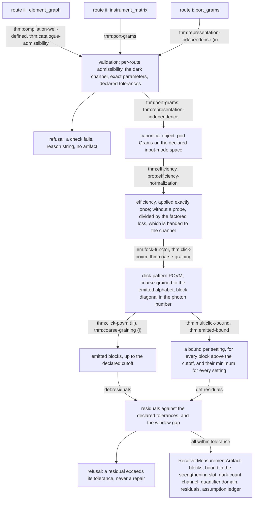

# Receiver: design notes

Working design notes of the `receiver` module (`spec/modules/receiver`): why
its claims are shaped as they are. Non-normative and in places dense; the claim
files and the `interface.yaml` files are authoritative.

## Module structure

The module is a core plus two submodules: `component-catalogue` (the
catalogue entries and their admissibility, `thm:catalogue-admissibility`,
plus the three worked BB84 examples) and `detector-imperfections` (detector
efficiency, `thm:efficiency`; dark counts, `thm:dark-counts`; what the
widened dark-channel admission costs, `prop:dark-slack-bound`; and the
efficiency normalization, `prop:efficiency-normalization`).

The core's high-photon bound (`thm:multiclick-bound`, `thm:emitted-bound`)
and its residuals (`def:residuals`) are stated over an abstract *setting
family* (`def:setting-family`): a finite set of settings, each carrying a
POVM on the channel Fock space that is block diagonal in photon number and
whose joint no-click elements have the prefactor form of
`thm:multiclick-bound`. The unconditioned receiver is the one-setting family,
a corollary inside the core (`cor:unconditioned-family`), and a submodule
that constructs another setting family proves there that it is one. That is
why the core never
depends on a submodule: the abstraction, not the submodule, is what
`thm:emitted-bound` consumes.

A receiver that declares source modes (a probe) needs a submodule that
constructs its setting family and is otherwise refused as
`probe_conditioning_submodule_absent`; every other receiver is the core's
probe-free one.

Inputs, outputs, parameters, tolerance conventions and refusal reasons are in
`interface.yaml` and are not repeated here.

## Structural design decisions

1. **The canonical object is the port Gram family, and the three input routes
   converge on it.** The click-pattern POVM depends on the optics *only*
   through a family of positive semidefinite matrices on the declared
   input-mode space summing to at most the identity (`thm:representation-independence`), which is
   exactly the object and exactly the validation that `spec/architecture.md`
   names. A supplied Gram family, a supplied instrument matrix and a compiled
   component graph are three *presentations* of that one object; the component
   compiler is a constructor in front of the module, not a second pipeline.
   The routes converge *before* any photon-number reasoning begins. The
   canonical object is the family $\{A_k\}$ on the *full* input space, and a
   setting family is constructed from it downstream (`def:setting-family`),
   so routes (i)-(iii) stay prefactor-free and prefactors reach
   `thm:multiclick-bound` only through a setting's $(\gamma,\{\beta_k\})$.

2. **The high-photon scope is single-bound, with a strengthening slot.** The
   module supplies exactly one high-photon minimum-eigenvalue bound — on the
   multiclick outcome set — per declared probe setting, quantified uniformly
   over all photon numbers above the declared cutoff at that setting, and
   their minimum over the declared settings as the one bound valid at every
   setting (`thm:multiclick-bound`, `def:pmc`, `thm:emitted-bound`). The artifact carries
   them in a *list* of outcome-set/weight pairs, one weight per setting,
   populated with a single entry (`def:slot`), so that a later multi-bound
   family is a new claim added to an existing slot rather than a re-derivation
   of this one. The slot carries one weight per setting rather than their
   minimum alone, so that each setting keeps its own multiclick floor, which
   the minimum would discard wherever it exceeds the smallest one, as a
   bright probe setting's is expected to; a probe-free receiver, having one
   setting, emits a single weight.

3. **The infimum over photon number is closed here, not deferred.** The
   high-photon bound (`def:bounddata`, `thm:multiclick-bound`) is the module's one
   quantitative deliverable and the place where an error would propagate
   furthest. What a
   squasher consumes is an infimum of the bound over all photon numbers above
   the cutoff. Collapsing that infimum needs an argument, and the module makes
   it: `lem:collapse` proves the bound non-decreasing in the photon number
   from the first index at which it is non-negative onwards, so the truncated
   infimum equals its value at the first index above the cutoff;
   `lem:windowtail` supplies a rigorous, convergent window-and-tail evaluation
   for a setting whose prefactors are not one by construction, where the
   collapse hypothesis can fail. Which is used is decided by `def:pmc`: the
   collapse at every setting whose exact flag holds, as it does for every
   probe-free receiver, where the hypothesis holds with equality by
   construction (`cor:unconditioned-family`, `rem:flag-instances`); the
   window-and-tail evaluation everywhere else.
   The exact window adds a third evaluation of the same infimum, requested
   rather than defaulted (`def:pmcex`, decision 12).

4. **Floats first, residuals reported.** Every claim is an exact statement
   about exactly declared data. The module *evaluates* those statements in
   floating-point arithmetic and reports residuals for six checkable
   identities (`thm:exact-and-evaluated`, `def:residuals`); it imports no interval-arithmetic
   assumption and claims no rigorous enclosure of a floating-point number.
   Beside it, the weights are evaluated rigorously wherever the port Grams
   are enclosed: the four inputs of the bound and the window blocks are
   bounded on the conservative side in exact rational arithmetic, and the
   weight so formed is a bound by theorem (`thm:enclosed-weight`,
   `req:rigorous-weight`).
   The consequence is stated plainly rather than hidden: an artifact carries
   `bound_evaluation: rigorous` only where every weight was so evaluated and
   `floating_point` otherwise, and a run whose declaration carries a
   floating-point weight reports at most `first-order`. What this evaluation
   model (`def:evaluation-model`) costs where the Grams are not enclosed is
   any label stronger than floating-point evaluation, and that cost is paid
   by withholding the label, never assumed away. The model is a definition
   and not an assumption: it is a restriction the contract places on itself,
   and nothing a run could violate.

   *Why the floating-point scope is not an open claim.* An open claim records
   a mathematical statement a contract asserts but does not prove. Nothing of
   that kind occurs here: `thm:exact-and-evaluated` does not assert that floating-point
   evaluation is sound; it asserts that this module does not claim soundness
   and withholds any stronger label in consequence. The tier consequence above follows from a
   scope decision, not from an unproved statement, and an open claim recording
   a scope decision would misreport the dependency chain a run's assumption
   manifest is computed over.

   *Why the fifth residual lives on the receiver's side.* A downstream module
   that validates the operator rows it receives for exact Hermiticity and
   positivity refuses a defective emitted block at its own boundary, correctly
   and with no diagnosis available there: it sees a matrix, not the receiver
   that produced it. `r_5` (`def:residuals`, `rem:res5why`) makes the same
   defect visible on the supplier side, which is the only side that can say
   which port, which setting and which photon number produced it.

   *Why each route tests its own datum at its own tolerance.* At route (i)
   `eps_2` both bounds the Gram-positivity residual and decides Gram
   admissibility; at route (ii) `eps_1` carries the same dual role, since
   `r_1 <= eps_1` and `lmax(Gamma^dagger Gamma) <= 1 + eps_1` are the same test
   on the same number (`def:tolmap` (v), Eq. `eq:r1islmax`), so no separate
   tolerance is added on either route. The derived bound-data constant `c` is
   decided at `eps_2` on every route (`def:tolmap` (iv), `rem:bound-data-band`).

   *A rejected reading of the bound-data admission.* One could read item (v)
   of `def:tolmap`, being route (ii)'s own admission rule, as settling
   admissibility for everything derived downstream on that route, so that the
   derived `c` inherits `eps_1` and the band `c in [-eps_1, -eps_2)` is
   admitted. It is not an absurd reading (it is what the phrase "the slack is
   transported rather than lost" invites), and it loses twice over. It loses
   on step (2) of `rem:bound-data-band`, because the transport is an
   inequality between exact quantities while an admission is a decision about
   computed ones. And it loses independently on step (3), because it would
   require `rem:cdirection`'s even-n bound to be restated in `eps_1`, so that
   one and the same quantity, `c`, would be admitted under two different
   declared numbers according to how its receiver happened to be presented,
   which is the opposite of what the two routes' tests say: each tests its own
   declared datum under the tolerance attached to that datum's residual.
   Neither reading is unsound: branch selection and `p_mc` are unaffected
   either way, and the cost of the losing reading is a false stated error
   bound, not a false bound on `lmin`.

   *The rigorous evaluation.* The directions in which each input of the
   bound is enclosed are `rem:ia`; `def:enclosed-weight` and
   `thm:enclosed-weight` are the weight formed on them and its proof, and
   `req:rigorous-weight` binds the engine to form it wherever the port Grams
   are enclosed, falling back to the floating-point weight with a reason
   elsewhere. It rides the enclosures that the reference of the blocks
   already needed (`thm:enclosed-blocks`), so it added no numerics substrate
   of its own beyond the least-eigenvalue bounds of `foundations`.

5. **Component parameters are exact, and a tolerance is refused rather than
   ignored.** A tolerance on a parameter is an uncertainty set, and
   uncertainty sets are deferred (`spec/future-scope.md`). Every parameter
   carries a reserved `tolerance` field validated as absent or exactly zero,
   and otherwise *refused* (`ass:exact`, `req:reserved-tolerance-field`). A
   user gets a refusal with a reason instead of a silently ignored field, and
   the eventual device-family work is a semantic change to an existing field
   rather than a breaking schema change.

6. **Detectors and the probe source are declared layers, not chain
   elements.** The detector port map with its per-port efficiencies is a
   terminal layer applied after every chain element; the probe source is an
   input layer declaring which input modes are not vacuum and what state they
   carry. Two consequences are structural rather than audited: detection
   efficiency enters the instrument matrix at exactly one site
   (`thm:efficiency` (iii)), and the click alphabet is a function of the declared
   port map (`def:clickalphabet`).

7. **The probe tier is Gaussian: vacuum and thermal.** A probe declaration
   admits products of thermal states only (`def:probe`,
   `req:probe-diagonal-admission`). General occupation-diagonal probe states
   would need a *bounded* truncation error wherever the receiver is
   conditioned on them, and choosing a cutoff with a warning is not a bound.

8. **Probe states must be occupation-diagonal.** The channel grading of
   the blocks is recovered from the total one only under a condition on the
   probe state (`rem:blockmeaning`); occupation-diagonality, diagonality in
   the occupation basis, is the stronger form that validation can check and
   the Gaussian tier satisfies by construction. The condition is part of
   the definition of a probe declaration (`def:probe`: every declared state is
   occupation-diagonal), and the engine admits only the Gaussian tier, which
   has it by construction (`req:probe-diagonal-admission`). Because the engine
   decides it on the declared data, it is not an assumption and carries no
   row in the assumption ledger.

9. **Element graphs are acyclic, and a cycle is refused.** A feedback path
   requires a fixed-point solve whose contractivity must itself be
   certified; the module does not do it, and the receivers it targets
   do not need it. A declared graph with a cycle is a specification error,
   not a solve (condition (E2) of `def:graph`, `req:graph-refusal`).

   Acyclicity is a well-formedness condition on a route-(iii) declaration,
   decided by finite inspection and refused when it fails, so it is not an
   assumption and carries no row in the assumption ledger. `def:compile` and
   `thm:compilation-well-defined` quantify over a well-formed graph and its
   linear extensions, and `cor:compiled-instrument` has a well-formed graph
   declaration as its hypothesis; (E2) is part of each.

   `cor:compiled-instrument` states that a well-formed declared element
   graph, with a declared mode space, an input split and a port map, *is* a
   receiver instrument tuple (`def:instrument`) whose instrument matrix is the
   compiled `Gamma = D_eta Gamma_G`. The corollary is a *route-(iii)* step,
   and nothing more: the emitted blocks use
   neither `def:compile` nor `thm:compilation-well-defined` nor that
   corollary, each of the emitted blocks being stated of the receiver
   instrument tuple (`def:instrument`) that the three routes converge on or of
   an object more abstract still (a setting family, a dark-count channel), so
   a declaration supplying port Grams or an instrument matrix rests on
   neither. Those theorems are true on every route, so the corollary is
   deliberately not a `uses` edge of any of them.

10. **Phases are carried, never silently dropped.** A phase that is global on
    one element is *relative* as soon as that element sits on one arm of an
    interferometer, so no catalogue entry drops one. That per-port phases are
    nevertheless unobservable in the click statistics is then a theorem with a
    stated hypothesis (`cor:phases`) rather than a reflex, and `ex:bb84`
    exhibits a concrete receiver where a dropped wave-plate phase happens to
    be harmless for exactly that reason.

11. **Compilation well-definedness needs a declared-graph condition, and the
    module states it.** A topological sort of an element graph does not by
    itself make the compiled matrix well defined: two elements incomparable in
    the graph order may still act on overlapping mode subsets, and then their
    product depends on the sort (`rem:e3`). The correct condition is *support
    comparability* — any two elements whose mode supports intersect are
    ordered by the graph (`def:graph` (E3)) — and `thm:compilation-well-defined`
    (i) proves that it makes the compiled instrument matrix independent of the
    chosen linear extension. It is decidable by finite inspection
    (`thm:compilation-well-defined` (iv)), is checked at validation, and a
    graph that violates it is refused (`req:graph-refusal`).
    Admissibility, by contrast, holds by construction
    (`thm:compilation-well-defined` (ii)): the refusal of a noncontractive
    receiver instrument (`spec/architecture.md` §5.4) cannot fire on a
    compiled matrix, so it is not a check that can fail late.
    The acyclic scope of route (iii) (`rem:noloops`, decision 9) suffices
    because the receivers this module is built for have no feedback
    path.

12. **A sharper evaluation of the same bound is opt-in, and the assumption it
    needs is declared with it.** The analytic bound of `thm:multiclick-bound` is what
    makes the infimum over photon number finite, and it is also what makes the
    emitted weight vacuous at the cutoffs a caller wants. The exact window
    evaluates the *exact* block minimum eigenvalue on a declared, finite
    window and keeps the analytic remainder above it (`lem:exactwindow`,
    `def:pmcex`). Three properties are structural rather than incidental. It
    is *requested*, never defaulted: the cost is a caller's to accept and a
    platform default would be an undeclared number. It is *never worse*
    (`prop:exactnoworse`), and a declaration that does not request it computes
    nothing new. And the arithmetic is not assumed away: decision 4 still
    holds, but a computed eigenvalue asserted to bound an exact one
    needs a stated hypothesis, so the module states one and scopes it to the
    opt-in route evaluated in floating point (`ass:eig`); the rigorous
    evaluation of decision 4 puts a proved lower bound in the computed
    eigenvalue's place and needs none. Read decision 4's opening sentence with
    `thm:exact-and-evaluated` (i) beside it: the *claims* remain exact statements about
    exactly declared data, while the *emitted value* of `def:pmcex` is a
    function of a computed spectral quantity as well.

13. **The catalogue is written for the parts a receiver is built from.** The
    entries of `component-catalogue/def:catalogue-entries` are parameterized the way the
    parts are specified and the way they deviate from ideal, and each entry
    that could look redundant is there for a stated reason.
    - *C2, polarizing beamsplitter.* Extinction is reported as
      ER_H = t_H/(1-t_H) when wanted, but the declared parameters are
      (t_H, t_V) so that ideal and real devices share one parameterization.
    - *C3, retarder.* Retardance error (delta = pi + Delta delta) and axis
      misalignment (theta + Delta theta) are available in the general form at
      no extra cost, which is why the catalogue has one retarder with presets
      rather than two components.
    - *C5, mirror or fold.* The entry is thin but earns its place: a real
      dielectric mirror has phi_H != phi_V, and that s/p phase difference is a
      common and easily forgotten source of polarization rotation in a folded
      receiver.
    - *C8, polarizer.* It is a convenience entry --- a PBS with one output
      terminated has the same Gram --- included because it is how the part is
      specified in a bill of materials.
    - *C9, mode routing.* Structural rather than physical: it is how the
      declared graph's edges become matrix entries (a fibre patch, a
      free-space path, "the reflected port goes to the second PBS"), and
      listing it as a catalogue entry keeps the wiring inside the same
      validated object as the physics.

14. **A probe-free receiver is compiled at its normalized station by
    default.** A common factor of the port Grams is uniform loss in front of
    the receiver, and the adversary may be handed it with the statistics
    unchanged (`detector-imperfections/prop:efficiency-normalization`). Left
    in the receiver, a low efficiency eta costs the two-photon multiclick
    block a factor eta^2 (`detector-imperfections/rem:normalization-gain`),
    which at a cutoff of one photon makes the certified high-photon weight,
    and with it the key, collapse long before the device's physics does: a
    passive BBM92 pair with efficiencies 3/5 and 1/5 gives no key analysed
    as declared and about half a bit per coincidence normalized. The
    normalization lives here, not in `reductions`, because the efficiency
    enters the measurement only at the terminal layer, where the three input
    routes converge, and because the declaration keeps describing the device
    (`ass:trust` stays true of it); `reductions/wpfss` records the factored
    loss in front of the link's channel witness
    (`reductions/wpfss/cor:normalized-flat`). The factor is formed exactly
    from declared numbers: by default the largest declared efficiency divided
    by 99/100, and one where that efficiency is at least 99/100
    (`detector-imperfections/req:efficiency-normalization`). The Gram-level
    factor `lmax(A_Sigma)`, which could be smaller, is an eigenvalue and is
    not used (`detector-imperfections/rem:normalization-scope`). A factor
    above the largest efficiency, the default's included where that
    efficiency is below 99/100, keeps some loss in the station, which is what
    the noise floor of `detector-imperfections/prop:noise-floor` needs
    (`detector-imperfections/rem:normalization-scope`). At the full
    normalization itself the engine's handling can lose the key, a
    property of the engine and not of the identity, which holds at every
    factor in `[eta_max, 1]`. Where the full normalization makes the largest
    efficiency of the station one, at a photon cutoff of two or more and with
    dark counts, the two-photon block, on which some dark-composed element is
    singular, can be evaluated in floating point
    (`detector-imperfections/rem:noise-floor-receiver`) and its least
    eigenvalue can come out slightly negative. The support-safe snap
    (`foundations/req:support-safe-snap`) can then lift that block, the
    support check (`meat-core/frank-wolfe/req:support-rank-check`) counts the
    near-empty directions the lift creates, and a run can withdraw the
    bracket of almost every iterate and report a key of zero where the model
    admits a positive one. A factor declared at the largest efficiency, or
    close to it, can meet this; so can a receiver whose largest efficiency is
    one, or close to one, at a factor of one. That is why the default keeps a
    margin where that efficiency is below 99/100. At or above 99/100 the
    default compiles the declared receiver, which can meet the same handling
    when its largest efficiency is one or close to it. The margin is the
    engine's, and is revisited when the snap or the support check changes. A
    probe-fed receiver is not normalized.

## Named extension points

Each is a later claim in a slot the module already carries, not a
re-derivation of anything it proves.

- *Multi-bound high-photon families* — additional entries in the
  strengthening slot of `def:slot`. The exact window is **not** this
  extension: it emits the same single entry for the same outcome set,
  evaluated more sharply. Nor are the per-setting weights: they are the same
  single entry with one weight per setting.
- *Active elements, feedback loops, photon-number-resolving detectors,
  temporal-mode structure, detector memory* — each excluded by a named
  assumption in the ledger or, for feedback loops and temporal-mode
  structure, refused as a declaration that is not well formed (`def:graph`
  (E2), the single-valued index of `def:modes`), so that a reader meeting one
  of them knows which line it violates.
- *Device families, uncertainty sets, characterization protocols and the
  family-dominating (range-inclusion) reduction* — deferred in
  `spec/future-scope.md`. `receiver/characterization` is a planned, currently
  empty submodule for the first of these: from calibration data to a
  certified family of port-Gram tuples. A device family is the sound repair
  where `ass:trust` fails.

## The module's main logic

The figure is a reading aid and the claim files are the contract; where they
disagree the claim files win. The emitted blocks are those of the
dark-composed family (`detector-imperfections/req:dark-composed-reference`).
Dark counts are also emitted as the channel R with its minimum multiclick
column mass `r_min`, the capped coefficient `rbar` and the admission
correction `delta_dc` carried separately (`req:dark-channel-record`), and are
not composed into the bound: the consumer composes them with Eq.
`eq:darkpmcslack` (`prop:dark-slack-bound`), `thm:dark-counts` (iv) being the
case of an exactly admissible R. The bare blocks are emitted beside them,
and the consumer composes R into blocks handed in that form
(`interface.yaml`, `photon_blocks`).

## The reference: enclosed for every declaration, exact where it can be

The emitted blocks are snapped onto the lattice before a key rate is
computed, and the snap only steers the search: the run evaluates its
first-order bound on a reference of the model handed beside the snap
(`foundations/def:evaluated-off-snap`,
`meat-core/frank-wolfe/req:bracket-on-reference`), and every block on which
that bound counts rests on no premise about the snap, where the key length is
formed from a number on the companion (not in the fallback of
`meat-core/frank-wolfe/req:certified-evaluation` (i), where those blocks rest
on the snap). The reference is read
through rational boxes (`foundations/def:exact-reference`). The binary64
evaluation cannot serve: its roundings are of unknown size and change
supports nobody controls, so it establishes neither that it encloses the
model nor that it is a POVM. So the receiver encloses its blocks rigorously
for every declaration whose model is an admissible receiver exactly
(`thm:enclosed-blocks`), and knows them exactly where it can
(`def:exact-route`, `thm:exact-blocks`).

*How the blocks are enclosed.* A block entry is a permanent of `1 - A_J`
divided by `sqrt(m! m'!)` (`lem:fock-permanent`), combined by inclusion and
exclusion and summed over fibres; a compiled receiver's port Grams are
products of catalogue matrices whose entries are square roots, cosines and
sines of the declared parameters. The contract fixes what an enclosure of a
square root, a cosine or a sine must satisfy (`def:complex-enclosure`) and
proves rules for sums, products, conjugates and reciprocals
(`lem:enclosure-arithmetic`); the method that produces the primitive
enclosures (a series with a bounded remainder, bisection on squares) is the
implementation's. Every step is exact rational arithmetic on Gaussian
rationals, so no floating-point value enters the reference. No size of the radius is a
threshold: it loosens the companion's relaxed entries and displaces the
evaluated family by up to its size, neither of which a claim bounds in its
effect on the key rate, so the enclosures are as tight as their exact
computation allows and the record shows the largest radius
(`detector-imperfections/rem:noise-floor-receiver`).

*Known weakness: lost zeros.* Interval arithmetic does not see cancellation:
an entry that is zero because terms of an inclusion-exclusion sum cancel is
enclosed with a positive radius. Recentring gives such an entry centre zero
wherever its enclosure contains zero (`foundations/lem:recentred-enclosure`),
so the evaluated family gains no entry there, but the snap's support-safe
rules (`foundations/req:support-safe-snap`) do not treat it as known to be
zero. Zeros that the claims establish (no more clicks than photons) are
enclosed exactly by requirement
(`detector-imperfections/req:dark-composed-reference` (ii)), and on the exact
route every entry of the blocks up to one photon is exact. Rejected: deciding
every zero of the model exactly, which needs exact arithmetic over the field
the parameters generate, the cost the enclosure route exists to avoid.

*Why the exact route stays.* A snap keeps a block unmoved only where every
radius of the block is zero and its exact entries are lattice values
(`foundations/req:snap-reference` (ii)). Where the port Grams are
Gaussian-rational, every block of at most one photon is exact
(`thm:exact-blocks`), which is what a configuration with dyadic blocks at
`N <= 1` needs in order to be kept. Above one photon the off-diagonal entries
carry factors such as `1/sqrt 2` and are enclosed even then. The exact route
is also what remains when a run declares that enclosed references are not
used (foundations `req:snap-reference` (i), the run's `reference_enclosure`
setting): only the exact blocks are then handed, so a run with `N >= 2`, and
a run off the exact route, typically rests on its snap there, disclosed in
the group no usable reference, or is refused under the strict option
(`detector-imperfections/rem:noise-floor-receiver`). The entry records the
reference kind it offers block by block (exact; enclosed, with the largest
radius of the block and the largest radius of the enclosures of irrational
inputs (square roots, trigonometric values) from which the centres are
computed exactly; none, with the cause)
(`detector-imperfections/req:dark-composed-reference` (iii), (iv)). The
record of every snap carries, separately, the kind of the reference the snap
ran on and the kind handed (foundations `req:who-snaps`), so that it shows
where an enclosure entered; in a run that declares enclosed references not
used, every block of a setting whose reference has a block offered as
enclosed (the exact-offered blocks of that reference included, since the
reference is not used as a whole) is handed no reference, with that cause in
the group no usable reference, and its offered kind is named in the fix
(`detector-imperfections/req:snap-fix` (ii)).

*Deciding the exact route.* On route (iii) the Grams are computed in a field
generated over Q(i) by `sqrt 2` and by `sqrt p` and `sqrt(1-p)` for every
declared rational parameter `p` (the catalogue carries `sqrt(1-x)`,
`sqrt(1-t_H)` and the per-output losses `sqrt(1-y)` as well as the square
roots of the parameters themselves), and the route needs every Gram entry to
land in Q(i). The claims fix only that the decision is exact; the method is
the implementation's. Angles reach that field only through the interface's
angle presentation, a rational coefficient of pi (`parameters.units`
`angle_presentation`): an angle given in radians is a binary64 number, a
dyadic rational, and when non-zero no rational multiple of pi, so it takes
the declaration off the exact route and onto the enclosed reference. A loss
in decibels is read at the converted efficiency the artifact carries
(`presentation_rule`), a dyadic rational (`req:exact-route-decision` (ii)).

*Rejected: a diagonal scale on the Grams.* An exact route that allowed Grams
Gaussian-rational up to a diagonal scale with rational squares would make a
probe on the free port of a beamsplitter exact at any rational
transmittance. With every declaration enclosed, the scale would buy
exactness only for idealised probe-conditioned devices off `x = 1/2`, at the
cost of a search for the scale (square classes over F2) and a second form of
every block.

*Exact admissibility.* A declared family is admitted at the receiver
tolerances and may be slightly non-admissible as exact numbers, which would
make the model no POVM and leave nothing to enclose. A declaration therefore
has a reference only where its model is admissible exactly: declared Grams
Hermitian with `A_k >= 0` and `1 - A_Sigma >= 0` decided in rational
arithmetic (`def:exact-route`, Eq. `eq:exact-admissible`), and, on route
(iii), every generic block a contraction exactly, the rest of the catalogue
being contractive at every parameter in its domain
(`component-catalogue/thm:catalogue-admissibility`).

*Why the angles are multiples of pi/8 on the exact route.* The half-wave
plate at `theta` has entries `cos 2theta`, `sin 2theta`; behind an ideal PBS
the port Gram's diagonal holds `(1 ± cos 4theta)/2`, which the exact route
needs rational. Multiples of pi/8 are the angles the BB84 receivers use and
give `cos 4theta` in {0, ±1}. Any other angle is enclosed, and the run hands
and evaluates an enclosed reference as it does an exact one: an angle is no
cause of resting on the snap (`detector-imperfections/req:snap-fix`).

*Ideal devices in a rotated basis.* An ideal device measuring in a rotated
basis can have rank-deficient elements whose supports contain no
Gaussian-rational vector: at one photon behind a plate at an angle with
irrational `cos 4theta`, and at two photons even in the diagonal basis of
BB84, whose one-photon directions are rational. Such a device has a
reference all the same, enclosed, and the run evaluates its bound on it; the
snap that steers the search may need its last resort on those blocks, which
the record flags, and a block it moves is evaluated off its snap wherever
the bound on the companion counts and the key length is formed from a number
on the companion (not in the fallback of
`meat-core/frank-wolfe/req:certified-evaluation` (i)). `foundations/lem:rational-obstruction`
(v) bounds below, by the largest eigenvalue of such an element, every weight
at which the model dominates a lattice family written in the occupation
basis; that is why domination is no route for a snap, and why it is kept
only as mathematics for a declared device range (`spec/future-scope.md`
section 13). A reduction that first applies a common unitary (for the angle)
or, for the two polarization modes, the isometry from the m-photon block
into the m-fold tensor power of C^2 (for the photon number; the image is
complete only on the symmetric subspace) can give a target with
Gaussian-rational entries; such reductions are future scope too.

*The last resort on a receiver block.* Where the support-safe rules cannot
restore positivity on a block, foundations `req:support-safe-snap` (iv) mixes
in a uniform family and flags the block `support_not_preserved`. On the
receiver it is needed only where some element has structurally zero rows:
where every element of a reference block is positive definite, as under loss
and a dark count in every port, every index lies in every element's
structural support, and the uniform lift itself meets the support-safe
rules. The fix recorded for a block that rests in the group last resort is
therefore the noise floor (`detector-imperfections/req:snap-fix`); a block
the last resort snapped that the run evaluates off its snap rests on nothing
and needs no fix.

*Why the reference is dark-composed.* The run evaluates its bound on the
reference, so the noise floor of the device belongs to the reference, not
to a step after it (`detector-imperfections/req:dark-composed-reference`).
With loss and dark counts in every port, every element is positive definite
on every block (`detector-imperfections/prop:noise-floor`), so the snap that
steers the search needs no last resort that revives a zero. Composing R
after a snap of the bare blocks would snap the rank-deficient bare elements
instead. Hence `photon_blocks` carries the dark-composed family, and R stays
emitted for the high-photon weight, which remains bare.

*Testing the dark-count minimum.* An implementation that computes `r_min`
(Eq. `eq:rmin` of the detector-imperfections submodule) is tested against
Eq. `eq:rmintrapnum` of `rem:rmintrap`: at `K = 4` and equal per-port
probabilities `p` the no-click column carries multiclick mass
`6p^2 + O(p^3)` and a single-click column `3p + O(p^2)`, so a minimum that
leaves out the no-click column is visible at any realistic `p`.

## Where the code is

The module's code is the package `src/certiqs_key/receiver/`. A claim's
`implements` field names the symbol it binds where one does, and that field
is the authority; the table is the orientation. Paths are under
`src/certiqs_key/receiver/`.

| Claims | Code |
| --- | --- |
| the request, the mode space, the input split and the port map: the inputs of `interface.yaml`, `req:efficiency-schema` | `request.py`, `modes.py` |
| input validations: route exclusivity, `req:window-declaration`, `req:exact-window-declaration`, `req:reserved-tolerance-field` | `validation.py` |
| receiver tolerances, their domain and the defect of `eq:rhodef`: `def:tolmap`, `req:tolerance-domain`, `prop:res5` | `numerics.py` |
| mode lift: `lem:fock-functor`, `lem:fock-block-spectrum` | `fock.py` |
| element graph and compilation: `def:graph`, `def:compile`, `thm:compilation-well-defined`, `req:graph-refusal` | `graph.py` |
| catalogue: `component-catalogue/def:catalogue-entries`, `component-catalogue/thm:catalogue-admissibility` and the catalogue remarks | `catalogue.py` |
| port Grams: `def:gram`, `thm:port-grams`, `thm:representation-independence`, `req:one-mode-per-port` | `grams.py` |
| click-pattern POVM and coarse-graining: `thm:click-povm`, `def:coarse`, `thm:coarse-graining` | `povm.py`, `coarse.py` |
| efficiency: `detector-imperfections/thm:efficiency`, `req:efficiency-record` | `efficiency.py` |
| efficiency normalization: the factor and its domain (`detector-imperfections/req:efficiency-normalization`), the record (`req:normalization-record`) | `efficiency.py` (`normalize_efficiencies`, `EfficiencyNormalization`) |
| the normalized station compiled in place of the declared receiver: `detector-imperfections/def:normalized-station`; the factor a consumer reads off a request | `request.py` (`normalized_station`, `factored_loss`, called by `validate_request`) |
| the factored loss applied before an evaluation: `detector-imperfections/req:loss-before-evaluation` (a consumer obligation) | the run tier's `runs/pipeline.py` (`LossAppliedProvider` and `LossAppliedRawProvider`, the `honest_model` refusal), `runs/channel.py` (each arm's `factored_loss` on the channel interface) and the honest models of `instances/common/honest/` |
| dark counts: `detector-imperfections/def:darkadm`, `thm:dark-counts`, `prop:dark-slack-bound`, `req:dark-route-exclusive` | `dark.py` |
| the probe declaration, its admission and the one seam to a setting family (a receiver with source modes refused as `probe_conditioning_submodule_absent` where no submodule constructs its family): `def:probe`, `req:probe-diagonal-admission`, `def:setting-family`, `cor:unconditioned-family`, `rem:flag-instances` | `settings.py` |
| high-photon bound and emitted weights: `def:bounddata`, `thm:multiclick-bound`, `lem:collapse`, `lem:windowtail`, `def:pmc`, `def:exactbnd`, `lem:exactwindow`, `def:pmcex`, `def:slot`, `thm:emitted-bound`, `cor:emitted-unconditioned`, `req:tolerance-tests` | `bound.py` |
| the rigorous weight: `def:enclosed-weight`, `thm:enclosed-weight`, `req:rigorous-weight` | `rigorous.py` |
| residuals: `def:residuals`, `req:residual-emission`, `req:residual-refusal` | `residuals.py` |
| the emitted artifact: the outputs of `interface.yaml`, `req:dark-channel-record` | `artifact.py`, `docking.py` |
| the reference: `def:complex-enclosure`, `lem:enclosure-arithmetic` | `enclosure.py` |
| the reference: `def:exact-route`, `req:exact-route-decision`, `thm:enclosed-blocks`, `detector-imperfections/req:dark-composed-reference` | `reference.py`, `radicals.py`, `generic.py` |
| the factor form: `def:port-dilation`, `lem:fock-permanent-maps`, `thm:factor-blocks`, `component-catalogue/lem:catalogue-dilations`, carried on the reference by `detector-imperfections/req:dark-composed-reference` (vii) | `factor.py` |
| the cause and fix of a block resting on its snap: `detector-imperfections/req:snap-fix` | `snapfix.py` |
| refusal reasons and assumption keys | `reasons.py` |
| the request-to-artifact pipeline | `construct.py` |

## Citations

Nothing cited is used by a proof: every claim is tagged `newly-derived` and
every identity, inequality and closed form is proved from definitions made in
the module's own claim files. The registered citations, in `rem:kamin`,
`rem:konig`, `rem:migdal`, `rem:normordelements` and
`detector-imperfections/rem:sperlingeta`, record where some of those
identities appear in the literature and where a different construction of a
related quantity may be found; removing them all would leave every proof
intact. The registered optics textbooks `hecht2017optics` and
`kok2010optical` are deliberately *not* cited, because a locator into either
could not be verified against a copy of the registered edition — so every textbook fact the module needs (the beamsplitter, the Jones
matrices of a retarder and a rotator, the mirror, the polarizer) is written
out and verified in `component-catalogue` instead.
