# Reductions: design notes

Working design notes of the `reductions` module: why its claims are shaped as
they are. Non-normative and in places dense; the claim files and the
`interface.yaml` files are authoritative.

Inputs, outputs, machine keys, refusal reasons, the number model and the
conventions are in the three `interface.yaml` files (the core's, `wpfss`'s
and `domination`'s) and are not repeated here. A claim's `implements` header,
where it has one, names the code that realises it.

## Module structure

One core and two submodules, with a third planned and empty. How many claims
each holds, and at what status, is what `python -m harness.check_claims
--module reductions --status` returns.

- **The core** is device-free. It states the generic object both of its
  reductions are and what such an object transfers (`def:opreduction`,
  `lem:opreduction-transfer`, `rem:why-exact`), what a squashing relation is
  and what it transfers (`def:squashing`, `thm:transfer`), the source-side
  instance and the two-sided composition (`lem:precomposition`,
  `lem:source-transfer`, `thm:two-sided`), the calculus that
  composes relations (`prop:preorder`, `lem:linear`, `prop:pinching`,
  `prop:tensor`, `lem:master`), the obstruction that makes the constraint slot
  mandatory (`prop:obstruction`), the attack-set licence (`thm:licence`), the
  chain (`def:link`, `def:chain`, `thm:chain`), the number model
  (`def:exactadm`, `lem:exactpsd`, `lem:latsum`) and the emission obligation
  (`def:emitnorm`, `thm:emit`, `cor:entries`). The last three are stated over
  `def:reduction-instance`, and three instances are proved in the core itself:
  the identity (`cor:identity-instance`), the flag PVM of an uncharacterised
  branch (`cor:flag-instance`) and the branching instance
  (`thm:instrument-instance`) with its register form
  (`cor:register-instance`).
- **`wpfss`** is where a receiver artefact is consumed: the flag-state and
  multi-bound weight-preserving targets (`wpfss/def:targets`,
  `wpfss/prop:chain`), the weight route (`wpfss/def:weight-route`,
  `wpfss/lem:descent`, `wpfss/prop:route`), and the flat-instance emission
  (`wpfss/prop:flat-instance`, `wpfss/cor:emitted-flat`).
- **`domination`** states the domination link: a family that dominates
  another at one weight per sector is a noise channel followed by the
  dominated family with classical flags (`domination/def:domination-link`,
  `domination/thm:noise-channel`), and a squashing link followed by it is an
  exact chain (`domination/cor:dom-chain`). It is mathematics kept for a
  declared device range (A-DOM, spec/future-scope.md §13): no requirement
  emits the link, and no snap is related to its model by it, the snaps
  being handled by the reference companion (decision 15). It depends on
  `wpfss`.
- **`family-reduction`** is planned and empty (spec/modules.yaml). It needs
  `receiver/characterization` first.

## Structural design decisions

1. **The emission obligation is stated once, over an abstract reduction
   instance.** Stating `thm:emit`, `cor:entries`, `def:emitnorm` and
   `def:exactadm` over the target and channel of one construction would
   make every statement about what the module emits name
   that model, and a submodule split would then leave the core's theorems
   using a submodule's claims. `def:reduction-instance` packages what every
   construction has in common — a handed model with a finite *datum*, a target
   built from that datum and from scalar values, an existence theorem with a
   transported set, and a list of certified entries — and the emission
   obligation is proved once over it. Each construction is then shown to be an
   instance *where it lives*. This is the receiver's
   `receiver/def:setting-family` pattern, and it is what makes the core
   minimal without making it weaker. Two parts of the definition earn their
   keep on their own: the model is given by a **model map** over admissible
   data, so that "the handed model with the datum replaced" is defined for
   every instance and `thm:emit` (iii) is one line; and a data sector carries
   a declared **support**, so that the normalizer never designates an
   element outside the sector support (spec/architecture.md §2.9) and the
   joint-outcome form of `thm:instrument-instance` closes. Three further
   choices of the definition have their reasons here. An entry is a real
   combination of transported operators with per-sector coefficients on the
   lattice, rather than a member of the transported set, because a branching
   instance forms Ô|_j − cΠ_j from two transported operators
   (`thm:instrument-instance`, Step 5). The scalar values are lattice values
   formed by downward rounding with every complementary value recomputed,
   which is (D-DIR) (`foundations/req:rounding-direction`) stated once in the
   definition so that `thm:emit` (iv) holds for every instance. And the
   class-marginal identity is a flag the instance sets rather than a
   condition, because a flag instance of an uncharacterised branch cannot
   establish it and a branching instance has it only when every branch does
   (`cor:flag-instance`, `thm:instrument-instance`).

2. **The relation, not the channel, is the object.** Everything is stated for
   `M ⊑_Λ F` of `def:squashing`, which carries a *tuple of transported
   operators* alongside the POVM. Carrying them is not decoration: a constraint
   built from an operator in the tuple is sound for *every* channel realizing
   the relation, while one read off a particular construction is tied to that
   construction (`rem:channel-choice`). Two channels realizing the same
   relation have incomparable reachable sets in general, and `cor:sound`
   requires one common channel.

3. **Register-conditioned squashing is in the core, and the register is
   squashed with a general POVM, not a PVM.** A classical branch register — a
   detector-response mode, a device label, a family index — is a generic construction
   and does not belong to any one device model, so `thm:mixture`,
   `thm:instrument-instance` and `cor:register-instance` are core claims.
   `lem:master` is stated for a *generalized instrument*
   (`def:generalized-instrument`) with branch-dependent output systems, which
   covers a non-projective register family through its square roots and files
   each branch as a *block* of the target rather than keeping the register
   intact. That removes a projectivity hypothesis a physical register model
   has no reason to satisfy, and it makes the sector structure the engine
   requires fall out of the construction instead of being imposed on it
   (`rem:povmreg` is what the generality costs).

4. **Both routes for device knowledge, not one.** Device knowledge may be
   encoded in the target itself (the `encoded` route, licence-free) *or*
   carried as a constraint list under the attack-set licence (the `licensed`
   route). The second cannot be dropped: `prop:obstruction` exhibits a device
   fact — a bound on a *union* of outcomes that must not be merged — that no
   target classical on the whole of the squashed system can encode. One route
   per artefact, because the two run on different channels and the
   cross-channel pairing is unsound (`wpfss/rem:tworoutes`,
   `wpfss/req:one-route-per-artifact`). Both rows are `wpfss`'s, the two
   routes being its two targets.

5. **Three requirements on the artefact's shape.** The artefact is a
   **chain of typed links**, never a single squashed POVM; it carries
   **constraint entries and a licence slot on every artefact**, even when both
   are empty; and **composition order is data**, source-stage links before
   receiver-stage links, even when the chain has one link. `def:link`,
   `def:chain` and `thm:chain` make each of the three a statement with a proof
   or a validation rule rather than a convention. The constraint slot and the
   licence slot are there on every artefact because of `prop:obstruction`
   (`req:constraint-and-licence-slots`): a pipeline that can only emit
   squashed POVM elements structurally excludes a class of device knowledge,
   and no later design of a classical target repairs it.

6. **The chain composes on both sides, the stage order is a record rather
   than the soundness, and the source segment is the transmitter's.** A
   source-stage link is a source link in the sense of
   `transmitter/def:source-link`, and a chain's source segment *is*
   `transmitter/def:source-segment` with its interface and admission
   conditions, which is why `depends_on` carries `transmitter`. The stage
   order (C3) has a reason (`rem:ordering`): a source-map argument
   re-parameterizes the first-round attack over *all* CPTP maps, while a
   receiver-stage link hands the analysis an attack set that is a proper
   subset of them, so applying a source link after one is not free — an
   inclusion must additionally hold. `lem:precomposition` establishes it for
   every channel and every list whose right-hand sides are real constants,
   which is every list this module emits; `thm:two-sided` then proves that the
   two orders give one and the same map of attack strategies, because the
   source composite acts at the input of the first round's attack and the
   squashing channel at the output of each round's. So a chain's composite is
   the **pair** (source composite, receiver composite), `(C3)` stays as the
   shape of the record, and no claim here rests on the source segment being
   empty.

   What stays a refusal is the admission rule of `def:chain`: a chain with a
   non-empty source segment carries licensed entries only, a `general` entry
   beside one being refused, with `lem:precomposition` (iv) as the reason
   that is not a formality. This module has no refusal-reason string for it,
   and none could be added: `interface.yaml` binds that no string exists for
   it beside the closed list of its `fail_closed` table, and every entry this
   module emits carries a real scalar. **Who refuses it** is the consumer
   that assembles a declaration's source segment with its constraint list —
   the protocol compiler's chain-condition definition, which carries
   the rule with a refusal reason of its own; this
   module states the rule, decides no instance of it, and names that
   definition only in mentions (`rem:chain-admission`, `rem:ordering`). The
   rule refuses on a presented declaration, and **both halves of it are
   decided by that consumer** — the **entry** half as
   `general_entry_beside_source_segment` and the **mode** half as
   `source_segment_in_untrusted_mode`, a declaration pairing a non-empty
   source segment with untrusted-source mode being refused there rather than
   kept out by the transmitter's provenance condition alone. The emitted
   ledger has no row saying that the source segment is empty, on two grounds,
   one about this module's own graph and one about what the artefact carries
   (`interface.yaml`, `assumption_ledger.no_row_for_an_empty_source_segment`).

   Why the chain carries a source stage even where it is empty, as it is in
   every artefact this module emits: no receiver-side theorem of this contract
   would be false if a source link were added, because what an added source
   link needs is the inclusion of `lem:precomposition`, a statement about the
   composition and not about any receiver-side theorem. The stage costs one
   enumerated field. It makes the two-sided statement a statement about this
   contract's chain rather than a new artefact shape, and a later decoy-state
   link cannot be composed in the wrong order without the artefact recording
   that there was an order.

   What stays outside this module is the *content* of a source link — a
   tagging or decoy construction and its soundness claim — which is a
   submodule of the transmitter's; the link *type* is the transmitter's too.
   **A separable transmitted system needs no amendment of anything**:
   `thm:two-sided` (ii) applies `thm:licence` to the *pre-composed* attack,
   whose input register is the **virtual** transmitted system,
   finite-dimensional in both cases of `transmitter/def:source-spec` (its
   clause (b): what a consumer receives is never the model but the virtual
   ensemble, which is finite dimensional). The separable specified system is
   then an intermediate system of one channel and is typed nowhere,
   `eq:attackchannel` constraining an attack by its outputs. `thm:licence` is
   read exactly as it stands.

   Two features of `def:chain` are choices rather than mathematics. `(C3)` is
   kept as a numbered condition although the pair form makes the stage order
   structural, because it is a rule with a reason (`rem:ordering`) and the
   name of a refusal (`source_link_after_receiver_link`). And the admission
   rule is deliberately not a fourth numbered condition: `(C1)`–`(C3)` are
   named by number in `interface.yaml`, in `thm:chain` and in `rem:ordering`,
   so a fourth would make those read as incomplete, and the rule is decided
   where an entry is declared rather than on a presented chain. `def:chain`
   names the deciding consumer in words; the remarks that point at its
   chain-condition definition by id (`rem:chain-admission`, `rem:ordering`)
   do so as mentions, which are pointers and no dependency.

7. **Classical post-processing happens before the first squashing link — and
   exactly one thing may still be relabelled after one.** A dark-count channel
   or a coarse-graining applied to the physical POVM produces a *different*
   physical family, and a squasher built for the original one is not a squasher
   to the same target for it; `lem:linear` (i) moves such a map across a
   *fixed* squasher only together with the target, which is then not the one
   the chain was built and certified for, and a map on a finer alphabet than
   the squasher's moves across only where a linear feasibility problem has a
   solution, which it has not in general. The order is fixed instead
   (`req:post-processing-order`). What `rem:intertwining` separates out is the
   case that *is* sound: a stochastic relabelling applied to **both sides**
   after a link, depending on Bob's private component of the outcome only, is
   `lem:linear` (i) with the *same* channel — the target space, its sector
   map, its dimension, every pull-back and every certificate are untouched.
   That is not a link (a link composes a new channel; a relabelling changes
   the alphabet at both ends of an existing relation), so this module declares
   no kind, no register and no position in a chain for it: it is the
   consumer's to apply, and the module that compiles the protocol may use
   `lem:linear` (i) directly. The `post_processing_order` row therefore
   reaches noise and coarse-graining maps only. **Leaving that relabelling
   open is what this decision is for**: a round-type designation is the
   compiler's vocabulary, and reductions declares no round-type register.

8. **A private setting is a joint outcome, never a fraction.** A setting drawn
   from Bob's own randomness with declared weights enters the joint alphabet as
   `M_(y,t) = q_t M_(y|t)` (`def:joint-family`). One squashing channel serves
   every setting (`lem:linear` (ii)), so the setting register is *not* handed to
   the adversary and no state-independent test fraction is assumed anywhere
   (`ass:tsm`, `req:output-state-statistics`). The class-marginal identity
   that comes with it is a fact about the *physical* model; which squashed
   form of it is sound is `rem:unsound`, and the answer is the expectation
   identity and never the operator identity on the target — which fails on
   every scalar sector whose values do not sum to the class weight over the
   class (`req:class-marginal-operator-form`).

9. **Only what the supplier's contract *states* is consumed.** The weights
    `wpfss` takes are the per-setting ones an accepted `receiver` version
    states as a claim (`receiver/thm:emitted-bound` Eq. `eq:pmcsetting`,
    `receiver/def:slot`), the weight of a joint letter `(y,t)` being formed
    from that setting's weight, because a hypothesis discharged by a locator
    that does not state it is not discharged (`ass:recv`,
    `wpfss/req:supplier-version`). Which claims *are* imported is
    `wpfss/prop:route` (iv), and which of the supplier's assumptions the
    imported facts rest on is `wpfss/rem:receiver-imports`, whose `uses` edges compute that closure from
    the graph rather than maintain it as a list
    (`check_claims --assumptions reductions/wpfss/cor:emitted-flat` is the
    authority). The emitted ledger's inherited keys are a different thing:
    its A-RECV entry carries the receiver's ledger **entire**, every key as
    supplied and in the receiver's order, extra keys included, and refuses an
    artefact that lacks a key the receiver's own presence rules make present,
    those rules being read from the installed receiver; this module keeps no
    list of the keys and no copy of the rules
    (`req:supplier-ledger-pass-through`, `req:supplier-ledger-refusals`). So
    the ledger may name an assumption the closure is without, in the safe
    direction; `wpfss/rem:receiver-imports` gives the reasons. The receiver's
    presence rules emit every row on every artifact, so no key is
    conditional. The acyclicity of a receiver's element graph and the
    occupation-diagonality of its probe states are decided by the receiver on
    its declared data (`receiver/def:graph`, `receiver/def:probe`) and are
    neither assumptions nor ledger keys.

    The same division holds for any supplier. `ass:recv` says only that the
    artefact is the supplier's own output and that the supplier's facts hold
    of the declared numbers; that its version is one the caller declares
    accepted is decided (`req:supplier-version-accepted`); which of its claims are
    consumed, and under which of its assumptions, is stated where its
    artefact is consumed: the reduction instance that reads it names the
    supplier's claims by id in the `uses` edges of the claims that read them,
    so that which of the supplier's assumptions the imported facts rest on is
    the closure of those edges rather than a prose list restated in the
    assumption. A change of the supplier's presence rules takes effect in
    this module's check without an edit here
    (`req:supplier-ledger-pass-through`); it must meet
    `req:supplier-presence-rules` on the closure keys those rules can omit,
    and it is a substantive change
    reaching the claim that states the supplier's imports
    (`wpfss/rem:receiver-imports` for the receiver).

10. **The licence is a theorem about the composite attack, not an assertion.**
    `thm:licence` derives the adjoint-form attack-set entry the engine names,
    from one hypothesis — a spectral bound on the *pull-back* of the declared
    operator — using only positivity and unitality of an attack channel's
    adjoint. The licence record names that theorem, its hypothesis and the
    supplier artefact discharging it, and is emitted only when all three are
    present (`rem:gateweight`, `req:licence-record`). Nothing is attested that
    is not proved here, and nothing is proved about a device: *that* the
    receiver satisfies the hypothesis is `ass:recv`. What the licence does
    **not** license is enumerated rather than left to inference
    (`rem:notlicensed`).

11. **The number model: decide exactly, and prefer a recorded declaration to an
    unrecorded one.** Every declared number *is* the dyadic rational it is;
    every predicate is decided exactly on it, in the Löwner order and by sign
    comparisons of polynomials with integer coefficients (`lem:exactpsd`,
    `def:substrate`); no rule is decided at a window, no defect is measured and
    this module carries no tolerance. The one place where exact arithmetic
    outruns the representation is a module's own construction — every exact
    step multiplies, and a lattice fixed at the instance is closed under none of
    them — so the emission normalizer re-establishes the invariant **on what
    this module declares** and records what it did (`def:emitnorm`,
    `thm:emit`). The reason to prefer a recorded declaration to an unrecorded
    one is not that the difference is small: it is that a family the platform
    can write down, hand over and decide is a family every downstream claim is
    *about*, while an exact construction that cannot be written in binary64 is
    a family nothing downstream can consume (`rem:emitclaim`). Nothing relates
    the declaration to the construction: the size of the move bounds nothing
    a key rate cares about (`meat-core/prop:optol-nobound`), and no other
    relation is sought (`thm:emit` (v)). A run needs none, because it forms
    its first-order bound on the reference companion
    (`cor:reference-companion`, `req:reference-companion`), the same
    construction run with no normalizer on the receiver's handed reference,
    or on the instance's own snapped blocks where none is handed, so that the
    companion's datum is the exact construction itself; the emitted target
    steers the search, and every class the normalizer moved is
    evaluated off its snap wherever the bound on the companion counts and
    the key length is formed from a number on the companion (not in the
    fallback of `meat-core/frank-wolfe/req:certified-evaluation` (i))
    (`foundations/def:evaluated-off-snap`). The companion is formed wherever
    a claim of this module establishes its hypothesis (H-REF) for the
    instance and either a block is handed or a class is moved; a caller's
    requested entries are carried to it in their companion form where their
    certificates are re-established at its datum (`cor:reference-companion`
    (vi), `wpfss/cor:flat-companion`), and left out, which only enlarges its
    feasible set, where they are not.

    The normalizer itself therefore aims at fidelity and at nothing else
    (`def:emitnorm`). It keeps a class already on the lattice; it snaps every
    other class by rounding to nearest, ties to even, after softening the
    off-diagonal entries by a weight on a fixed ladder where positivity needs
    it (the mixture with the class's diagonal parts, which
    `foundations/req:support-safe-snap` (ii) admits), and places the
    completeness residue component by component on an element whose
    structural support holds it, so that no zero row or column is revived. A
    class whose residue no single element can host takes the flagged last
    resort of `foundations/req:support-safe-snap` (iv): the exact class mixed
    with `q_t/n` times the identity on the same ladder, with a round-down
    fall-back that always yields a positive semidefinite family. A moved
    class is never refused by default: it is disclosed with its step, weight
    and hosts (`req:emission-record`), and where the run does not evaluate it
    off its snap it rests on `foundations/ass:snapped-measurement` (A-SNAP);
    the strict option `strict_snaps` refuses instead, at emission where no
    companion is formed and after the search otherwise
    (`req:emission-refusal`, `foundations/req:snap-reference` (iv)).
    Splitting the residue entry by entry and lifting per coordinate was not
    taken for the last resort: it can still fail positivity, so it would
    need the uniform lift behind it anyway, and it adds a re-rounding loop.
    Nothing in the number model repairs a supplied block and no statement of
    this module rests on a rounding-error budget of its own; the wpfss weight
    at a setting with a declared exact-window depth that the receiver
    evaluated in floating point inherits the receiver's
    A-EIG through A-RECV (`wpfss/rem:receiver-imports`,
    `foundations/req:exact-island`). The two places a budget would otherwise
    be needed are closed by construction: the one emitted bound is computed
    exactly and rounded in the direction that weakens it, and the emitted
    family is *decided* exactly admissible rather than bounded near something
    that is. For the same reason no assumption says that the declared numbers
    lie within a tolerance of a true operator family: what such an assumption
    would hypothesize is decided (`def:exactadm` says what exact admissibility
    is, and the rules of the `fail_closed` table decide it, exactly and on
    entry, refusing otherwise), so the declared numbers *are* an exactly
    admissible family and no assumption about their distance from one is made
    or needed. What remains a hypothesis is that the receiver facts hold of
    the family declared (`ass:recv`), stated of the declaration itself: the
    supplier's facts are asserted of a declaration that is exactly admissible
    by *decision* and not by hypothesis, so there is no second assumption about
    how far the declaration stands from a true family, the modelling step
    being taken and recorded where the data is declared.

    The field the exact decisions are taken in is left open
    (`def:substrate`). ℚ always suffices, every binary64 value being a dyadic
    rational, and it is the choice an implementation may make without
    declaring anything further. Leaving the field open costs nothing, because
    no admissible choice can change a decision.

    The emission normalizer (`def:emitnorm`) applies to this module's own
    emission the steps of the documented procedure by which an instance snaps
    what it declares (`foundations/def:snap`). Its tie rule is its own: the
    lattice rounding runs in the exact substrate, where a halfway part is an
    exact equality, and IEEE 754's tie rule governs binary64 *operations* and
    decides nothing about a rounding this contract defines on the rationals.
    Ties to even is chosen because it is odd-symmetric, which is what lets the
    Hermitian part be taken once, before the rounding. Each component of the
    completeness residue goes to the first element, in the designation order
    (largest exact trace, then the declared order), whose structural support
    in the handed datum holds it, and no element is excluded beyond the ones
    outside the sector support: the designation order is a function of the
    declaration alone, so the emission is reproducible from it.
    Extending an exact decision to an object with no finite presentation, such
    as an uncharacterised branch, would first require declaring a finite
    representation for it, which widens the instance's model rather than the
    number model (`rem:exactboundary`); whether to do so is a modelling
    decision, not a change an implementation makes.

12. **Refuse, with no default anywhere — and decide rather than repair.**
    Every hypothesis this module needs and cannot verify is either a declared
    input that is validated and *refused* when invalid, or a named ledger
    assumption. A missing lattice exponent, a probe-weight declaration or a
    strengthening slot that is not well formed, a declared block that is not
    exactly admissible, a split fibre, a total weight at one, an approximate
    relation, a chain with a link that is not exact, or a link kind this
    module does not implement each produce a refusal with a machine-readable
    reason and *no* artefact. The complete list is the `fail_closed` tables
    of the three interface files and not this paragraph; no rule there is
    decided at a window and no refusal reason names one. A declaration that
    is not exactly admissible is a modelling error and is refused; one that
    is, is used exactly as declared and is never repaired. Repair of declared
    data happens where data is *declared*: at the instance, before this
    module sees it, and — for the family this module declares to its
    consumer — inside its own emission, in the open and recorded. Neither
    ever touches what this module was handed.

    The declared-relation check (`req:declared-relation-check`,
    `rem:obstructiondecide`) is the one row that could have been decided
    loosely at no cost to soundness, and the only row of which that is true:
    nothing emitted rests on its having passed, so a looser decision could
    change only which declared relations are refused, and when. It is exact
    none the less, because the substrate that decides every other row decides
    this one at no extra cost (`rem:psdalgorithm`), and because a contract with
    one approximate row would have to say at what window, which is exactly the
    apparatus this contract does without.

    In `wpfss`, a slot with one non-absorbing bounded letter is refused as a
    whole (`wpfss/req:absorbing-bounded-letters`) although it need not be:
    the proof of `wpfss/prop:route` for entry `i` uses the absorbing condition
    only at `y_i`, so that letter could have been handled by dropping its
    entry's weight to zero and keeping the rest. The whole artefact is refused
    instead, which costs rate and not soundness, because a partially honoured
    slot would emit a target whose weights do not correspond entry for entry
    to the declared slot, and no declared field records which entry was
    zeroed. The exact column-stochasticity rule on the dark-count matrix
    (`wpfss/req:column-stochastic-refusal`) closes coverage and attribution
    rather than soundness (`wpfss/rem:colstoch`): beyond diagnosis it is used
    in one place, half of `wpfss/rem:darkcompose`, and otherwise its value is
    that the refusal names its own cause.

13. **Several measuring parties are a product of instances, and no product
    datum is formed.** Where two stations measure (BBM92, for one), the module
    emits *one exactly admissible artefact per party*, each with its own party
    label, together with the combination rule `F_v = ⊗_f F^f_{v_f}`
    (`thm:emitted-product`, `req:factorised-emission`, the `factor_emission`
    row of `interface.yaml`); no entry of the product is ever formed, declared,
    rounded or snapped. The rejected alternative is a tensor instance whose
    product is then snapped, and three obstructions make it more than extra
    work. A product sector built from a data block of one station and a scalar
    flag block of the other is neither class-complete data nor a scalar
    multiple of the identity, so it fits neither kind of sector of
    `def:reduction-instance` (I2). The stability clause of (I1) would have to
    hold for every admissible *product* datum, and a Kronecker product of two
    `2^-κ`-lattice families lies on the `2^-2κ` lattice, so the product would
    need an emission of its own whose snap can break the exact Löwner decision
    an entry's constant was certified by. And a snapped joint target declares a
    *non-product* measurement for two separated stations, which is a different
    physical model from the two receivers. What the factorised route costs is
    that a consumer needing a product block forms it itself under its own
    number model, and that a product class weight `q_t = ∏_f q^f_{t_f}` is
    formed by whoever reads it; what it buys is that `def:reduction-instance`
    serves unchanged, every factor's constant stays exact, and the emission
    introduces no displacement that no theorem bounds (`thm:emit` (v) has
    nothing further to say here). The **party-local entry**
    (`lem:party-local`, `def:licensed`, `thm:licence` (v), `def:attset`
    Eq. `eq:attsetpl`) is what keeps the factorised route from losing
    constraint strength across the two stations — a squasher's operator bound
    transported as an operator inequality on the other party's system rather
    than as a scalar — and it is the one place this module widens the
    consumer's gate (G3)(a). It carries its own tag and its own licence row, it
    is emitted only where the measured system is a declared product, and every
    entry of a one-factor emission is untagged (`cor:entries`,
    `rem:entry-tags`, `req:party-local-tag`).

14. **The output-equality results are stated over one generic object, and
    both reductions are instances of it.** The object is an **exact
    operational reduction** (`def:opreduction`): two protocols presented as a
    set of attack strategies together with the full output state each
    produces, and a map of strategies under which every strategy and its image
    produce the *same* output. `lem:opreduction-transfer` is the whole of what
    it buys — transfer with the same `ε` for every criterion at once,
    restriction, enlargement, one map for many analysed sets, and
    composition — and `rem:why-exact` says why nothing approximate is offered.
    The squashing reduction (`cor:sequential`, `thm:transfer`) and the source
    map (`lem:source-transfer`) are its two instances and `thm:two-sided` is
    their composition. **What it costs.** The module carries
    `def:opreduction`, `lem:opreduction-transfer` and `rem:why-exact`, which
    are bookkeeping about sets and maps and no mathematics of quantum
    information, and `cor:sequential`, `thm:transfer` and `cor:sound` are
    proved by citing that layer rather than by arguing inline. **What it
    buys.** The two reductions are not two arguments with the same shape:
    composition is proved once, the *common-channel* requirement of
    `rem:channel-choice` is a named hypothesis with a counterexample
    (`lem:opreduction-transfer` (iv)) rather than a caution, and the two-sided
    statement is an instance rather than a new theorem chain. The layer is
    deliberately thin — strategies, the full output, the map, exact
    equality — and carries no protocol formalism of its own; a generic
    substitution lemma over "locations" would need one, and each instance
    proves its own output equality in the round model of `def:protocol`
    instead.

    Where the round's assumptions are declared: `def:protocol` places the
    measurement channel before the round's remaining processing and fixes
    one POVM and one channel for all rounds, but a definition assumes
    nothing (`spec/claim-format.md` §4.1), and an assumption claim is a leaf
    whose `assumes` is empty, so neither `ass:meas` nor `ass:round` can carry
    the round order; both leave it out. `thm:factorization` declares A-SEQ
    (`transmitter/ass:seq`), A-ROUND-SQ and A-MEAS, and every claim built on
    `def:protocol` and that theorem, the emission path included, inherits
    them through it, in the graph and in the emitted ledger. A-SEQ is
    declared whatever the number of measuring parties, because that number
    is not a datum the definition reads, and an over-declared ledger row errs
    in the safe direction.

15. **The snaps only steer the search: the bound is formed on the reference
    companion.** Two snaps stand between the device and an emitted target:
    the declaring party's snap of the receiver blocks and this module's
    emission normalizer. A displacement bound relates neither to a key rate,
    and no claim relates either to what it replaced. The run instead
    evaluates its first-order bound, which holds at any admissible points,
    on the reference companion at the points its search on the snapped
    declaration found (`meat-core/frank-wolfe/cor:fo-reference`).
    - *Why the companion is built here.* It is the same chain run on other
      data, so it is built where the artefact is built, by the same
      builder in companion mode, and has the artefact's shape by
      construction (`cor:reference-companion` (i)). Nothing is proved again
      for it: every part of a reduction instance holds at every admissible
      datum, and the one hypothesis to supply, (H-REF), is that the
      instance's rule forms an admissible datum from any family with the
      properties a reference has, over the reals. The identity instance
      and branching discharge it in the core, and the flat instance in
      `wpfss/cor:flat-companion`.
    - *Exact data, relaxed rows.* The companion keeps the reference's exact
      data, Gaussian-rational centres and rational radii, recentred so that
      an entry whose enclosure contains zero has centre zero, before the
      construction and again after it (`foundations/lem:recentred-enclosure`).
      Only its entries are emitted in binary64, each rounded to nearest with
      its constant moved outward by the exactly computed bound on the
      rounding and the radius (`lem:row-relaxation`), so that the set the
      consumer's oracle sees contains the exact one.
    - *Formed also with no handed reference.* Where the declaring instance
      hands no reference but the normalizer moved a class, the companion is
      formed on the instance's snapped blocks: its datum is then the handed
      datum, the module's exact construction, so the classes the normalizer
      moved are evaluated off their snap, while the instance's own moved
      blocks rest on A-SNAP as they would without a companion. The cost is
      one exact construction and one evaluation after the search; the gain
      is that an emission snap needs no premise wherever the bound counts
      and the key length is formed from a number on the companion.
    - *Requested entries.* An entry a caller requests beside the
      instance's own (`carried_operators`) was decided on the emitted
      numbers (`cor:entries` (iii); for the two-sector operator,
      `wpfss/cor:two-sector-decided`), which says nothing about the
      reference. It is carried to the
      companion in its companion form, the same formula at the companion's
      datum, where its certificate is established there: a sum of sector
      projectors and the class-marginal entry are the artefact's operators
      with their certificates (`cor:reference-companion` (vi)); the two-sector
      operator `eq:two-sector-entry` of `wpfss/rem:published` holds where the
      centres of the companion's datum clear its constant `a` by the radius
      and `b` is at most the certified weight (`wpfss/cor:flat-companion`).
      One whose certificate is not so established is left out and recorded;
      leaving an entry out only enlarges the companion's feasible set, so
      the bound stays a bound, if a lower one.
    - *Disclose, or refuse on request.* Where the bound on the companion
      does not count, or no companion is formed (no claim establishes
      (H-REF) for the instance), a moved class rests on A-SNAP, recorded
      with its group and fix (`req:emission-record`,
      `foundations/req:snap-reference` (iii)); the strict option refuses
      instead (`req:emission-refusal`).
    - *Rejected: relating a snap to its model by domination*, for the
      reasons `spec/modules/foundations/design.md` gives (decision 12,
      "Domination is not the route for snaps"). The `domination` submodule
      keeps the link and its chain rule as mathematics for a declared device
      range (spec/future-scope.md §13); no requirement emits it.

## Deferred extensions and where each attaches

Deferred means *named, with the slot it will occupy already present*, not
silent. This module states none of these and proves none of them.

- **The family reduction.** Attaches at the link kind `family-dominating`,
  whose mathematics is `prop:common` — a common dominating target reduces a
  family of devices to one squashed model, with the family label becoming a
  branch register, which is the core's `cor:register-instance`. The kind's
  first instance would be the `domination` submodule's link, which no
  requirement emits; a declared domination weight, A-DOM, is reserved there
  for device ranges (spec/future-scope.md §13), as is the general-channel
  route for idealised models.
  What is missing is not the
  composition rule but *the family itself*: certified outer sets of device
  data are deferred out of `receiver`, and the planned `family-reduction`
  submodule waits on `receiver/characterization`. No output key is reserved
  for the family's data: a key with no content would be a hand-maintained
  mirror of a deferral, and the kind and the proposition are the slot.

- **Approximate squashing.** Attaches at the link `status` value
  `certified_outer`, which is never emitted (`req:no-approximate-relations`).
  *That value is not a result tier*: it is a **link** status, saying whether a
  link's defining identity carries an error term, and the tiers of
  spec/architecture.md §2.8 (`foundations/def:tiers`) do not reach it. This
  is deliberately *not* a parameter of `thm:transfer`: that theorem rests on
  an equality of output states and has no penalty slot, so an approximate
  relation needs a new theorem converting the error into a security penalty,
  and until there is one the request is refused — which is also why a
  chain with a link that is not exact is refused rather than given a
  composite status (`thm:chain` (iv), `req:mixed-status-chain`). The exact
  substitute that *is* available is operator domination with a declared
  weight (`cor:instances` (i)).

- **The general device-label-space treatment.** Attaches at the link kind
  `label-space`, reserved and refused (`req:reserved-link-kinds`). It carries
  a warning the others do not: there is *no source at all* for it, so it is
  originate-from-scratch work. Nothing depends on it: the branch-register
  constructions run on a declared finite mode set and a POVM on the register,
  and need no general label space.

- **An already-finite receiver.** Attaches at the `identity` link kind and
  `cor:identity-instance`, with its emission `cor:emitted-identity`. The
  instance is proved and **is not reachable from any declared input** — no
  input row of any of the three interfaces carries an already-finite POVM.
  Admitting one is a new declared input *and* a new refusal rule, hence an
  amendment, not a default (`ex:identity`, `req:identity-link-recorded`).

## What the module does not do

It computes **no number a run reports**: no entropy, no objective value, no key
length, no acceptance set, no honest-channel statistics and no observed number
of any kind. It emits **no penalty term and no error parameter**, the transfer
being an equality. It **recomputes no supplier quantity**: a supplier's weights
and blocks are referenced, transported, and never re-derived. And it **decides
no more of its never-verified assumptions than their clauses on declared
data**: every assumption whose `verification` field is `never`
(`spec/claim-format.md` §3.2; `ass:meas`, `ass:round`, `ass:recv`,
`ass:probe`, `ass:tsm` and `ass:constdecl`) is named and carried in the ledger, and no code path
may decide more of it (`req:never-verified-assumptions`); the rows it takes
from the transmitter and from the engine carry their owner's mark.

**The setting is a definition; the adversary's registers are an assumption.**
That the physical system is separable and that every target space and every
side register other than the adversary's is finite-dimensional with declared
dimensions is the setting the contract is stated in (`def:system-setting`):
the declared dimensions are decided on entry, and separability is the
standing convention of a quantum system with countably many modes. The
adversary's registers are finite-dimensional, of undeclared size, as every
register of the round model is (`foundations/def:round-model`); the adjoint
bookkeeping of `lem:sep` (ii) reads them so, and `thm:two-sided` transfers
the strategies of that kind. That is no premise about the adversary: the
consuming engine carries the security statement to an adversary whose memory
has any dimension, and who receives the signals round by round, by
compressing her registers before any reduction applies and taking a limit
(`meat-core/lem:memory-lift`, applied by `meat-core/cor:composed-security`).
The reductions keep finite registers at every
fixed dimension and transfer every criterion exactly; the limit, which needs
a criterion continuous in the output state, is taken for the trace distances
of the security statement alone.

**The soundness of the emitted constraint list is not an assumption.** That
every entry of the emitted list holds on every reachable squashed state is a
conclusion of `thm:chain`, `cor:entries` and `thm:licence` for the entries
this module emits, and inside the engine's security chain it is implied for
the whole list, entries a declaration brings itself included, by A-ATK
through the engine's range lemma (`rem:sound-and-atk`). No ledger row carries
it.

## The module's main logic

```mermaid
flowchart TD
  DECL["declared data: outcome alphabet Y and settings T with weights q_t in declared order, lattice exponent kappa, sector declaration with supports, link declarations, carried operators, requested tier"] --> GATE
  SUP["supplier artefact (A-RECV): accepted version, its own validation results, its ledger keys"] --> GATE
  GATE["fail_closed rules, decided exactly on declared data: lattice first, then the tier, the artefact, the sector map and exact admissibility"] -->|"a rule fails"| REF1["refusal: named reason, NO artefact"]
  GATE --> WP
  WP["wpfss weight route (wpfss/def:weight-route): dark counts descend through the coarse-graining, then the joint alphabet, then the routed weights rounded DOWN onto the lattice"] --> INST
  CORE["core instances, device-free: identity (cor:identity-instance), flag PVM of an uncharacterised branch (cor:flag-instance), branching and register (thm:instrument-instance, cor:register-instance)"] --> INST
  INST["REDUCTION INSTANCE (def:reduction-instance): (I1) handed datum + hypotheses (H) + model map, (I2) sectors, supports and scalar values, (I3) channel constructor + transported set, (I4) certified entries + class-marginal flag"] --> NORM
  NORM["emission normalizer (def:emitnorm), per data sector and per class: (1) keep a class already on the lattice; (2) snap every other class for fidelity, rounding to nearest after softening its off-diagonal entries on a ladder, the residue placed by components on elements whose support holds it; (3) with no host, the flagged last resort (support_not_preserved); every moved class disclosed, refused only under the strict option where no companion is formed"] --> SIX
  SIX{"the six (D-EMIT) conditions, decided on the numbers about to be emitted (thm:emit (ii))"}
  SIX -->|"one cannot be established"| REF2["refusal: emitted_family_not_admissible, naming the predicate"]
  SIX -->|"all six"| ENTRIES
  ENTRIES["entries (cor:entries): where the request carries entries (wpfss's licensed route) the emitted list is the instance's own entries; the class-marginal entry on request, where the instance discharges it and refused otherwise; and any further requested entry that cor:entries (iii) admits, on a decided certificate that holds at the emitted numbers (req:uncertified-operator-refused), at the constant its certificate is established at. EMPTY where the request carries none (wpfss's encoded route), whatever the instance's own list. The instance's default carried operators are entries only where a caller requests one as an entry (cor:entries (i)); otherwise they travel in transported_operators at 0 with >= on either route"] --> LIC
  LIC["licence (thm:licence), present exactly when the entry list is non-empty: the theorem, its hypothesis, the artefact that discharges it"] --> CHAIN
  CHAIN["chain (def:chain, thm:chain): the transmitter's source segment, EMPTY in every artefact this module emits, then the receiver segment; the composite is the PAIR of the two composites and what the pair composes to is thm:two-sided; status exact, a chain with a link that is not exact refused"] --> ART
  ART["ProofReductionArtifact: target with its sector map, the exact identity on B, transported operators, constraint list and licence, the chain, the emission record, the assumption ledger"]
  INST --> COMP{"reference companion (req:reference-companion): a claim establishes (H-REF), and a block is handed or a class is moved?"}
  COMP -->|"yes"| CREF["the same construction, exact, no normalizer, on the handed reference or the snapped blocks; requested entries in their companion form where certified there; entries rounded with relaxed constants (lem:row-relaxation); evaluation-only, emitted beside the artefact"]
  COMP -->|"no"| NOC["no companion; the record says why"]
  ART --> PC["protocol-compiler: consumes the chain and the declaration"]
  ART --> MC["meat-core: reads the target, the entries and the licence"]
```

The figure is a reading aid and the claim files are the contract; where they
disagree the claim files win. Two things the figure does not draw: the emitted
family is decided a *second* time after the normalizer has acted, which is the
`SIX` node and the one rule whose subject is this module's own numbers; and
the figure draws the path
of *one* instance, while an emission of several measuring parties runs that
whole path once per party and emits the list of artefacts with the
combination rule (decision 13, `thm:emitted-product`).

## Where the code is

The core is the package `src/certiqs_key/reductions/`, and the submodule
`wpfss` is the subpackage `wpfss/` of it. A claim's `implements` field names the symbol it binds
where one does, and that field is the authority; the table is the orientation.
Some rows the interface gives to `wpfss` are registered in the core package;
the core interface's `code_note` lists them. Paths are under
`src/certiqs_key/reductions/`.

| Claims | Code |
| --- | --- |
| the declared inputs of `interface.yaml` | `inputs.py` |
| the joint alphabet, its classes and weights: `def:joint-family` | `joint.py` |
| the reduction instance and its register form: `def:reduction-instance`, `cor:register-instance` | `instance.py` |
| an instance precomposed with a channel: `lem:precomposed-instance` | `instance.py` (`precompose`, `Precomposition`), `channels.py` (`ChannelWitness.precomposed_with`), the chain's pull-backs in `emit.py` |
| sectors and scalar values: `cor:flag-instance`, `req:party-label` | `sectors.py` |
| channel witnesses, adjoints and the transported set: `def:squashing`, `cor:pullback`, `req:transported-set-certificates` | `channels.py` |
| constraint entries, certificates and the licence: `cor:entries`, `thm:licence`, `req:caller-constant-rounding`, `req:party-local-tag` | `constraints.py` |
| typed links and chains: `def:link`, `def:chain`, `thm:chain` | `links.py` |
| the emission normalizer: `def:emitnorm` | `normalizer.py` |
| the emission: `thm:emit` | `emit.py` |
| several measuring parties: `thm:emitted-product`, `req:factorised-emission` | `factors.py` |
| the core's `fail_closed` table, one function per row: `req:emission-refusal`, `req:class-marginal-entry`, `req:uncertified-operator-refused`, `req:constraint-list-by-request`, `req:licensed-entry-lattice`, `req:mixed-status-chain` | `validation.py` |
| refusal reasons, rows and ledger keys | `reasons.py` |
| the emitted artefact and its emission record: the outputs of `interface.yaml`, `req:emission-record` | `artifact.py`, `docking.py` |
| the weight route: `wpfss/def:weight-route`, `wpfss/lem:descent` | `wpfss/weights.py` |
| the two targets and the flat instance: `wpfss/def:targets`, `wpfss/prop:flat-instance` | `wpfss/construction.py` |
| the weight route's refusal rows | `wpfss/validation.py` |
| the flat-instance emission: `wpfss/cor:emitted-flat` | `wpfss/api.py` |
| the flat instance of a normalized station: `wpfss/cor:normalized-flat`, `wpfss/req:normalized-link-record` | `wpfss/api.py` (`FlatInstanceBuilder`), `wpfss/construction.py` (`normalized_precomposition`, `PureLossWitness`) |
| a normalized receiver refused as a branch: `wpfss/req:normalized-branch-refusal` | `wpfss/validation.py` (`rule_normalized_branch`) |
| the reference companion and its relaxed entries: `cor:reference-companion`, `req:reference-companion`, `lem:row-relaxation` | `companion.py` |
| the companion's factor enclosures: `cor:companion-factor-enclosure`, `req:reference-companion` (vii) | `companion.py` (`combined_factor`) |
| the flat rule's factor enclosures: `wpfss/cor:flat-companion` | `wpfss/weights.py` (`post_processed_preserved_factors`), `wpfss/api.py` |
| `domination` (mathematics only; no requirement, so no code) | none |

## Citations

No citation is used by a proof: every claim is `newly-derived` and every
identity, inequality and construction is proved from definitions made in this
module's own files. Removing every registered reference would leave every
proof intact. What each does, by the claims that cite it:

- `portmann2022security` — the published form of the security criterion
  (`rem:criteria`, `rem:completeness`).
- `tupkary2026decoy` — the published framing of the squashing step and of the
  licence, and the one place a published framework names the two resolutions
  of the source/receiver-stage interaction, of which it adopts the ordering
  one and this module proves the other (`rem:ordering`,
  `rem:publishedlicence`, `rem:notlicensed`, `rem:platform-published`,
  `rem:source-transfer-registers`, `rem:dictionary`, `wpfss/rem:published`).
- `nahar2024postselection` — the same reduction shape in a narrower model
  (`rem:platform-published`, `rem:notchannel`, `wpfss/rem:published`).
- `beaudry2008squashing` and `buscemi2005clean` — the dictionary entries, the
  second warning that the relation's arrow points the other way there
  (`rem:dictionary`).
- `fung2011universal` and `upadhyaya2021dimension` — reductions that are *not*
  squashings, which is why every emitted link carries a channel witness
  (`rem:notchannel`).
- `zhang2021security` — where the flag-state and weight-preserving targets
  appear (`wpfss/rem:published`).
- `nahar2025imperfect` and `douglas1966majorization` — the published form of
  operator domination with a declared weight, and the factorization the
  deferred family reduction would rest on (`rem:dominating`).
