# Acceptance statistics: design notes

Working design notes of the `statistics` module (`spec/modules/statistics`)
and of its submodules `binomial-box` and `singleton`: why their claims are
shaped as they are, which alternatives they reject, what the module does not
do, and where the code realises it. Non-normative and in places dense; the
claim files and the `interface.yaml` files are authoritative.

Inputs, outputs, machine keys, reason codes, the conventions, the error terms,
the assumption ledger and the artifact bindings are in `interface.yaml` and in
`binomial-box/interface.yaml`, and are not repeated here.

## Module summary

Read the [generated module summary](graphs/README.md#module-summary), shared
with the contract PDF. The design rationale follows here.

## Module structure

The core states what an acceptance set is and what a consumer may read off
it: the frequency vector (`def:freq`), the two admissible geometries and the
canonical box form (`def:taxonomy`, `thm:geometry-validation`), the binomial
tails in closed form (`thm:binomial-tails`, `cor:tail-forms`), the acceptance
support and the closed-form box minimum (`thm:box-oracle`), the honest
envelope (`def:envelope`), the alphabet and round count matched to the
consuming declaration (`def:matched-alphabet`, `req:matched-alphabet`), exact
data with conservative evaluation (`def:conservative-evaluation`), and its own
assumptions A-HON, A-HON-ENV, A-ALPHABET and A-REACH. It names no endpoint
rule.

`binomial-box` is where a set is built: the admissible endpoint rule and the
guard (`def:endpoint-rule`, `lem:guard`), the construction map
(`def:construction`, `thm:box-construction`), the completeness bound
(`thm:completeness-bound`), honest containment and refusals
(`thm:honest-containment`), the behaviour in the budget and the round count
(`thm:monotonicity-limits`), and the two rules the repository carries with
their evaluations. `singleton` states the exact completeness of a declared
singleton acceptance set (`singleton/thm:singleton-completeness`).
`python -m harness.check_claims --module statistics --status` says where each
claim stands.

## Structural design decisions

1. **The direction is forwards, and the module makes no security claim.**
   Observed counts appear in no claim. A pipeline that fitted the acceptance
   set to the data it then accepts would be assuming what it is meant to test
   (`spec/architecture.md` §3.2), so the set is built from a *declared* honest
   model and the run's counts only decide accept-versus-abort later. The one
   consequence worth stating plainly is the one `binomial-box/rem:sound-indep`
   states: if the true honest behaviour leaves the declared model, the
   reported completeness figure is void and the protocol may abort more often
   than advertised, and the key produced on runs that do accept is
   unaffected.

2. **The taxonomy has exactly two tags, and that is not a simplification.**
   `def:taxonomy` admits `singleton` and `polytope` and nothing else, in
   one-to-one correspondence with the two geometries `meat-core`'s acceptance
   side certifies (`meat-core/frank-wolfe/rem:acc-side` (a), (b)). A third tag
   would produce sets that remark cannot certify, and `meat-core` refuses
   such a set at admission (`meat-core/frank-wolfe/req:acceptance-geometries`).
   A consumer presented with any other tag
   refuses it (`req:geometry-tag`). The canonical box form is a *sub-form* of
   `polytope`, not a third tag: it adds a recorded pair of bound vectors
   (`req:box-bounds-key`) that licenses the closed-form oracle, and a consumer
   that ignores them still reads a well-formed polytope (`rem:two-tags`). The
   `singleton` tag is kept although the construction map never emits it,
   because the consumer's acceptance oracle reads exactly that geometry and
   `meat-core/frank-wolfe/rem:acc-side` (a) certifies its acceptance-side
   minimum; the construction does not produce it because its completeness
   figure is close to one at any realistic alphabet and round count
   (`singleton/thm:singleton-completeness`, `singleton/rem:singleton-honest`).

3. **The honest-containment guard is unconditional, and both of its costs are
   reported.** The raw quantile interval need not contain the honest mass (at
   a lopsided allocation it demonstrably does not), so the emitted interval is
   widened to contain it, for every rule (`def:endpoint-rule`, `eq:guard`).
   `thm:box-construction` (iii) and `thm:honest-containment` rest on exactly
   that and would otherwise carry a side condition on the budget. What the
   guard costs has two different and equally correct answers: measured
   against the rule's own interval it is *not* bounded by one count and grows
   without bound as a single tail's allocation approaches one
   (`prop:rule-exact` (vi)); measured from the honest value the emitted
   endpoint sits within `1/n` of it, unconditionally (`lem:guard` (iv)).
   Reporting only the second would overstate the guarantee, which is why
   `rem:guard` states both. The guard also fires *at ordinary budgets under
   the default uniform allocation* for any outcome whose expected count is at
   or below its tail budget (`rem:guard-activation`), which on the
   fine-grained joint alphabet A-TSM gives is routine rather than exotic.

4. **The box construction is stated over an admissible endpoint rule, and each
   rule is one claim.** `def:endpoint-rule` is the one definition of what a
   rule is: admissibility, the zero-budget convention, the degenerate-mass
   convention, the guard, and monotonicity in the allocation as a *named
   property*. `lem:guard` proves the rule-independent properties of the
   guarded endpoints for every rule. The exact binomial quantile rule is then
   the default instance (`def:interval`, `prop:rule-exact`). Two clauses of
   the definition are conditions on every rule rather than facts about the
   quantiles: the zero-budget and degenerate-mass conventions. Making them
   conditions is what lets `thm:monotonicity-limits` (iii) and (vi) and
   `rem:epsstar` hold for *every* rule rather than for one. Adding a rule is
   one claim proving an instance of the definition, its entry in the clause
   of `def:endpoint-rule` that lists the rules and in `req:rule-in-force`, one
   row of the submodule's `rule_table` and one value of the `endpoint_rule`
   input; no theorem about the construction changes.

5. **Two request fields, defaulting to the exact rule evaluated by its closed
   forms.** `endpoint_rule` in `{exact, bernstein}` and `tail_evaluation` in
   `{sweep, enclosure}`, default `exact` + `sweep` (`req:rule-in-force`). The
   two further routes are opt-in, each is one claim group that can be deleted
   on its own, and the request is recorded in the emitted `honest_model`
   (`req:honest-model-record`), so that no figure travels without the route
   that produced it. The complexity is priced: two claim groups, one table and
   two blocks of an interface file, and removing either group deletes its
   claims and rows and edits only the claims that name them
   (`binomial-box/interface.yaml`, `artifact_bindings.package_note`).

6. **A-TSM is an edge to its owner, not a row of this module's ledger.** Short
   ids are repository-wide, so the claims that speak of the `output_state`
   model declare A-TSM and the checker resolves it to `reductions/ass:tsm`.
   The module therefore carries `depends_on: [reductions]`, for that one edge
   and nothing else: no claim of this module uses a claim of that one, no
   proof appeals to a file of it, and the code imports `domain/` only.

7. **The enclosure route is self-contained down to integer square roots, and
   the arithmetic substrate is the point.** The exact rule's tail comparisons
   can be decided against *enclosures* instead of exact sums, which is
   precisely what a conservative evaluation (`def:conservative-evaluation`)
   admits, and the local evaluation then costs about
   `log₂ n` evaluations per endpoint instead of a sweep linear to quadratic in
   `n`. What makes it possible is not the bisection but the arithmetic
   substrate (`req:enclosure-substrate`): everything is computed in log space
   with directed rounding (the mass point through `lem:pmf-enclosure`, the
   window through the rationals of `lem:tail-majorant` whose logarithms
   `lem:log-enclosure` encloses), and the products inside the window are held
   as dyadic numbers with an explicit binary exponent rather than as exact
   rationals whose denominators would grow with the window, so that no
   intermediate ever has the magnitude of a mass point, of a power of the
   honest mass or of a binomial coefficient. An exact rational whose
   denominator is a power of the round count is not a number model for this
   route. And no logarithm, exponential or special function of any library is
   called anywhere: the logarithm is root bounds evaluated with integer square
   roots, Stirling's constant is Wallis's product, the tail is a window of
   exact mass points and a geometric majorant. That is why the lemmas are
   derived in full rather than imported, and each names in prose the
   classical result it restates (see Citations). A separate lemma enclosing
   the exponential is not needed: the endpoint decision is made in log space
   with the window carried as exact multiples of one mass point, and the one
   exponential the route takes, turning the log-space bound on a tail into a
   rational completeness figure, inverts the root bounds of
   `lem:log-enclosure` (`binomial-box/interface.yaml`, `completeness_report`).

8. **The Bernstein rule is carried for its behaviour in `n`, not for its
   width.** It is never narrower than the exact quantile interval
   (`prop:rule-bernstein` (iii)), and it is closed-form: `n`, the honest mass
   and the allocation in, two integers out, with no tail evaluated at all.
   What it buys is regularity in `n`: its unrounded half-width is strictly
   decreasing in `n`, whereas the exact rule's emitted interval can *widen*
   when `n` grows by one (`thm:monotonicity-limits` (v), with an explicit
   counterexample, and `rem:n-nonmono` on why that failure is stated rather
   than repaired). A
   consumer sweeping `n` sees that non-monotonicity as noise; this rule's
   unrounded half-width has none of it, at the price of a wider box, and that
   its integer-rounded boxes are nested in `n` is not claimed
   (`prop:rule-bernstein`, its lead-in). Measured against the exact quantile
   interval, the Bernstein interval is about 7 to 9 per cent wider in the
   Gaussian regime and about 20 per cent wider at an expected count of ten;
   that is a numerical observation, not a claim.

9. **What `thm:monotonicity-limits` (i) and (ii) apply to is tabulated in the
   interface, because it is the one thing a consumer can read wrongly.** Budget
   monotonicity (the set shrinks as the budget grows) and its consequence for
   any infimum over the set are proved for a rule monotone in the allocation.
   The exact rule under the sweep is monotone (`prop:rule-exact` (ii)); the
   Bernstein rule is monotone, provided its roundings are monotone at fixed
   parameters (`prop:rule-bernstein` (ii)); the enclosure evaluation of the
   exact rule is not claimed to be (`prop:bracketed-endpoints`, its notes;
   `rem:local-evaluation` says when it holds in practice and that the claims
   do not rest on it). So on one of the four routes those two clauses may not
   be read, and `binomial-box/interface.yaml`'s `rule_table` is the table that
   says so. This is the sharpest cost of decision 5, and it is recorded where a
   consumer will meet it.

10. **The honest model is a per-outcome envelope, one law being its degenerate
    case.** Real channels drift within a run and between runs. The
    completeness proof needs no more than the per-outcome count tails and a
    union bound, so the honest input is an **envelope** `[p⁻(ĉ), p⁺(ĉ)]`
    (`def:envelope`) and the honest-round premise is **A-HON-ENV**
    (`ass:hon-env`): each round's conditional outcome law, given the past,
    stays inside the envelope, with drift within a run, between runs and with
    past outcomes all allowed. A classical comparison, proved in full as
    `binomial-box/lem:envelope-dominance` (stochastic dominance of a sum of
    adapted Bernoulli variables by the binomial law), bounds each count's
    upper tail by the binomial at `p⁺` and its lower tail by the binomial at
    `p⁻`. So the rules are unchanged functions of `(n, p, ε)`: the lower
    endpoint is the rule at `p⁻`, the upper at `p⁺`, the guard contains the
    whole envelope interval, every law of the envelope set is accepted
    (`thm:box-construction` (iii)), and the union bound carries over
    (`thm:completeness-bound`). The output is still a canonical box, so
    `meat-core` and the solvers read it unchanged. With the degenerate envelope
    every claim reads as its single-law case (A-HON-ENV is then A-HON,
    `lem:hon-degenerate`), so a point-form request emits exactly what a
    single-law construction emits, and the frozen oracles pin it. A set of
    statistics enters through its entrywise minimum and maximum, which is
    already tight; the convex hull of the set would need joint concentration
    (`binomial-box/rem:envelope`). The price is box width: the box widens by
    the envelope's width, which costs rate and never soundness. The request
    carries the honest model once, as a distribution (`honest_distribution`)
    or as an envelope (`honest_envelope`); a malformed envelope has a refusal
    code of its own, and the singleton, whose accept probability is a
    multinomial under one law, takes the point form only
    (`singleton/req:singleton-point-form`).

11. **The docking adapter is the consumer's.** The conversion of the emitted
    exact geometry into `meat-core`'s declaration record lives at
    `src/certiqs_key/meat_core/docking_statistics.py`: the consumer reads the
    supplier. An adapter inside the producing module would import the
    consumer's declaration type and make the supplier depend on its consumer;
    with the adapter on the consumer's side, `certiqs_key.statistics` imports
    `domain/` only. The rounding direction is named where the conversion
    happens: `q⁻` down and `q⁺` up, the direction a conservative evaluation
    admits (`def:conservative-evaluation`; `binomial-box/lem:widening` shows
    why it is safe) and the one `foundations/req:consumer-decides-exactly`
    lets a consumer take. What
    survives the conversion is everything that survives a superset; what does
    not is the clause of `thm:box-construction` (i) that the bounds are integer
    multiples of `1/n`, so the docked record is not the emitted artefact and is
    not offered as one.

12. **`singleton` has no interface file.** It adds no input, no output key, no
    ledger row and no convention, and one refusal, a non-degenerate envelope
    (`honest_envelope_not_degenerate`, `singleton/req:singleton-point-form`).
    It states the exact accept probability of a singleton geometry, the least
    admissible budget, and the degenerate case in which *no* admissible budget
    exists; its obligation falls on a profile that *declares* such a set
    (`singleton/req:singleton-budget-record`), the construction map never
    emitting one. The core interface's `submodules_today` entry carries it. If
    it acquires a row of its own, that entry becomes a file.

## The module's main logic

The arrows carry data towards their consumer; they are not the allowed-import
edges of the module map.

```mermaid
flowchart TD
  REQ["The request: the acceptance alphabet with its declared enumeration, the honest distribution or a per-outcome honest envelope (lower, upper), the rounds, the completeness budget, the constrained outcomes and the budget allocation, all exact rationals, plus endpoint_rule and tail_evaluation, default exact and sweep"] --> VAL
  VAL{"Input-domain validation, decided before anything is constructed: the eleven violations of thm:honest-containment (iii), with the codes of req:input-refusal, in the order interface.yaml fixes: alphabet, rounds, selector, rationality first among the value checks, honest distribution or envelope, budget, allocation sign, allocation sum, and the rule selector"}
  VAL -->|"a clause fails"| REF["infeasibility_report: the first violation named, and no acceptance_set; nothing repaired, nothing defaulted"]
  VAL -->|"one clause is decidable nowhere here"| BUNDLE["def:matched-alphabet: that the alphabet, its enumeration and n are the consumer declaration's. No reason code; checked in bundle validation as a hard error (req:matched-alphabet)"]
  VAL --> RULE
  RULE{"The rule in force, selected by the pair (req:rule-in-force): exact plus sweep, exact plus enclosure, or bernstein; one row of binomial-box rule_table, each an instance of def:endpoint-rule"}
  RULE --> EX["Exact plus sweep: the quantiles of def:interval by the closed forms of cor:tail-forms, the extremal admissible indices, prop:rule-exact (iii). The default, and what the frozen oracles pin"]
  RULE --> EN["Exact plus enclosure: bisection on the certified predicate over the index range (req:search-procedure), the tail enclosed by lem:tail-majorant with lem:pmf-enclosure, lem:stirling-enclosure and lem:log-enclosure, all in log space with directed rounding (req:enclosure-substrate). An admissible relaxation; equal to the quantile where the bracket is decided"]
  RULE --> BE["Bernstein: the closed-form deviation of lem:bernstein-tail at a budget term rounded up, then a floor and a ceiling with a clip. No tail evaluated. Unrounded half-width strictly decreasing in n, never narrower than the quantile interval"]
  EX --> GUARD
  EN --> GUARD
  BE --> GUARD
  GUARD["The honest-containment guard, eq:guard, applied to whatever the rule returned: the rule's lower endpoint taken at the envelope's lower value, its upper at the upper value; the lower endpoint capped at the floor of n times the lower value, the upper raised to the ceiling of n times the upper value. Rule-independent; lem:guard proves the ordering, the budgets still met, the exact cost and the 1/n distance"] --> BOX
  BOX["The box bounds, eq:boxbounds: the guarded counts over n on the constrained outcomes, the vacuous bounds 0 and 1 off them, so that the row count does not depend on the selector"] --> GEO
  GEO["The canonical box geometry, eq:boxrows and eq:accset: tag polytope (req:geometry-tag), the m upper-bound rows then the m lower-bound rows in the declaration's enumeration, entries in 0 and plus or minus 1, box_bounds recorded (req:box-bounds-key). Exact rationals throughout, thm:box-construction (i), (ii)"] --> SUP
  SUP["The acceptance support, thm:box-oracle (i) and req:acceptance-support: the outcomes with a positive upper bound. It need not be minimal and must not be tightened"] --> COMP
  GEO --> HONEST
  COMP["The completeness report, thm:completeness-bound with the route's row of completeness_report (req:completeness-report): the exact epsilon-star on the sweep, the upper enclosures at the emitted endpoints clamped by the budget on an enclosure route, the allocation sum on bernstein plus sweep. Never rounded down"] --> HONEST
  EN -.->|"per outcome and side"| DIAG["endpoint_exact, on exact plus enclosure only (req:endpoint-exact-record): whether the bracket was decided, prop:bracketed-endpoints (ii), with the conservatism bound in counts where one is held"]
  DIAG --> HONEST
  HONEST["The honest_model record (req:honest-model-record): the tag iid_honest_rounds (one law or a degenerate envelope) or envelope_honest_rounds, the distribution or the envelope, n, the selector, the allocation, the rule, the evaluation and the evaluation parameters. Completeness is meaningful only relative to this record"] --> OUT
  OUT["The emitted set, its support, the figure and the record, read by meat-core by tag and converted into its machine-number type by its own docking adapter, q-minus down and q-plus up"]
```

Two things the figure does not draw. **What never happens**: no set is
inferred from counts, no datum is repaired, no binary64 number is formed
anywhere inside this module, and no refusal originates in the construction:
every one is an input-domain violation, which is what
`thm:honest-containment` (iii) asserts and which the enclosure route does not
change, its search being total. And **the degenerate cases**, which are
ordinary rather than special: a one-letter alphabet makes the emitted set
constant in all its parameters, and for the degenerate envelope the box data
too, with perfect completeness (`thm:monotonicity-limits` (vi)); a zero budget
buys the whole simplex (`thm:monotonicity-limits` (iii)); a degenerate honest
coordinate pins its outcome exactly and leaves its budget entirely unspent
(`def:endpoint-rule` (c)), and for an envelope side by side: an upper value `0`
pins the coordinate at `0`, a lower value `1` at `1`; and an empty selector
emits the vacuous box with an empty completeness sum.

## Named extension points

Each of these is named, with the place it will occupy already present.

- **The Chernoff–KL endpoint rule.** Where it attaches: `def:endpoint-rule`,
  the `rule_table` of `binomial-box/interface.yaml`, and the `endpoint_rule`
  input. `spec/future-scope.md` §12 records it: the tight exponent, equal to
  Bernstein in the Gaussian regime and better where a constrained outcome's
  expected count is below about fifty, with its endpoint found by a bisection
  on the index and rigorous lower bounds on two logarithms, which
  `lem:log-enclosure` already supplies. It is one lemma and one proposition on
  the existing definition, with its entry in the clauses that list the rules,
  which is the return on decision 4.
- **A second statistics method's interface.** Where it attaches:
  `def:taxonomy`, which admits exactly two tags, and `req:geometry-tag`, under
  which a consumer refuses a third. A method emitting a geometry neither tag
  covers needs a taxonomy amendment *and* a certified acceptance-side bound
  from `meat-core/frank-wolfe/rem:acc-side`; the coupling is deliberately that
  tight.

## Where the code is

The module's code is the package `src/certiqs_key/statistics/`. A claim's
`implements` field names the symbol it binds where one does, and that field
is the authority; the table is the orientation. Paths are under
`src/certiqs_key/statistics/`.

| Claims | Code |
| --- | --- |
| the geometries, the canonical box, validation and the emitted support: `def:taxonomy`, `thm:geometry-validation`, `req:geometry-tag`, `req:box-bounds-key`, `req:acceptance-support` | `taxonomy.py` |
| the binomial tails and their two strict forms: `thm:binomial-tails`, `cor:tail-forms`, `lem:exact-strict-tails` | `tails.py` |
| the closed-form box minimum and its dual witness: `thm:box-oracle` (ii)-(iii) | `minimization.py` |
| exact rationality at the boundary: `def:conservative-evaluation` | `exact.py` |
| what a rule is and its instances: `def:endpoint-rule`, `prop:rule-exact`, `prop:rule-bernstein`, `req:rule-in-force` | `rules.py` |
| one outcome's interval and the guard: `def:interval`, `lem:guard` | `intervals.py` |
| the construction map, the request and its defaults, validation, the completeness report and the record: `def:construction`, `thm:box-construction`, `thm:completeness-bound`, `thm:honest-containment`, `def:monotone-rule`, `def:envelope`, the model tags of `ass:hon` and `ass:hon-env`, `req:request-defaults`, `req:input-refusal`, `req:completeness-report`, `req:honest-model-record`, `req:endpoint-exact-record` | `construction.py` |
| the enclosure evaluation: `lem:pmf-enclosure`, `lem:tail-majorant`, `prop:bracketed-endpoints`, `req:search-procedure` | `enclosure.py` |
| logarithms and factorials by root bounds, and their inverse: `lem:log-enclosure`, `lem:stirling-enclosure` | `logs.py` |
| directed rounding of dyadic numbers: `req:enclosure-substrate` | `dyadic.py` |
| the Bernstein deviation: `lem:bernstein-tail` | `bernstein.py` |
| singleton completeness and the point-form refusal: `singleton/thm:singleton-completeness`, `singleton/req:singleton-point-form` | `singleton.py` |
| reason codes and the malformed-input error | `reasons.py`, `errors.py` |

The docking adapter is `meat-core`'s,
`src/certiqs_key/meat_core/docking_statistics.py` (decision 11). Above a size
bound on the exact tails, the sweep's own arithmetic encloses the tails in
dyadic arithmetic with directed rounding and decides every comparison against
the upper bound (`tails.py`); `binomial-box/prop:rule-exact` (vii) states that
route. It is internal to the `exact` + `sweep` route and is not the `enclosure`
value of `tail_evaluation`, which is the local evaluation of
`prop:bracketed-endpoints`.

The frozen oracle registry `tests/oracles/registry_statistics_acceptance.py`
pins the default route (the endpoints, the boxes, the completeness figures and
the box minima), hand-derived and frozen in exact rationals rather than
floats; the comparison is bit for bit and not within a tolerance, because the
emitted box bounds are integer multiples of `1/n`, so the same box is a
comparison of integers. `tests/oracles/registry_statistics_rules.py`
pins the Bernstein rule over a bracket on `ln(1/ε)` and the enclosure
evaluation's bracket verdict with its equality with the sweep where the
bracket is decided; those cases pin the search procedure as much as the
mathematics. Oracle data are never regenerated from the code they test
(`PRINCIPLES.md` §2.3).

## Citations

No claim of this module rests on an external source: every one is
`newly-derived` with its derivation inline, and the `refs` list of every claim
file is empty. The pointers below are offered as reading, so that a reader can
see where the constructions sit relative to published work. They are named by
registered ref-id with locators, in prose; nothing here is cited and nothing is
a dependency.

A tolerance box in the frequency coordinates around an expected frequency
vector is the acceptance-set shape of `kamin2025improvedfinite`, Eq. (10), and
the identification of the regularised incomplete beta function with the
binomial cumulative distribution function (`thm:binomial-tails` here) is the
device behind that work's variational bounds, `kamin2025improvedfinite`,
Eqs. (15)–(16). The aggregation step of `thm:completeness-bound` is finite
subadditivity; in complement form it is the Fréchet lower bound recorded as
`kamin2025improvedfinite`, Eq. (111), which that work uses for the same
purpose, namely bounding an accept probability whose events may depend on one
another arbitrarily. That equation's symbol for the number of events collides
with the round count of this contract; only the name differs, and substituting
complements turns the display into the union bound `thm:completeness-bound`
uses.

Three differences are why the constructions here are derived rather than
imported. That work's security statement is for i.i.d. collective attacks
extended by the postselection technique, whereas this platform's soundness is
MEAT-based and assumes no i.i.d. structure against an adversary, so its
acceptance set carries proof obligations that have no counterpart here, where
the acceptance set is a protocol parameter and nothing more. Its
expected-key-rate analysis approximates the protocol's accept probability by
the acceptance-test probability alone, an approximation stated as an
assumption at `kamin2025improvedfinite`, Eqs. (106)–(107), and justified there
by the honest error-correction step succeeding with high probability;
`thm:completeness-bound` is instead a one-sided bound, and a bound on the
acceptance-test event only: this module makes no statement about a protocol's
overall accept probability. And the honest-containment guard, on which
`thm:box-construction` (iii) and `thm:honest-containment` rest, has no
counterpart there, for a structural reason: that work's box is centred on the
parameter its analysis sets equal to the honest behaviour, so honest
containment holds by construction, whereas a box assembled here from binomial
quantiles need not contain the honest distribution at all, and the guard is
what makes it do so.

The classical results the lemmas of the enclosure and Bernstein groups restate
are named in prose inside the lemmas themselves: Robbins' two-sided Stirling
bounds and Wallis's product in `lem:stirling-enclosure`, the tangent
inequality of the logarithm and the pre-series tabulation identity in
`lem:log-enclosure`, Feller's geometric tail estimate in `lem:tail-majorant`,
and Bernstein's inequality in `lem:bernstein-tail`. None of them is registered
in `refs/` and none is cited, because each lemma carries its own complete
proof.
