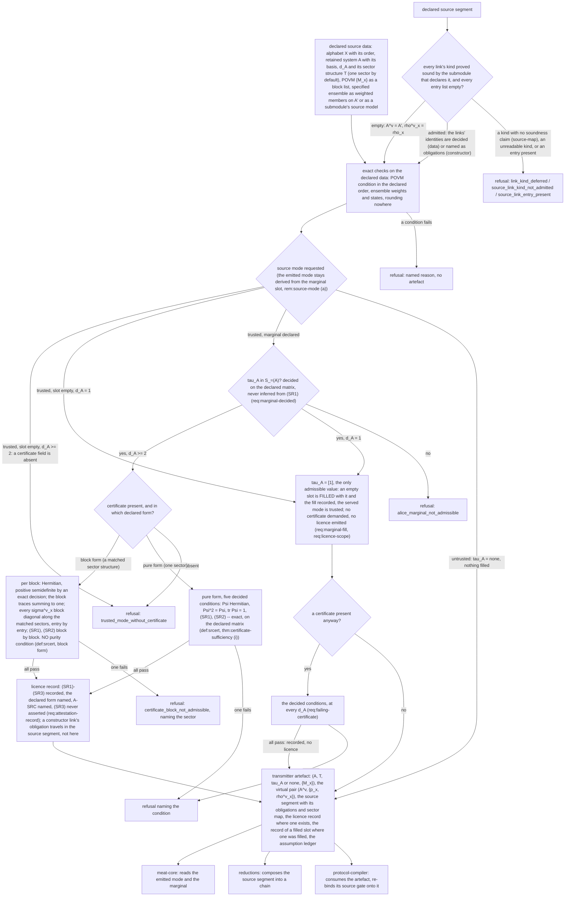

# Transmitter: design notes

Working design notes of the `transmitter` module: why its claims are shaped as
they are, which alternatives they reject, and where the code realises them.
Non-normative and in places dense; the claim files and `interface.yaml` are
authoritative.

## Module structure

One core and one submodule. The core declares Alice's data (`def:source-spec`),
the source links and the source segment that connect a virtual ensemble to the
specified one (`def:source-link`, `def:source-segment`), the source-replacement
certificate (`def:srcert`) with the lemma that defines it from an ensemble
(`lem:ensemble-presentation`), the imported source-replacement lemma
(`fact:sr`), the theorem that makes the certificate sufficient (`thm:certificate-sufficiency`),
the lemma on the states a block certificate reaches (`lem:matched-pinching`),
the assumptions `A-ENS`, `A-SEQ` and `A-SRC`, and the requirements its
implementation obeys.
`python -m harness.check_claims --module transmitter --status` says where each
claim stands.

The submodule `decoy` declares the weak-coherent-pulse source, the tagged
virtual source, the tagging link and what the emission declares. The other
submodule planned in `spec/modules.yaml`, `characterization` (a certified or
partially characterized source, symmetric to `receiver/characterization`), is
empty.

Inputs, outputs, machine keys, refusal reasons and conventions are in
`interface.yaml` and are not repeated here.

## Design decisions

1. **The boundary is at the declaration.** The module owns statements about
   Alice's *preparation* and her *retained system*: what the declared data are,
   what the two modes assert, what the certificate is and what a verified
   certificate buys. It owns nothing about what a declared marginal *does to a
   program*. The marginal condition on a feasible set, the constraint classes
   it licenses, the Choi parametrisation, the fact that the two modes impose the
   same condition on the engine's feasible set at `d_A = 1`, and the admissible
   Alice subspace (the support bound a declared marginal puts on every feasible
   state) are the consuming engine's program facts and live in meat-core. The
   device-side half of the `d_A = 1` statement, that the licence is vacuous there
   and is not demanded, is `rem:da1` with `req:licence-scope`.

2. **The published source-replacement lemma is an imported `fact`, with its
   symbol map and hypotheses visible.** `fact:sr` quotes the lemma in this
   repository's terms and then does the two things a bare citation cannot: it
   maps every symbol (`k ↔ x`, the source's `A'` to the transmitted system,
   `Ā Â` to the retained `A`, `M_x = |x⟩⟨x|_Ā ⊗ 1_Â`) and it names the
   hypotheses, `A-ENS` for the classical-quantum source state and `A-SEQ` for
   the sequential protocol structure. An import whose hypotheses are in the
   ledger is auditable; one whose hypotheses are in a footnote is not. The map
   records one trap rather than hiding it: the two documents' `d_A` are not the
   same number, and they agree exactly when the shield system is trivial.

3. **One attestation, one assumption.** Retention of `A` in Alice's laboratory,
   condition (SR3), is what makes `A` inaccessible to the adversary; they are
   not two facts. So one assumption, `A-SRC`, carries both, and the ledger's
   machine key `source_replacement_license` has exactly one assumption behind
   it.

4. **`A-SEQ` lives here.** It is the stated hypothesis of `fact:sr` and of
   `thm:certificate-sufficiency` (iii), and a transmitter claim cannot assume another module's
   assumption; the consuming modules use this one.

5. **The certificate is an operator, not a vector.** No binary64 number
   squares to ½, so a declared vector with entries `fl(1/√2)` yields a
   `|ψ⟩⟨ψ|` whose entries are not ½, and (SR1) fails for the certificate as an
   instance declares it. The operator `|Φ⁺⟩⟨Φ⁺|` has every entry equal to ½,
   which is a binary64 number. Declaring the operator is therefore the minimal
   change that makes the exact reading *satisfiable* rather than merely
   stricter: the datum is exactly admissible, and a rounding is absorbed where
   the datum is declared, at the instance that declares the certificate, which
   is the only place it can be absorbed honestly. Purity (`Ψ² = Ψ` with
   `tr Ψ = 1`) recovers the vector where a proof needs one, as two exact
   identities on the declared matrix. `rem:certificate-forms` states the
   mathematics.

6. **Nothing is inferred that can be decided.** `thm:certificate-sufficiency` (i) proves that
   (SR1) implies `τ_A ∈ S_=(A)`; `req:marginal-decided` nevertheless makes the
   engine decide it on the declared matrix. The implication is recorded so that
   a reader knows the data are consistent. It is no shortcut past a check,
   because an inferred property is a property of the objects the datum was
   built from and not of the datum (the `decide_never_infer` convention of
   `interface.yaml`).

7. **The source link type is defined here; its composition is not.** A source
   link is an Alice-side object: both descriptors name a transmitted system and
   an ensemble on it, both indexed by the same alphabet with the same weights,
   so the *type* belongs to the device leaf on Alice's side. How a list of
   source links composes with the receiver-stage links of a chain is a
   statement about the interaction of two stages, and the module that composes
   chains makes it (`reductions/lem:precomposition`,
   `reductions/thm:two-sided`). The `decoy` submodule's tagging link is a
   source link of this shape.

8. **Conditions are stated as mathematics, and consumers re-decide them.** The
   claims state the conditions a consumer decides (the POVM condition of
   `def:source-spec`, the decided conditions of `def:srcert`), never the names
   of a validator, which is code. The compiler's gate (G2) consumes the
   transmitter artefact: it tests that the artefact carries a licence record
   and that the emitted mode matches what was requested, and it re-decides the
   certificate's conditions on the emitted data, which is why the licence record
   carries the certificate it was decided on. An unattested trusted-source
   request is refused here, which is the safe direction; a consumer that wants
   an untrusted fallback states its own claim for it.

9. **One corner fills a slot instead of refusing.** At `d_A = 1` the state
   space is a singleton, the two modes impose the same condition, and the
   licence deletes no attack. A trusted-source request there may leave the
   marginal slot empty and is served with `τ_A = [1]` (`req:marginal-fill`):
   not a default substituted for a missing datum but the only admissible value.
   The served specification is in trusted-source mode, which decides nothing
   where the two modes coincide, and the artefact records that the slot was
   filled, so nothing is filled silently and a consumer can tell a filled value
   from a declared one. A certificate that is present and fails is still refused
   at every `d_A` (`req:failing-certificate`): a certificate that does not verify
   is a defect in the supplied data, not a weaker claim.

10. **The corollary carries its own witness.** `cor:noncanonical` needs a
    source specification with `d_A < |X|` to show that the certificate admits
    more than the canonical form. It proves its own: the four-state BB84
    ensemble on a qubit with `M_(b,k) = ½|k_b⟩⟨k_b|`, `τ_A = ½1`,
    `Ψ = |Φ⁺⟩⟨Φ⁺|`, at `d_A = 2` where the canonical form has `d_A = 4`. The
    shipped qubit BB84 instance declares the same certificate, `|Φ⁺⟩⟨Φ⁺|` as an
    operator.

11. **The attack channel's register discipline is a hypothesis, and the module
    shows why.** `thm:certificate-sufficiency` (iii) admits only channels acting on the transmitted
    system and the adversary's registers. `rem:xreg` proves the restriction
    cannot be dropped (without it the statement is ill-typed and false) and then
    shows it costs nothing, because `A-SEQ` places the public announcements
    after both measurements. A hypothesis that looks like bookkeeping gets a
    counterexample instead of a reassurance.

12. **The certificate has three forms, and the pure form keeps its
    conditions.** A *pure* certificate is a rank-one projector against a
    one-sector retained system; a *block* certificate is a list of Hermitian,
    positive semidefinite blocks against matched sector structures, with unit
    total trace and no purity condition anywhere; an *ensemble presentation*
    declares only the weighted virtual ensemble (decision 17). Two declared forms
    rather than one weaker one, because replacing `Ψ² = Ψ` by positivity for
    every certificate would change what a consumer refuses of a pure-form
    certificate, and no registry entry, refusal string or accepted instance may
    move for that. The pure form is therefore kept as a form of its own with its
    conditions unchanged; it is the block form's one-sector case with one decided
    property more. The weaker form is sound because `thm:certificate-sufficiency` (iii) reads
    purity nowhere: (ii) is the only statement whose conclusion depends on it,
    and a consumer whose gate re-decides purity refuses a block form, which is
    the safe direction. Why the block form is needed at all, and why the
    ensemble presentation beyond it, is the arithmetic of `rem:certificate-forms`.

13. **A sector structure is a presentation; a licence to restrict a feasible
    set is a theorem elsewhere.** `{M_x}`, `τ_A` and a block certificate are
    *presented* as block lists, so block diagonality of the declared data holds
    by type and nothing is measured. What a block certificate adds is
    `lem:matched-pinching`, a statement about the states an admitted attack
    *reaches*. What it does not add is a restriction of any consumer's feasible
    set: a positive operator merely constrained to have the marginal `τ_A` need
    not be block diagonal, and the lemma exhibits one. The boundary is stated
    twice on purpose, in the lemma and in `rem:boundary`, because it is the one
    inference the block form invites and the one this module must never license.

14. **An ensemble is read through its weighted members.** `σ_x = p_x ρ_x ⪰ 0`
    with `p_x = tr σ_x`; a declared pair `(p_x, ρ_x)` is the declaration of that
    product formed exactly, which is what every matrix-declared instance
    declares. The reason is the arithmetic of decision 5 again: (SR2) is
    bilinear in the declared data, and a normalised `ρ_x` with a dyadic `p_x`
    need not have an exactly representable product, while the product is
    declarable as one operator.

15. **Link kinds are admitted by claims; the segment is not shut by an
    assumption.** What admits a link *kind* is the admission rule of
    `def:source-segment`: no kind is admitted unless the submodule that declares
    it supplies its soundness claim. Whether a presented segment is non-empty is
    data of the chain, and each way a non-empty segment can be wrong is met by a
    named refusal or a theorem. As a reading aid (the claims and `interface.yaml`
    are authoritative): a kind no claim proves is refused where the link is
    admitted (`link_kind_deferred`, `source_link_kind_not_admitted`); an
    obligation missing from the registry or the ledger by (A1), (A2)
    (`source_link_not_in_registry`, `source_link_assumption_not_in_ledger`); a
    segment outside an artefact of the admitting module by (A3)
    (`source_segment_not_from_admitting_module`); a transported entry by
    `def:source-link` (f) (`source_link_entry_present`); a data link whose
    identity fails or whose family excludes its own descriptor by (S3) and
    `def:source-link` (d) (`source_link_family_excludes_its_descriptor`); a
    `general` constraint entry beside the segment by the admission rule of
    `reductions/def:chain`, decided by `protocol-compiler/def:chaincond`; a
    non-empty segment in untrusted-source mode by that decider
    (`source_segment_in_untrusted_mode`); and a consumer carrying Alice's POVM
    rather than the ensemble form by the compiler
    (`ensemble_presentation_without_ensemble_form`,
    `ensemble_form_in_untrusted_mode`). Every instance whose ensemble is
    declared as matrices declares an empty segment; the decoy instance's
    segment carries the one tagging link.

    The admission rule is deliberately **not** a fifth numbered interface
    condition: (S1)–(S4) are what a consumer decides on a presented chain, the
    admission rule is applied where a link is admitted, and numbering it would
    make the compiler claims that decide "(S1)–(S4)" by name read as incomplete.

    One case is covered by an assumption rather than a theorem, and `rem:da1`
    says so: a trusted specification at `d_A = 1` with a non-empty segment
    whose virtual ensemble is not constant over the letters of positive weight,
    so that no certificate exists, rests on the source clause of
    `protocol-compiler/ass:link` (A-LINK). No refusal is added for it. No artefact reaches it, and the
    existing untrusted-mode refusal cannot be reused: its condition is that the
    marginal slot holds `none`, which is false of a trusted `d_A = 1`
    declaration, whose slot holds `[1]`, so reusing it would put a refusal that
    reads "untrusted mode" on a trusted declaration.

16. **A channel may be supplied as a theorem, and then the obligation is
    named.** A link's witness is either declared data, and its identity is
    decided exactly, or a named claim of a submodule that proves the identity for
    a declared family of descriptors. In the second case nothing numerical is
    decided and the link carries an obligation record: the kind, the claim id,
    the assumptions the obligation carries, and the member of the family the
    descriptors are. Three of the four are decided: the triple is compared
    against a closed soundness registry the artefact emits, a comparison of
    declared strings that is what makes an obligation a check rather than a
    label; its assumptions must be in the ledger; and a non-empty segment is
    accepted only inside an artefact of the admitting module. Family membership
    is not decidable (it is the extension of a claim's hypothesis), and the
    definition says so rather than leaving an implementer to find that the
    refusal it names cannot fire. A registry entry's assumptions are not simply
    what the soundness claim rests on: for the one kind that exists they cannot
    be, `decoy/prop:tagging` assuming nothing, being an identity among the model's
    states. An entry lists the claim's assumption closure, which
    `python -m harness.check_claims --assumptions <claim>` computes and which
    may be empty, together with the physical-source assumption the submodule
    declares for the model the claim is stated over. That second half is what an
    obligation on a *physical* source owes and a mathematical identity does not;
    putting it into the claim's `assumes` would be a mathematical error. The
    transported-entry list stays in the type and stays refused, so that the
    discipline has a shape and a name rather than so that it may be used: no
    claim of this repository transports an Alice-side entry.

17. **Declare the ensemble, define the certificate.** A decoy certificate needs
    quotients (`p_x w_{x,t} / g_t`) and square roots (the amplitudes of a pure
    block over non-orthogonal signal states); binary64 holds neither, and an
    emission cannot round them, because `decoy/prop:tagging` proves its
    identity only for a virtual ensemble of the exact tagged form, so a rounded
    ensemble leaves the claim's family and the source identity fails
    arithmetically, which no attestation can carry. So what is declared changes:
    the ensemble presentation declares the matched sector structure and the
    weighted virtual ensemble as block lists and nothing else; `A_t` is a copy of
    `S_t`, `τ_A` is the transpose of the declared sum, and `Ψ_t` and `M^{(t)}_x`
    are the canonical purification and its square-root measurement
    (`lem:ensemble-presentation`). Three consequences. (a) Of the defined
    objects only `τ_A` is ever formed as numbers, and it is a transpose of a
    declared sum, so the irrational entries exist in the proof and nowhere else.
    (b) What is decided shrinks to (E1)–(E3); (SR1), (SR2), positivity, the POVM
    condition and purity become theorems, and an implementation that re-decides
    them on formed numbers decides nothing while introducing the rounding the
    form exists to avoid. (c) A consumer whose declaration carries Alice's POVM
    cannot read a presentation and refuses it; the ensemble form of the
    compiler's declaration (`protocol-compiler/def:declaration`, which the
    key-rate engine's `meat-core/def:declaration` reads), admitted beside a
    presentation by `protocol-compiler/def:eligible`, carries `N_x = σ_x^T`
    instead.

18. **The ledger is spelled in machine keys.** (A2) compares a registry entry's
    assumption *short ids* against a ledger emitted as *machine keys*. The wire
    spelling does not move: re-spelling it would move the emitted ledger of
    every instance and the digests derived from it for no security gain, while
    translating at the consumer's boundary moves nothing emitted. The
    comparison goes through the declared per-assumption mapping
    (`ASSUMPTION_MACHINE_KEYS` in `src/certiqs_key/transmitter/reasons.py`, with
    the decoy submodule's `DECOY_ASSUMPTION_MACHINE_KEYS`: one key per short id,
    total on the assumptions this module and its submodules may emit, and
    injective), and a short id with no declared key is refused
    (`source_link_assumption_not_in_ledger`).

## Where the code realises the contract

| Claim | Code |
| --- | --- |
| `def:source-spec` | `certiqs_key.transmitter.artifact:SourceSpecification`; decided by `certiqs_key.transmitter.artifact:emit_artifact` |
| `def:source-link` | `certiqs_key.transmitter.links:SourceLink`; a chain carries the stage-generic wire record `certiqs_key.domain.chain:ChainLink` |
| `def:source-segment` | `certiqs_key.transmitter.links:check_source_link`; (S1)–(S4) also decided by `certiqs_key.protocol_compiler.chain:check_chain` |
| `def:srcert` | `certiqs_key.transmitter.certificate:SourceReplacementCertificate` |
| `lem:ensemble-presentation` | `certiqs_key.transmitter.presentation:alice_marginal_blocks` |
| `thm:certificate-sufficiency` | `certiqs_key.transmitter.certificate:verify_certificate`, `certiqs_key.transmitter.certificate:consistency_criterion` |
| `req:marginal-decided`, `req:licence-scope`, `req:marginal-fill`, `req:failing-certificate` | `certiqs_key.transmitter.artifact:emit_artifact` |
| `req:attestation-record` | `certiqs_key.transmitter.certificate:SourceReplacementLicense` |

## Extension points

Each fills, with claims of its own, a slot the module already carries; the
first is filled and the other two are open.

- **Decoy**, filled by the submodule `decoy`: the weak-coherent-pulse source
  model, the tagged virtual source, the link kind `tagging` with its soundness
  claim, and an emission that declares its weighted blocks and compresses
  nothing. It rests on the ensemble presentation (decision 17), a witness
  supplied as a theorem, and a registry entry for its kind. The link is
  composed in reductions, not here. What it refuses is as interesting as what
  it does: an entropy cutoff above two, because a basis with exactly
  representable signal dyads is exhibited at one and at two photons and at no
  higher photon number, and a quantum sector whose polarisations that
  construction does not cover.
- **A characterized source.** State-preparation flaws or an uncertainty set on
  the declared ensemble, symmetric to `receiver/characterization`, planned in
  `spec/modules.yaml` as the submodule `characterization` and described in
  `spec/future-scope.md` §6. It must *replace* `A-ENS` (`ass:ens`, the
  emission of the specified ensemble) rather than add an assumption beside
  it.
- **Further source-link kinds.** The type carries the declared descriptor
  family, the retained-register sector map and the per-entry certificate case
  of a transported entry; a new kind needs its soundness claim in a submodule
  and its registry entry. The status value `certified_outer` is the reduction
  artefact's link status (`spec/architecture.md` §4.3), not a claim status.

## What the module does not do

It is **not a security reduction**. `thm:certificate-sufficiency` (iii) says that Alice's
measurement commutes with every admitted attack and that the declared
trusted-source data describe the virtual preparation. The argument that a
consuming engine's optimisation is sound (granting the adversary a
purification, restricting to the declared feasible set, accumulating over
rounds) lives in that engine's claims, which import `A-SRC` for it.

It **never asserts (SR3)**. Retention is decided by no function of the declared
data. The module records the attestation it was given and emits it as a
pass-through (`req:attestation-record`); it never verifies it and never asserts
it of a physical apparatus, and no consumer verifies it either.

It describes **one round**. Round homogeneity is the consumer's assumption.

## The module's main logic

The figure is a reading aid. It does not draw the ensemble-presentation
branch, in which (E1)–(E3) are decided on the declared blocks and the
certificate, `τ_A` and `{M_x}` are defined by `lem:ensemble-presentation`
rather than declared.

## Citations

Three registered ref-ids, each doing one job.

- `tupkary2026decoy`, the only citation a claim rests on. `fact:sr` is an
  import of its Lemma 8.3 with the protocol framing of Defs. 8.1–8.2,
  `ass:seq` is the sequential structure those definitions formalise, and
  `ass:ens` names its Protocol 2, step 1(a), as the same premise of a source
  prepared afresh in each round. `rem:xreg` cites its Thm. 8.3 as
  corroboration only, and says so: no step of `thm:certificate-sufficiency`'s
  proof appeals to it. The `decoy` submodule cites it as well, and wherever it
  does the tree's statement is wider than the published one and says so: its
  Eq. (144) is the weak-coherent-pulse state of `decoy/def:wcp-model`, and its
  Lemma 9.2 with Eq. (145) is the exact-weight, no-middle-summand case of
  `decoy/def:tagged-source` and `decoy/prop:tagging`, whose rounded-down
  weights and polarisation flags are newly derived.
- `winick2018reliable`, Eqs. (36)–(39): the published template for a
  trusted-source marginal constraint and its stated ground ("system `A` is
  inaccessible to Eve"). Cited in `rem:source-mode`, `ass:src` and `fact:sr`
  (for the pure-ensemble case, where the shield system is trivial). It
  corroborates what the two modes assert; no proof rests on it.
- `kamin2025renyi`, Rem. 1: the same assertion in the `n`-round product form
  ("because we assume Eve has no access to Alice's lab"). Cited in
  `rem:source-mode` and `ass:src` for the same purpose.

Everything else is `newly-derived`: `thm:certificate-sufficiency`, its corollary, the two lemmas
and the definitions are proved from statements made in this module's own claim
files, and so is every claim of the `decoy` submodule.

## The `decoy` submodule

An optical decoy source lives on a Fock space, so its ensemble cannot be
declared as matrices: it is declared as a source model (`decoy/def:wcp-model`),
and one channel, the tagging map, carries a finite virtual ensemble onto it
(`decoy/prop:tagging`). Below the entropy cutoff the photon-number sectors stay
quantum; above it each photon number and polarisation has one flag shared by
every intensity; the rest of the weight sits on a tail flag per polarisation
and intensity.

**Why the flags are shared.** Sharing one flag across intensities is the decoy
content of the declaration: it is what makes one photon number's behaviour one
object across intensities. A family split by intensity still admits a tagging
channel, so the source identity would not catch it; it would only show as a
rate that does not improve with a further intensity. That is why the emission
refuses it by name (`decoy/req:shared-flags`) rather than accepting a silent
loss (`decoy/rem:no-intensity-split`).

**Why an inequality and not the Poisson weights.** `P_μ(n)` is not a number a
declaration can carry, so the declared weights need only lie below it; the
tail absorbs the shortfall. The emission decides the inequality against the
rational lower end of an enclosure it forms itself from the declared
intensity (`decoy/lem:poisson-enclosure`, `decoy/req:sector-weight-bound`):
two consecutive partial sums of the exponential series bracket `e^{-μ}`, in
exact rational arithmetic. An enclosure handed in with the declaration would
be a premise no claim establishes and no ledger row names, so none is read.
Rounding a weight down gives *another* tagged declaration with its own sector
list (`decoy/cor:emitted-decoy` (v)), not a perturbation of the first.

**Why the source declares its weighted blocks.** A block-form certificate for
a decoy source needs quotients and square roots of declared numbers, which
binary64 cannot hold, and changing any number would leave the family
`decoy/prop:tagging` proves its identity for, so the identity would fail
arithmetically, which no attestation can carry. The emission therefore declares
the tagged ensemble itself as an ensemble presentation (`def:srcert`): the
certificate, Alice's system, her measurement and her marginal are defined from
the blocks, and only the marginal, a transposed declared sum, is ever formed as
numbers.

**Why a formed entry is refused and never rounded.** Rounding an entry of a
declared block would change which ensemble is declared, and so which ensemble
the source identity is asserted of (`decoy/req:exact-decoy-blocks`). A declarer
removes the refusal by choosing weights on a coarser dyadic grid.

**Why the engine forms the signal dyads.** The source identity at the emitted
blocks holds because those blocks are the tagged ensemble of the model, so on
a quantum sector their dyads must be the matrices of the number states in an
orthonormal basis of the sector. The polarisation vectors and that basis are
model objects whose coordinates (`1/√2` for `|+>`) are not binary64 numbers;
the entries exist as numbers only through the construction of
`decoy/cor:emitted-decoy` (iv)(b), which covers polarisations among H, V, +
and - at one and two photons. The emission therefore forms them itself and
refuses a quantum sector the construction does not cover
(`decoy/req:signal-dyads`); a dyad taken from a request could pass every
positivity and weight condition and still be the dyad of another state.

**Why the entropy cutoff stops at two.** Every claim is generic in the entropy
cutoff. The emission refuses three and more (`decoy/req:entropy-cutoff`)
because a basis in which the signal dyads have exactly declarable entries is
exhibited at one and two photons (`decoy/cor:emitted-decoy` (iv)(b)) and at no
higher photon number. Admitting a higher sector would put entries that are not
the numbers written into a condition decided exactly.

**Why A-WCP is not a premise of the tagging proposition.**
`decoy/prop:tagging` is an identity among the model's states and assumes
nothing. The soundness-registry entry of the `tagging` kind carries A-WCP
beside the proposition's empty assumption closure (`def:source-segment` (A1)).
What A-WCP attests, that the model is the physical device, is owed by a link on
a physical source and not by a mathematical identity; making it a hypothesis of
the proposition would misstate what the proposition proves.

**Mapping to code** (`certiqs_key.transmitter.decoy`):

- `model.py` is `decoy/def:wcp-model`;
- `tagged.py` is `decoy/def:tagged-source`, with the index set of (T3) and the
  tail weight;
- `bases.py` is the construction of `decoy/cor:emitted-decoy` (iv)(b); the
  signal dyads are formed by it and none is taken from a request
  (`decoy/req:signal-dyads`);
- `enclosure.py` forms the enclosure of `decoy/lem:poisson-enclosure` at the
  index `decoy/req:sector-weight-bound` fixes, and the emission records that
  index;
- `emit.py` is the emission and every refusal: `emit_decoy_declaration`
  implements `decoy/cor:emitted-decoy` and every `decoy/req:*`, and
  `DecoySourceDeclaration` implements `decoy/prop:decoy-cert`;
- `reasons.py` holds the refusal strings.

**Not built here:** a helper that rounds a supplier's Poisson weights down onto
a dyadic grid. The choice of grid is the declarer's, made on data it is about
to declare; it belongs with the instances and not in the module that decides
the result.
